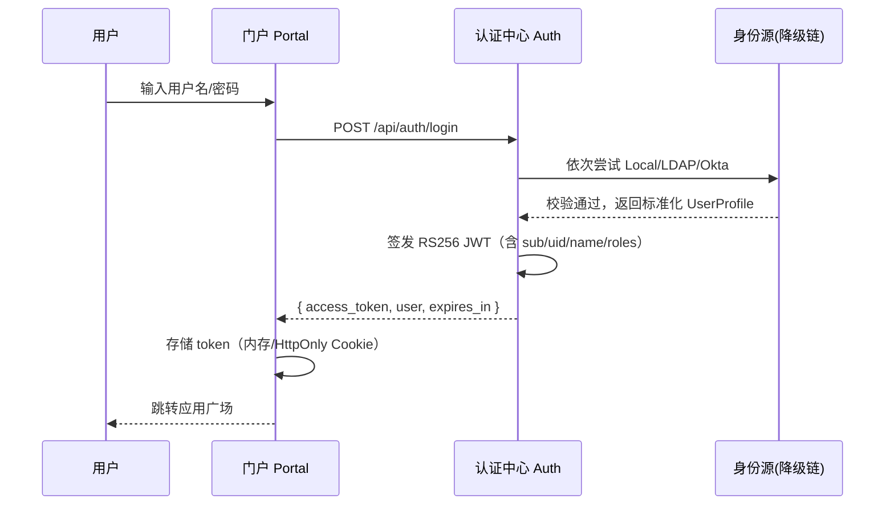
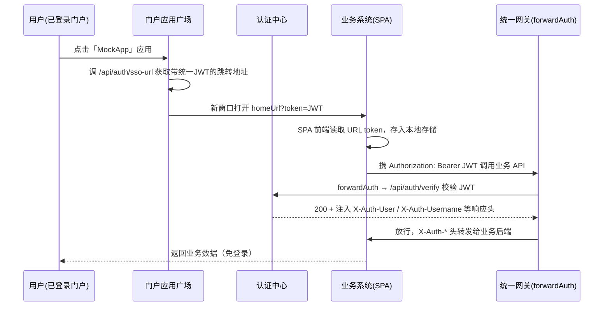
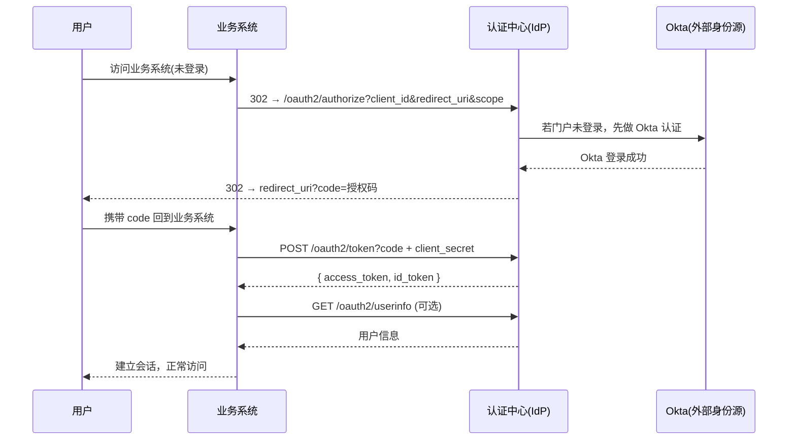
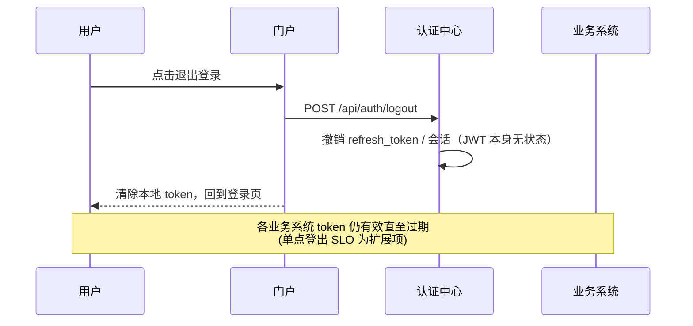

# 统一认证中心 — 认证与 SSO 流程

## 一、登录认证流程（用户名 / 密码）



要点：
- 密码只发给认证中心，各业务系统**不接触密码**
- JWT 携带最小必要信息（用户标识、姓名、角色），不敏感
- 认证中心可签发 `refresh_token`，避免频繁登录

## 二、SSO 单点登录流程（Demo 实现）



要点（Demo）：
- 门户点击应用 → 经 `sso-url` 获取带统一 JWT 的跳转 URL（`home_url?token=xxx`）
- 业务系统 **SPA 首页免鉴权**加载，前端读取 URL token 后存入本地
- 调用受保护业务 API 时前端携带 `Authorization: Bearer <JWT>`，**统一网关 forwardAuth 校验**
- 网关放行时注入 `X-Auth-*` 请求头，业务后端无需解析 JWT，直接读头取身份
- `verify` 端点 Demo 兼容从 query `token` 读取（SSO 直开场景）；真实生产应仅用 Authorization 头

> ⚠️ Demo 简化：JWT 直接携带跳转。**真实生产**绝不在 URL 传 token，而是走 **OIDC 授权码流程**（见下节），或使用 HttpOnly + Secure Cookie + CSRF 防护。

## 三、真实生产 SSO：OIDC 授权码流程（文档说明）

真实项目中，业务系统通过标准 OIDC 与认证中心对接：



对应知识点：
- **OAuth2 授权码模式**：`authorize` → `code` → `token` 三步
- **OIDC**：在 OAuth2 之上增加 `id_token`（JWT），携带身份断言
- **client_id / client_secret**：业务系统注册时发放，即「应用注册表」管理的内容
- Demo 中该流程由 `OktaAuthenticator` 预留实现，可对接自建 mock OIDC Provider

## 四、登出流程



- JWT 是无状态凭证，无法服务端主动作废；登出 = 客户端删除 token + 认证中心撤销 refresh token
- 面试点：JWT 无状态 vs 会话化（黑名单/Redis 白名单）的取舍

## 五、统一网关 forwardAuth 鉴权流程

```
请求 → Traefik → [forwardAuth 中间件] → /api/auth/verify
                                           │
                           200(带X-Auth-*)  │  401/403
                         放行→业务后端       │  302 → 门户登录页
```

- `/api/auth/verify` 校验 `Authorization: Bearer <JWT>`，返回 `200` + 用户头，或 `401`
- 网关在放行时注入 `X-Auth-User`、`X-Auth-Username` 等头，业务后端直接从请求头取身份，**无需再解析 JWT**
- 该模式把鉴权下沉到网关，业务系统零改动接入（改配置即可）
