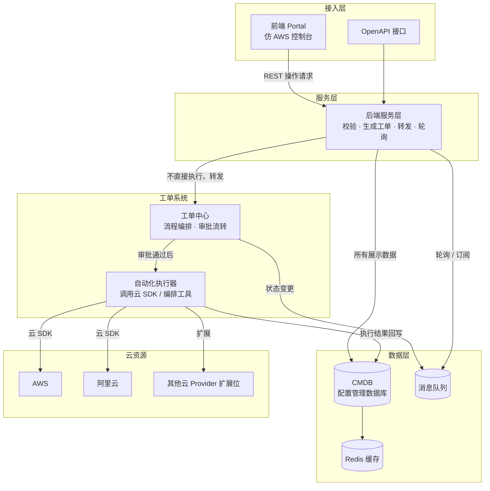
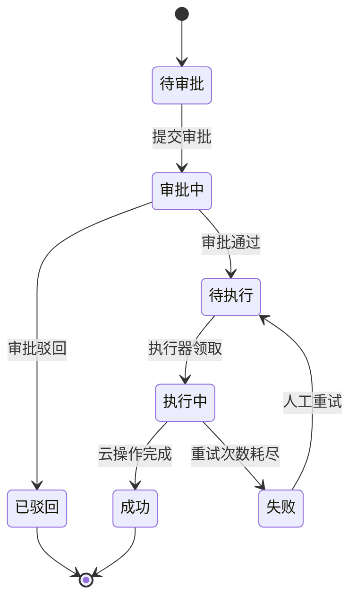

# 02 · 系统架构设计

## 一、总体架构（还原真实项目四层骨架）



## 二、核心设计决策（面试重点）

### 决策 1：操作为什么必须走工单系统？
- **解耦**：前端/后端不直接依赖云 API，云厂商变更只影响工单系统的执行器
- **合规**：所有资源变更先审批后执行，满足企业内部审计要求
- **留痕**：每次操作都有完整工单 + 审批 + 执行日志，可追溯
- 面试回答要点：这是"流程治理优先"的设计，比"直连云 API"更符合企业现实

### 决策 2：CMDB 为什么是唯一数据源？
- 前端所有展示数据从 CMDB 拉取，保证**多页面数据一致**
- 云上资源是"事实"，CMDB 是"配置视图"：通过**定时同步 + 变更回调**保证一致性
- 一致性策略分层：
  - 全量/增量同步（定时任务）
  - 操作后主动刷新（工单执行成功后回写）
  - 漂移检测（对比云上真实状态与 CMDB 记录）

### 决策 3：云操作是异步长任务，如何保证最终一致？
- 云 API（创建/变更主机）多为异步，需要**状态机 + 轮询/事件回调**
- 失败处理：**有限次数重试 + 人工介入**
- **幂等设计**：重试时用唯一请求 ID 去重，避免重复创建资源
- 状态机：



## 三、模块划分（建议包结构）

```
cloud-manager
├── cloud-manager-web          # 前端（Vue3 + Ant Design Vue）
│   ├── src/views/compute      # 计算模块（云主机）
│   ├── src/views/network      # 网络模块（VPC/子网/安全组）
│   ├── src/views/storage      # 存储模块
│   ├── src/views/ticket       # 工单中心
│   ├── src/views/cost         # 成本管理（P4）
│   └── src/views/audit        # 审计中心
└── cloud-manager-server       # 后端（Spring Boot，模块化）
    ├── cloud-provider-core    # 云适配层核心（统一接口 + SPI 扩展）
    ├── cloud-provider-aws     # AWS Provider
    ├── cloud-provider-aliyun  # 阿里云 Provider
    ├── cloud-manager-cmdb     # CMDB 资源管理
    ├── cloud-manager-ticket   # 工单系统（流程引擎）
    ├── cloud-manager-auth     # 权限与审计
    ├── cloud-manager-cost     # 成本管理（P4）
    └── cloud-manager-common   # 公共模块
```

## 四、云适配层设计（核心扩展点）

统一接口抽象，各云实现为一个 Provider：

```java
public interface CloudProvider {
    String getProviderType();                 // aws / aliyun / ...
    CloudAccountVO connect(AccountCredential credential);

    // 资源查询
    List<ResourceVO> listInstances(String accountId, String region);
    List<ResourceVO> listVpcs(String accountId, String region);
    List<ResourceVO> listSecurityGroups(String accountId, String region);

    // 资源操作（异步，返回任务句柄）
    TaskHandle startInstance(String instanceId);
    TaskHandle stopInstance(String instanceId);
    TaskHandle resizeInstance(String instanceId, String newSpec);
    TaskHandle createInstance(CreateInstanceRequest request);
    TaskHandle releaseInstance(String instanceId);

    // 账单
    CostSummary queryCost(String accountId, Date start, Date end);
}
```

**设计要点**：
- 用 **SPI / 策略模式** 实现插件化，新增一朵云 = 新增一个 Provider 模块，不改动上层
- **统一资源模型**：各云资源抽象为统一 `ResourceVO`，差异化字段放 `metadata(JSON)`
- 支持"纳管模式"与"只读模式"（只展示云上真实资源，不进行管理操作）

## 五、数据流

### 查询链路（读）
```
前端页面 → 后端 API → CMDB（走缓存）→ 返回统一资源模型 → 前端渲染
```

### 操作链路（写）
```
前端操作 → 后端校验+生成工单 → 工单系统 → 审批流转 → 执行器调用云 SDK
→ 云操作完成 → 回写 CMDB + 更新工单状态 → 消息通知 → 前端轮询刷新
```
