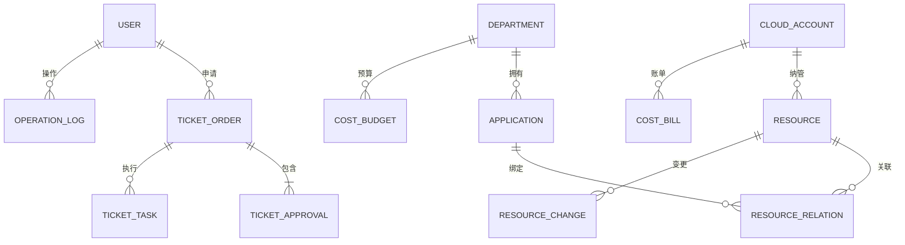

# 05 · 数据库设计

> 数据库：MySQL（字符集 utf8mb4），ORM：MyBatis-Plus。
> 本文档为设计基准，P1 阶段先落地 CMDB / 工单 / 权限核心表，成本与服务目录表在对应阶段补充。

## 一、总体 ER 概览

## 二、CMDB 模块

### 1. `cmdb_cloud_account` 云账号表
| 字段 | 类型 | 说明 |
|---|---|---|
| id | BIGINT PK | 主键 |
| account_name | VARCHAR(64) | 账号名称 |
| provider_type | VARCHAR(16) | aws / aliyun / mock |
| access_key | VARCHAR(128) | AccessKey（加密存储） |
| secret_key | VARCHAR(256) | SecretKey（加密存储） |
| regions | VARCHAR(255) | 纳管地域（逗号分隔） |
| status | TINYINT | 0-未纳管 1-正常 2-异常 |
| sync_status | TINYINT | 0-未同步 1-同步中 2-同步完成 3-同步失败 |
| last_sync_time | DATETIME | 最近同步时间 |
| created_at / updated_at | DATETIME | 创建/更新时间 |

### 2. `cmdb_resource` 统一资源表（多态资源建模核心）
| 字段 | 类型 | 说明 |
|---|---|---|
| id | BIGINT PK | 主键 |
| account_id | BIGINT | 所属云账号 |
| provider_type | VARCHAR(16) | 冗余，便于按云过滤 |
| resource_type | VARCHAR(32) | instance / vpc / subnet / security_group / disk / load_balancer |
| resource_name | VARCHAR(128) | 资源名称 |
| cloud_resource_id | VARCHAR(128) | 云上资源 ID（如 i-xxxx / vpc-xxxx） |
| region | VARCHAR(32) | 地域 |
| zone | VARCHAR(32) | 可用区（可空） |
| status | VARCHAR(32) | 运行状态（running/stopped/pending...） |
| spec | VARCHAR(64) | 规格（t3.medium / ecs.g6.2xlarge） |
| department_id | BIGINT | 所属部门（数据权限） |
| application_id | BIGINT | 所属应用（可空） |
| metadata | JSON | 差异化字段（各云特有属性） |
| source | TINYINT | 0-同步 1-工单创建 2-手工录入 |
| is_deleted | TINYINT | 逻辑删除（保留审计） |
| created_at / updated_at | DATETIME | 时间戳 |

> **多态建模取舍（面试点）**：采用"公共字段表 + JSON 差异化字段"方案。
> 备选方案：单表多字段（字段冗余、空值多）、每类资源独立表（关联复杂、查询难统一）。
> 当前方案在**查询统一性**与**扩展灵活性**间取得平衡，符合内部管理系统规模。

### 3. `cmdb_resource_relation` 资源关系表
| 字段 | 类型 | 说明 |
|---|---|---|
| id | BIGINT PK | 主键 |
| source_id | BIGINT | 源资源 ID |
| target_id | BIGINT | 目标资源 ID |
| relation_type | VARCHAR(32) | belongs_to_vpc / belongs_to_subnet / attach_sg / bind_application |
| created_at | DATETIME | 创建时间 |

### 4. `cmdb_resource_change` 资源变更历史表
| 字段 | 类型 | 说明 |
|---|---|---|
| id | BIGINT PK | 主键 |
| resource_id | BIGINT | 资源 ID |
| action | VARCHAR(32) | start / stop / resize / create / release / sync |
| before_data | JSON | 变更前快照 |
| after_data | JSON | 变更后快照 |
| operator | VARCHAR(64) | 操作人 |
| source | VARCHAR(16) | ticket / sync / manual |
| ticket_id | BIGINT | 关联工单（可空） |
| created_at | DATETIME | 变更时间 |

### 5. `cmdb_application` 应用表
| 字段 | 类型 | 说明 |
|---|---|---|
| id | BIGINT PK | 主键 |
| app_name | VARCHAR(64) | 应用名称 |
| department_id | BIGINT | 所属部门 |
| owner | VARCHAR(64) | 负责人 |
| description | VARCHAR(255) | 描述 |

## 三、工单系统模块

### 6. `ticket_order` 工单表
| 字段 | 类型 | 说明 |
|---|---|---|
| id | BIGINT PK | 主键 |
| ticket_no | VARCHAR(32) | 工单号（唯一，如 WO202608040001） |
| ticket_type | VARCHAR(32) | create_instance / start / stop / resize / release / apply_quota |
| title | VARCHAR(128) | 工单标题 |
| status | VARCHAR(16) | pending / approving / executing / success / failed / rejected / cancelled |
| applicant | VARCHAR(64) | 申请人 |
| approver | VARCHAR(64) | 审批人（可空） |
| resource_id | BIGINT | 目标资源（可空） |
| request_content | JSON | 申请内容（规格/网络/参数等） |
| result_content | JSON | 执行结果（云资源 ID 等） |
| fail_reason | VARCHAR(255) | 失败原因 |
| created_at / updated_at / finished_at | DATETIME | 时间戳 |

### 7. `ticket_approval` 审批记录表
| 字段 | 类型 | 说明 |
|---|---|---|
| id | BIGINT PK | 主键 |
| ticket_id | BIGINT | 工单 ID |
| approver | VARCHAR(64) | 审批人 |
| action | TINYINT | 1-同意 2-驳回 |
| comment | VARCHAR(255) | 审批意见 |
| approved_at | DATETIME | 审批时间 |

### 8. `ticket_task` 自动化任务表
| 字段 | 类型 | 说明 |
|---|---|---|
| id | BIGINT PK | 主键 |
| ticket_id | BIGINT | 工单 ID |
| task_type | VARCHAR(32) | 云操作类型 |
| provider_type | VARCHAR(16) | 目标云 |
| status | VARCHAR(16) | pending / running / success / failed |
| retry_count | INT | 已重试次数（上限 3） |
| request_id | VARCHAR(64) | 幂等请求 ID（唯一） |
| exec_log | TEXT | 执行日志 |
| started_at / finished_at | DATETIME | 时间戳 |

## 四、权限与审计模块

### 9. `sys_user` 用户表
| 字段 | 类型 | 说明 |
|---|---|---|
| id | BIGINT PK | 主键 |
| username | VARCHAR(64) | 登录名 |
| password | VARCHAR(128) | 密码（BCrypt） |
| display_name | VARCHAR(64) | 显示名 |
| department_id | BIGINT | 所属部门 |
| email | VARCHAR(128) | 邮箱 |
| status | TINYINT | 0-禁用 1-启用 |
| created_at | DATETIME | 创建时间 |

### 10. `sys_role` / `sys_permission` / `sys_user_role` / `sys_role_permission`
标准 RBAC 四表：
- `sys_role`：角色（超级管理员/云管理员/运维/只读）
- `sys_permission`：权限点（如 `cmdb:instance:start`、`ticket:approve`）
- `sys_user_role`：用户-角色关联
- `sys_role_permission`：角色-权限关联

> **数据权限说明**：除功能权限（RBAC）外，资源数据按 `department_id` 隔离。
> 云管理员可见全部，运维/只读仅可见本部门资源。查询统一拼装部门过滤条件。

### 11. `sys_operation_log` 操作审计表
| 字段 | 类型 | 说明 |
|---|---|---|
| id | BIGINT PK | 主键 |
| user_id | BIGINT | 操作人 |
| username | VARCHAR(64) | 冗余用户名 |
| module | VARCHAR(32) | 模块（cmdb/ticket/cost/auth） |
| action | VARCHAR(64) | 操作标识 |
| resource_id | BIGINT | 目标资源（可空） |
| detail | JSON | 操作详情 |
| ip | VARCHAR(64) | 来源 IP |
| created_at | DATETIME | 操作时间 |

> 实现：Spring AOP + 自定义注解 `@AuditLog`，统一记录，业务代码零侵入。

## 五、成本模块（P4）

### 12. `fin_cost_bill` 账单表
| 字段 | 类型 | 说明 |
|---|---|---|
| id | BIGINT PK | 主键 |
| account_id | BIGINT | 云账号 |
| bill_month | VARCHAR(7) | 账单月份（2026-08） |
| total_cost | DECIMAL(12,2) | 总费用 |
| currency | VARCHAR(8) | 币种 |
| bill_source | VARCHAR(16) | real / mock |
| created_at | DATETIME | 创建时间 |

### 13. `fin_cost_item` 成本明细表
| 字段 | 类型 | 说明 |
|---|---|---|
| id | BIGINT PK | 主键 |
| bill_id | BIGINT | 所属账单 |
| resource_id | BIGINT | 资源 ID（可空） |
| service_type | VARCHAR(32) | 服务类型（ec2/s3/rds...） |
| cost | DECIMAL(12,2) | 费用 |
| cost_date | DATE | 费用日期 |
| department_id | BIGINT | 分摊部门 |

### 14. `fin_budget` 预算表
| 字段 | 类型 | 说明 |
|---|---|---|
| id | BIGINT PK | 主键 |
| department_id | BIGINT | 部门 |
| budget_amount | DECIMAL(12,2) | 月预算 |
| alert_threshold | DECIMAL(5,2) | 告警阈值（如 0.8 = 80%） |
| alert_status | TINYINT | 0-正常 1-已告警 |

## 六、服务目录模块（P3）

### 15. `svc_catalog_item` 服务目录项
| 字段 | 类型 | 说明 |
|---|---|---|
| id | BIGINT PK | 主键 |
| item_name | VARCHAR(64) | 服务项名称（如"标准云主机-2C4G"） |
| provider_type | VARCHAR(16) | 目标云 |
| resource_type | VARCHAR(32) | 资源类型 |
| template | JSON | 申请模板（规格/镜像/网络默认值） |
| need_approval | TINYINT | 是否需要审批 |
| enabled | TINYINT | 是否启用 |
| created_at | DATETIME | 创建时间 |

### 16. `svc_quota` 配额表
| 字段 | 类型 | 说明 |
|---|---|---|
| id | BIGINT PK | 主键 |
| department_id | BIGINT | 部门 |
| resource_type | VARCHAR(32) | 资源类型 |
| limit_count | INT | 配额上限 |
| used_count | INT | 已用数量 |

> 申请时校验配额，超限则工单自动驳回或转人工审批（业务规则可配置）。

## 七、索引与性能要点

- `cmdb_resource`：`(account_id, resource_type)`、`(department_id, resource_type)`、`(cloud_resource_id)` 唯一索引
- `ticket_order`：`(status)`、`(applicant)`、`(ticket_no)` 唯一索引
- `fin_cost_item`：`(cost_date)`、`(department_id, cost_date)`
- 资源列表大数据量场景：列表接口走 Redis 缓存 + 分页；变更/审计写走异步落库
