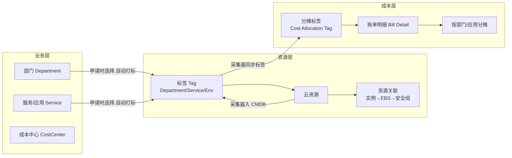

# 09 · 业务 / 资源 / 成本 三角关系与打通机制

> 定位：解释真实云环境下「业务（部门/服务）— 资源（云资源）— 成本（账单/分摊）」三大块
> 的关系、打通方式与长期维护机制，并映射到本项目的建模与落地实现。
> 场景：多云管理平台 / CMDB / FinOps。可作面试架构话术。

---

## 1. 核心结论

三大块打通靠的不是"资源自身长着部门字段"，而是一条 **「标签（Tag）主线」**：

```
业务定义（部门 / 服务 / 成本中心）
        │  ① 申请资源时强制选择，平台自动打标签
        ▼
云资源（实例 / DB / MQ / 缓存 … 全部携带 Tag）
        │  ② 账单侧激活"成本分摊标签"
        ▼
账单明细（每行费用自带业务标签 → 按标签归集）
```

**AWS / 阿里云 / 腾讯云 全部支持这套机制**，原理一致，仅命名与入口不同。
几乎所有"产生费用"的资源都能打标签；免费/虚拟资源也能打标签，通过关联传导归属。

---

## 2. 三角关系总览



---

## 3. 各云厂商"标签 → 业务/成本"能力对比

| 能力 | AWS | 阿里云 | 腾讯云 |
|---|---|---|---|
| 资源打标签 | **Tag**（几乎所有资源） | **资源标签**（大部分资源） | **资源标签** |
| 账单侧按标签分摊 | **Cost Allocation Tags** + **Cost Categories** | **成本标签** + **财务单元** | **分账标签** + **费用分摊** |
| 组织归属 | Organizations 的 **OU 组织单元** | 资源组 / 企业账号体系 | CAM + 资源分组 |
| 申请时强制选业务 | 控制策略 SCP + 建标签前置 | 云效 / 应用资源组 | 标签策略强制 |

> 差异点：AWS 起步早、Tag 最统一；阿里云/腾讯云历史上标签体系有过分散
> （资源标签 / 系统标签 / 成本标签三套），现收敛为"资源标签 + 成本分摊标签"两套，
> 且都支持 **标签继承（子资源继承父资源标签）**。

---

## 4. 不同资源类型的标签与计费能力

### 4.1 实体资源（计算 / 存储 / 数据库 / 中间件）——全部支持标签且计费
- 计算：EC2 / ECS / CVM
- 存储：EBS / OSS / S3 / 云硬盘
- 数据库：RDS / 云数据库
- 中间件：消息队列（SQS / RocketMQ）、缓存（Redis / ElastiCache）
- 计费方式：按规格 + 容量 / 时长；均可打 Tag，按标签归集到部门 / 服务。

### 4.2 网络类（虚拟 + 流量）
- **安全组、VPC、子网**：支持标签，但**本身免费**。无独立账单，归属价值在于
  "它属于哪个业务"决定了其关联资源（实例、流量）的费用算到谁头上。
- **付费网络组件**：EIP（弹性公网 IP）、NAT 网关、VPN、专线、负载均衡（SLB/ALB/NLB）——
  支持标签，按带宽 / 时长计费。
- **流量 / 带宽**：不是独立资源，而是**附着在资源上的计费项**
  （实例出网流量、NAT 流量、LB 流量），归属靠"给附着资源打标签"传导。

### 4.3 关键理解
- 标签既可打在"资源"上，成本也能通过 **资源关联 + 标签继承** 传导：
  给 EC2 打 `Service=订单中心` → 其 EBS 卷（继承）→ 实例产生的流量费，全部归集到"订单中心"。
- 安全组这类"0 元但承载业务"的资产，同样纳入 CMDB 归属体系，只是成本为 0。

---

## 5. 三大块打通与维护（架构层三步）

### 5.1 供给侧：业务 → 资源（自动打标）
用户在自助平台申请开主机时**必须选择服务 + 部门**，云平台通过自动化
（Terraform / CloudFormation / 云控制台 API）把选择转成标签打到资源上。

### 5.2 消费侧：资源 → CMDB（采集映射）
采集器定时拉取资源 + 标签，把标签值翻译成内部部门 / 服务外键写入 CMDB。
标签缺失时，靠**资源关联关系**（实例→EBS、实例→安全组）推断归属。

### 5.3 成本侧：账单 → 分摊（标签归集）
云账单明细在激活"成本分摊标签"后，**每行费用自带业务标签**；
分摊引擎按标签把费用归到部门 / 应用。

### 5.4 长期维护治理
- **标签规范（Tag Schema）**：统一约定 `Department` / `Service` / `CostCenter` / `Environment` Key
- **合规巡检**：对"无标签资源"告警、强制补标（SCP / 标签策略：不打标不让建）
- **映射表**：标签值 ↔ 内部部门/服务，组织调整时只改映射表，不改资源

---

## 6. 映射到本项目建模（关键）

真实世界里 **账单的分摊标签（CostItem）与资源的归属标签（Resource）是两套数据**：

| 概念 | 本项目字段 | 真实来源 |
|---|---|---|
| 资源归属部门 | `cmdb.Resource.department` | 采集器拉取云上资源标签 `Department` 映射 |
| 资源归属应用 | `cmdb.Resource.application` | 采集器拉取云上资源标签 `Service` 映射 |
| 账单明细分摊部门 | `cost.CostItem.department` | 云账单 Cost Allocation Tag `Department` 解析 |
| 账单明细分摊应用 | `cost.CostItem.application` | 云账单 Cost Allocation Tag `Service` 解析 |

- 资源归属来自"采集资源标签"，成本分摊来自"账单标签"，虽然通常对齐，但**建模上必须分开**。
- 这就是本系统给 `CostItem` 增加独立 `application` 分摊标签字段的原因：
  避免"应用分摊借用 `resource__application`"导致大量资源未归属、图表失真。

---

## 7. 本系统落地实现（本次改动）

1. **模型**：`CostItem` 增加 `application` 外键（分摊标签，独立于资源）；
   `OptimizationReport` 增加 `report_no`（单号，按日期编排唯一编号，如 `RPT-20260812-004`）。
2. **分摊 API**：`/cost/bills/by_department/` 按 `CostItem.department` 聚合；
   `/cost/bills/by_application/` 按 `CostItem.application` 聚合（不再借用资源应用）。
3. **Mock 账单**：`seed_data.create_cost_data` 重写分摊逻辑——部门从 5 个部门
   （技术部/运维组/研发组/产品部/财务部）按权重随机分配；应用从
   （订单中心/支付中心/用户中心）按比例分配（约 70% 有标签、30% 未归属，模拟真实账单）。
4. **报告单号**：`run_all` 生成当天序号编号，前端列表 / 检测成功提示展示单号。
5. **列表刷新**：修复 `ConsoleLayout` 的 `<keep-alive>` 缓存导致报告列表不刷新的问题
   （`ReportCenter` 增加 `onActivated` 重新拉取）。

---

## 8. 面试话术要点

- 业务 / 资源 / 成本 三条主线靠"标签"打通：供给侧自动打标、消费侧采集映射、成本侧账单分摊。
- 三家公有云机制对齐：AWS 靠 Tag + Cost Allocation Tags + Organizations；
  阿里云靠资源标签 + 财务单元；腾讯云靠资源标签 + 分账标签。
- 免费虚拟资源（安全组/VPC）也能打标签，靠资源关联传导归属；流量靠附着资源归集。
- 分摊建模上，账单标签（CostItem）与资源标签（Resource）是两套数据，需分开维护。
