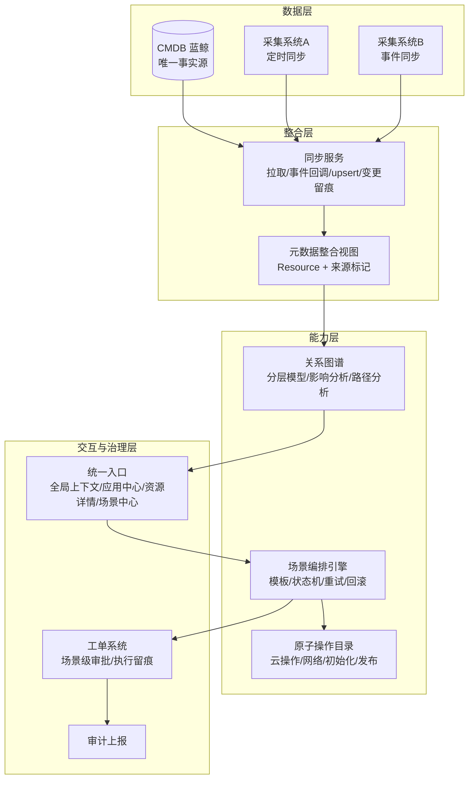
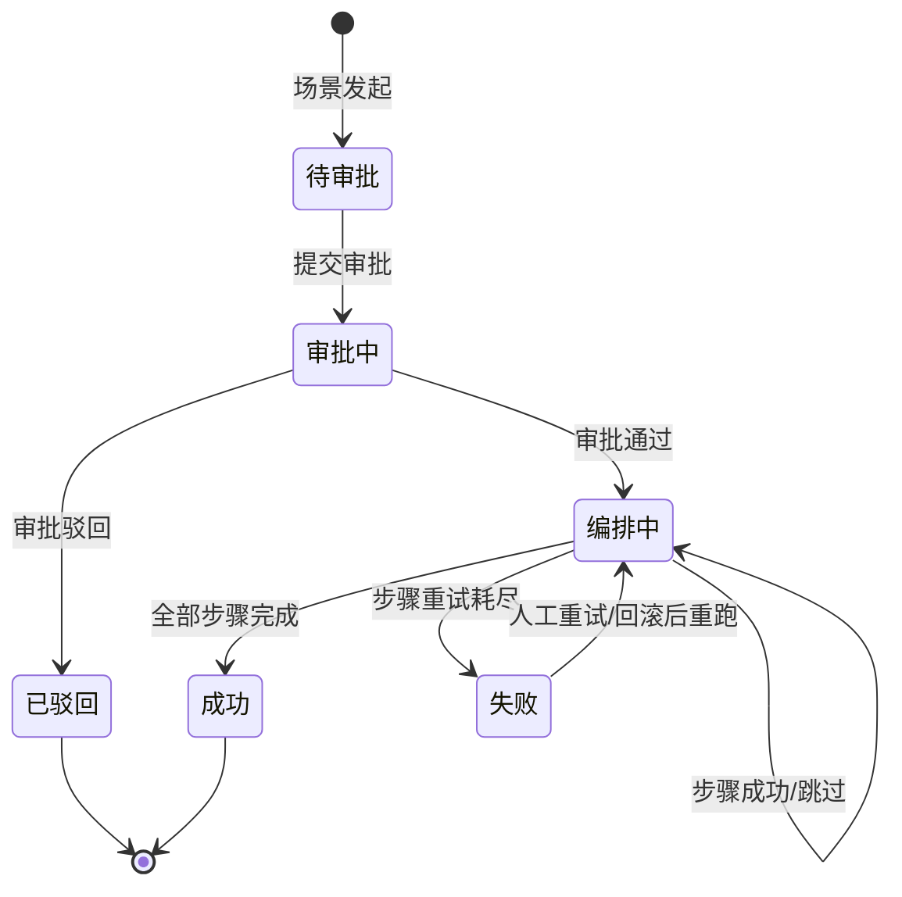

# P5 · 场景化能力与关系图谱（核心能力深化）

**目标**：围绕两个核心能力完成落地闭环：
1. **关系图谱**：在云管侧整合 CMDB 元数据，提供应用为中心的分层图谱（业务/服务/资源/网络/暴露层），CMDB 仅作数据源，图谱能力放在云管，用户不直接登录 CMDB。
2. **场景化能力**：把"申请机器 + 新建子网/安全组 + 网络打通 + 环境初始化 + 数据落库 + 推送发布"等原子操作组合成场景，一键发起、编排执行、标准化审批与审计。

**状态**：✅ 已实施（2026-08-06，Phase A/B/C 全部落地）

> **实施记录**：后端模型扩展、图谱/影响面/连通性 API、同步服务（定时+事件）、场景编排
> （8 步"服务扩容"闭环已跑通）、影响面附单、成本按应用聚合、种子数据已全部实现并通过
> 冒烟验证；前端完成全局账号/地域切换、资源详情独立页、应用中心、场景中心、工单影响面
> 展示与成本按应用图表。按 Demo 简化项：编排为顺序执行（`depends_on` 仅做展示，不做并行）、
> 未实现失败自动回滚（保留 `rollback_action_type` 定义与单资源回滚函数）、幂等以
> `request_id` 留痕为主（未做全局去重表）。

---

## 一、定位与架构对齐

### 1.1 定位

> 基于 CMDB 元数据、以关系图谱和场景化编排为核心、面向业务与运维的统一云资源运营平台。

### 1.2 职责边界（守住，不越界）

| 能力 | 归属 | 云管职责 |
|---|---|---|
| 数据采集（定时同步 + 事件同步） | 两个独立采集系统 | ❌ 不实现，只提供同步接收/事件回调接口（Mock 模拟） |
| CMDB（配置项 + 关系事实源） | 蓝鲸 CMDB | ❌ 不重做，只做本地元数据整合视图 + 来源标记 |
| 关系图谱展示与基于图谱的能力 | 云管 | ✅ 核心能力：图谱展示、影响面分析、场景决策上下文 |
| 场景化编排 | 云管 | ✅ 核心能力：原子操作组合 + 编排执行 |
| 权限 | 统一权限中心 | ✅ 权限收口：本地轻量版 + 预留对接；控制入口与操作可见性 |
| 审批 | 工单系统 | ✅ 所有变更转工单，场景级审批 + 标准化流转 |
| 审计 | 独立审计系统 | ✅ 本地留痕 + 预留事件上报接口 |

### 1.3 分层架构



---

## 二、数据模型设计

### 2.1 元数据整合（cmdb 模块增强）

#### Resource 表扩展字段

- [ ] `source_system` VARCHAR(32)：数据来源系统（`cmdb` / `collection` / `manual`）
- [ ] `sync_mode` VARCHAR(16)：同步方式（`schedule` / `event` / `manual`）
- [ ] `external_id` VARCHAR(128)：CMDB 配置项 ID（CI ID），用于与采集系统对齐
- [ ] 迁移文件：`cmdb/migrations/0002_*.py`

#### ResourceRelation 表增强

- [ ] `relation_type` 选项扩展：
  - `belongs_to`（服务/资源 → 应用）
  - `deployed_on`（服务 → 主机/集群）
  - `depends_on`（服务 → 依赖资源）
  - `communicates_with`（服务间通信）
  - `hosted_on`（数据库/缓存 → 存储/主机）
  - `contains`（应用 → 服务；VPC → 子网）
  - 保留：`belongs_to_vpc` / `belongs_to_subnet` / `attach_sg` / `bind_application`
- [ ] `strength` VARCHAR(8)：依赖强弱（`hard` 强制依赖 / `soft` 可降级）
- [ ] `source` VARCHAR(16)：关系来源（`sync` 采集同步 / `manual` 人工维护）
- [ ] `metadata` JSON：关系属性（如端口、协议、描述）
- [ ] 查询优化：`(source_id, relation_type)`、`(target_id, relation_type)` 索引

### 2.2 服务与端点（新模型）

#### `cmdb.ServiceInstance` 服务实例表

| 字段 | 类型 | 说明 |
|---|---|---|
| application | FK | 所属应用 |
| name | VARCHAR(64) | 服务名称（前端/后端/数据库/缓存/MQ） |
| service_type | VARCHAR(32) | frontend / backend / database / cache / mq / worker |
| deploy_type | VARCHAR(32) | ec2 / eks / serverless |
| region / status | 常规字段 | 部署地域、运行状态 |
| owner | VARCHAR(64) | 负责人 |
| description | TEXT | 描述 |

#### `cmdb.ServiceEndpoint` 服务端点表

| 字段 | 类型 | 说明 |
|---|---|---|
| service | FK | 所属服务 |
| protocol | VARCHAR(16) | http / https / tcp / udp |
| port | INT | 端口 |
| domain | VARCHAR(128) | 域名（可空） |
| certificate | VARCHAR(255) | 证书信息 |
| is_public | BOOL | 是否公网暴露 |
| metadata | JSON | 扩展属性 |

### 2.3 安全组规则（新模型）

#### `cmdb.SecurityRule` 安全组规则表

| 字段 | 类型 | 说明 |
|---|---|---|
| security_group | FK → Resource | 所属安全组 |
| direction | VARCHAR(8) | inbound / outbound |
| protocol | VARCHAR(16) | tcp / udp / icmp / all |
| port_range | VARCHAR(32) | 端口范围（如 80 / 1-65535） |
| source | VARCHAR(128) | 源 CIDR 或源安全组 |
| target | VARCHAR(128) | 目的 CIDR 或目的安全组 |
| priority | INT | 优先级 |
| action | VARCHAR(8) | allow / deny |
| enabled | BOOL | 是否启用 |

> **用途**：支撑"服务与上下游网络是否连通"的规则级推导（Demo 用规则推导，生产接云网络分析，不夸大）。

### 2.4 场景编排（新应用 `scenario` 或并入 `catalog`）

> 决策：**场景定义表独立**（`scenario` 模块），**场景工单复用现有工单体系**（`ticket`）。
> 理由：审批/审计/工单列表/详情全部复用，避免复制一套；Demo 规模下清晰且改动可控。

#### `scenario.Scenario` 场景定义表

| 字段 | 类型 | 说明 |
|---|---|---|
| code | VARCHAR(32) | 场景编码（唯一，如 `service_scale_out`） |
| name | VARCHAR(64) | 场景名称（如"服务扩容"） |
| description | TEXT | 场景说明 |
| icon | VARCHAR(32) | 图标 |
| need_approval | BOOL | 是否需要审批（默认 true） |
| enabled / version | 常规字段 | 启用状态、版本 |
| created_at / updated_at | 时间戳 | 时间 |

#### `scenario.ScenarioStep` 场景步骤表

| 字段 | 类型 | 说明 |
|---|---|---|
| scenario | FK | 所属场景 |
| step_no | INT | 步骤序号 |
| name | VARCHAR(64) | 步骤名称 |
| action_type | VARCHAR(32) | 原子操作类型（见 3.1） |
| action_params_template | JSON | 参数模板/默认值 |
| depends_on | JSON | 依赖的步骤号列表（支持并行） |
| need_approval | BOOL | 步骤级审批（默认跟随场景） |
| retry_max | INT | 最大重试次数（默认 3） |
| rollback_action_type | VARCHAR(32) | 回滚操作类型（可空） |
| enabled | BOOL | 是否启用 |

#### 场景工单（复用 ticket 表）

- [ ] `ticket_type` 增加 `scenario` 选项
- [ ] `TicketOrder` 增加 `scenario_id` / `scenario_code` 字段（可空）
- [ ] `TicketTask` 作为场景步骤任务：`task_type = step:{action_type}`，一条工单对应多个步骤任务
- [ ] 工单号前缀：场景工单使用 `SO` 前缀（如 `SO202608050001`）

---

## 三、原子操作目录与编排引擎

### 3.1 原子操作注册表（provider/actions.py）

统一注册机制（策略模式 + 注册表），Mock 实现，延迟 + 状态推进 + 失败注入：

- [ ] `create_instance`：申请 N 台机器（已有，对齐参数）
- [ ] `create_subnet`：新建子网（依赖 VPC）
- [ ] `create_security_group`：新建安全组
- [ ] `attach_security_group`：实例绑定安全组
- [ ] `allow_network`：网络打通（安全组规则 + 路由，Mock 生成 SecurityRule）
- [ ] `init_env`：环境初始化（Mock 执行日志，模拟脚本）
- [ ] `write_cmdb`：数据落库（回写 Resource/Relation，模拟 CMDB 变更）
- [ ] `publish_platform`：推送发布平台（Mock HTTP 回调占位）

每个操作定义：

```python
@dataclass
class ActionSpec:
    action_type: str
    name: str
    params_schema: Dict[str, Any]   # 参数校验规则
    need_approval: bool
    handler: Callable               # 执行函数（返回 TaskHandle）
    rollback: Optional[Callable]    # 回滚函数
```

### 3.2 编排状态机



步骤级状态：`pending → running → success / failed`，失败按 `retry_max` 重试，重试耗尽进入人工介入。

### 3.3 执行器要点

- [ ] 按 `step_no` 顺序执行，`depends_on` 声明并行步骤
- [ ] 步骤失败：记录 `exec_log`，重试；耗尽后场景工单置 `failed`，支持人工重试
- [ ] 幂等：每步骤任务生成 `request_id`，执行前按 request_id 去重
- [ ] 回滚：步骤定义 `rollback_action_type`，场景失败时可选回滚已成功步骤
- [ ] 每步骤执行结果回写元数据视图 + 写 `ResourceChange` + 写审计日志

---

## 四、核心 API 设计

### 4.1 图谱 API（cmdb 模块）

- [ ] `GET /api/graph/applications/`：应用列表（含服务数/资源数/依赖数统计）
- [ ] `GET /api/graph/applications/{id}/`：应用全景图（分层节点 + 边）
- [ ] `GET /api/graph/resources/{id}/neighbors/?depth=1`：按需展开邻居
- [ ] `GET /api/graph/resources/{id}/impact/`：影响面分析（BFS 遍历，见 4.2）
- [ ] `GET /api/graph/resources/{source}/path/?target={id}`：两资源间路径/链路
- [ ] `GET /api/graph/resources/{id}/connectivity/?target={id}`：网络连通性推导（基于 SecurityRule）

### 4.2 影响面分析设计

- 输入：资源 ID / 服务 ID
- 算法：从起点沿关系图 BFS，深度限制（默认 3）
- 输出：
  - 影响链（节点路径 + 关系类型）
  - 严重度（`high`：强制依赖链上的资源；`medium`：软依赖；`low`：间接影响）
  - 单点依赖（SPOF）标记：只被一个上游依赖的强依赖节点
  - 影响资源清单（按应用聚合，便于审批人快速判断）

### 4.3 场景 API（scenario 模块）

- [ ] `GET /api/scenarios/`：场景列表
- [ ] `GET /api/scenarios/{id}/`：场景详情（步骤定义 + 参数表单 schema）
- [ ] `POST /api/scenarios/{id}/apply/`：发起场景 → 参数校验 → 生成场景工单
- [ ] `GET /api/ticket/orders/?ticket_type=scenario`：场景工单列表（复用）
- [ ] `GET /api/ticket/orders/{id}/tasks/`：步骤执行状态（复用，前端按步骤渲染）

### 4.4 同步与事件接口（cmdb 模块）

- [ ] `POST /api/cmdb/sync-jobs/`：手动触发定时同步（模拟采集系统A）
- [ ] `POST /api/cmdb/events/`：事件回调（模拟采集系统B：resource.created/updated/deleted）
- [ ] `GET /api/cmdb/sync-jobs/`：同步任务列表与结果
- [ ] Celery Beat 定时任务：每日全量/增量同步（Mock）

---

## 五、前端设计

### 5.1 全局上下文（前置）

- [ ] `stores/global.ts`：`accountId` / `region` 全局状态（Pinia）
- [ ] 布局切换器（现有 `ConsoleLayout` 的账号/地域下拉）接入 store
- [ ] 资源列表、拓扑、成本页统一消费全局上下文，移除各页面独立筛选

### 5.2 资源详情页（从抽屉升级为独立路由）

- [ ] 路由：`/resources/:id`
- [ ] 页面区块：
  - 基本信息（规格/地域/账号/标签/来源标记）
  - **关系与上下游**（图谱为中心：父级、子级、依赖、被依赖，强弱标识）
  - 网络与安全（安全组规则、端点、连通性）
  - 变更历史（复用 ResourceChange）
  - 影响面分析（谁依赖我 / 我依赖谁，强制依赖高亮）

### 5.3 应用中心

- [ ] `GET /api/graph/applications/` 驱动的应用列表页
- [ ] 应用全景页：分层图谱（应用 → 服务 → 资源 → 端点），支持展开/收起

### 5.4 场景中心

- [ ] 场景列表页（卡片式，含说明与"立即发起"）
- [ ] 场景详情页：步骤编排图（时间轴/泳道）+ 参数表单
- [ ] 场景工单详情：复用工单详情，增加步骤执行状态视图（每步状态/日志/重试）

### 5.5 图谱组件

- [ ] `components/GraphView.vue`：基于 AntV G6（或 ECharts graph）
- [ ] 节点类型着色、强弱依赖线型（实线 hard / 虚线 soft）、点击展开邻居、过滤
- [ ] 大图策略：按需加载（`neighbors` 接口），不做一次性全量渲染

---

## 六、Mock 数据方案

- [ ] 场景种子："服务扩容"场景 + 完整步骤定义（申请机器 → 子网/安全组 → 网络打通 → 初始化 → 落库 → 发布）
- [ ] 图谱种子：3 个应用 × 2-3 个服务 × 资源（复用 MockProvider）+ 关系 + 端点 + 安全组规则
- [ ] 应用示例："订单中心" = 前端(EC2) + 后端(EC2) + 数据库(RDS) + 缓存(Redis) + MQ(Kafka)，依赖 s3/nginx，含域名与端口
- [ ] 采集系统模拟：同步任务生成/更新 Resource（带 `source_system=cmdb` 标记）+ 事件回调生成增量
- [ ] 演示脚本：一次"服务扩容"完整流程（发起 → 审批 → 步骤执行 → 图谱变化可见）

---

## 七、阶段拆解与验收

### Phase A · 元数据整合与图谱增强

**后端**
- [ ] Resource / ResourceRelation 模型扩展 + 迁移
- [ ] ServiceInstance / ServiceEndpoint / SecurityRule 模型
- [ ] 同步服务（定时 + 事件回调）+ 同步任务模型
- [ ] 图谱 API（应用全景 / 邻居展开 / 路径 / 连通性）

**前端**
- [ ] 全局上下文 store + 布局切换器接通
- [ ] 资源详情页（独立路由，图谱为中心）
- [ ] 应用中心列表 + 应用全景页
- [ ] GraphView 组件

**验收**
- [ ] 顶部切换账号/地域后，资源列表与图谱随之过滤
- [ ] 点开任意资源可看到完整上下游关系与强弱依赖
- [ ] 应用全景图展示"应用 → 服务 → 资源 → 端点"分层

### Phase B · 场景化编排

**后端**
- [ ] Scenario / ScenarioStep 模型 + 种子场景
- [ ] 原子操作注册表（8 个 Mock 操作）
- [ ] 编排执行器（顺序/并行/重试/回滚/幂等）
- [ ] 场景发起 API + 场景工单（复用 ticket）

**前端**
- [ ] 场景中心（列表 / 详情 / 发起）
- [ ] 场景工单步骤执行状态视图

**验收**
- [ ] "服务扩容"场景一键发起 → 审批通过 → 按序执行全部步骤 → 图谱可见新增资源与关系
- [ ] 步骤失败可重试，重试耗尽场景进入 failed 且可人工重试

### Phase C · 影响面分析与治理闭环

**后端**
- [ ] 影响面分析 API（BFS + 严重度 + SPOF）
- [ ] 提单时自动附带影响面分析结果（写入工单 request_content）
- [ ] 成本按应用/服务聚合

**前端**
- [ ] 工单审批页展示影响面（"本次变更影响 3 个服务、1 条强制依赖"）
- [ ] 资源详情页展示影响分析区块
- [ ] 成本页增加按应用维度

**验收**
- [ ] 审批人可在审批时看到变更影响范围
- [ ] 强制依赖（如数据库停机影响订单中心）可在一张图上直观判断
- [ ] 影响面分析与图谱数据一致（来自同一元数据视图）

---

## 八、技术要点备忘（面试深度点）

- **图谱数据来源与可信度**：关系/资源带 `source` 标记（同步/人工），云管不负责采集准确性，只做整合与展示——"CMDB 是事实源，云管是运营视图"
- **为什么图谱放云管不放 CMDB**：权限收口 + 场景化能力需要图谱做决策上下文；CMDB 只读，操作太危险
- **编排与工单的关系**：场景 = 一组原子操作，审批/审计/留痕全部落在工单体系，云管不自建审批流
- **双向关系一致性**：逻辑上存一条边，查询双向遍历，避免两边不同步
- **幂等设计**：步骤级 `request_id` 去重，重试不重复创建资源
- **规模演进**：关系表 + 缓存可支撑 Demo 规模；规模化演进方向为图数据库（Neo4j/Nebula），并说明阈值与迁移路径
- **与外部系统集成点**：统一权限中心（角色/权限同步）、审计系统（事件上报）、采集系统（同步/事件回调）、发布平台（Mock 回调）——全部以接口占位，不重做
- **防穿帮边界**：不声称实现 Agent/eBPF/APM 实时调用链；网络连通性为规则级推导，生产接云网络分析

---

## 九、范围外（明确不做）

1. ❌ 不重做 CMDB/采集系统（只做整合视图与同步接收）
2. ❌ 不重做权限中心/审计系统（轻量本地版 + 集成点）
3. ❌ 不做 APM 实时调用链 / eBPF 自动发现
4. ❌ 不做真实多云 Provider 对接（沿用 Mock，P2 另行推进）
5. ❌ 不引入图数据库（Demo 用关系表，演进方案见备忘）
