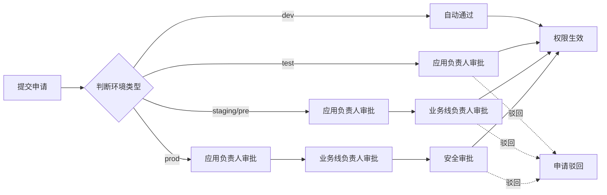

# 权限模块重构详细设计方案

> 版本：v1.0 | 状态：待审阅 | 对应项目：发布系统 Demo

---

## 目录

1. [总体变更一览](#1-总体变更一览)
2. [导航结构调整](#2-导航结构调整)
3. [角色模型：组/用户一对一角色绑定](#3-角色模型组用户一对一角色绑定)
4. [模块一：组织权限（原组织权限树）](#4-模块一组织权限原组织权限树)
5. [模块二：权限申请（原组权限配置）](#5-模块二权限申请原组权限配置)
6. [模块三：我的权限](#6-模块三我的权限)
7. [模块四：权限审批（新增）](#7-模块四权限审批新增)
8. [权限计算逻辑](#8-权限计算逻辑)
9. [审批链路设计](#9-审批链路设计)
10. [后端数据模型变更](#10-后端数据模型变更)
11. [前端路由与菜单变更](#11-前端路由与菜单变更)
12. [实施计划](#12-实施计划)
13. [附录：Mockup 示意图](#13-附录mockup-示意图)

---

## 1. 总体变更一览

| 当前 | 变更后 | 说明 |
|------|--------|------|
| 菜单「组织权限树」 | 菜单「组织权限」 | 页面大幅重构，信息密度增加 |
| 菜单「角色管理」 | 菜单「权限申请」 | 旧角色管理页面移除 |
| 菜单「组权限配置」 | **删除** | 功能并入组织权限页面 |
| 菜单「我的权限」 | 菜单「我的权限」 | 页面重构为功能/数据双维度 |
| - | 菜单「权限审批」 | 新增模块 |
| 右侧个人中心「我的权限」 | 不变 | 保持快捷入口 |

### 导航结构（变更后）

```
权限管理
├── 组织权限          ← 组/用户/角色/权限统一视图
├── 权限申请          ← 申请历史 + 新建申请
├── 我的权限          ← 功能权限 + 数据权限展示
└── 权限审批          ← 待办审批列表 + 审批操作
```

---

## 2. 导航结构调整

### 当前菜单（需修改）

```typescript
// frontend/src/components/Layout/AppLayout.tsx
{
  key: 'permissions',
  icon: <SafetyCertificateOutlined />,
  label: '权限管理',
  children: [
    { key: '/permissions', label: '组织权限树' },       // → 改为「组织权限」
    { key: '/permissions/roles', label: '角色管理' },     // → 删除，替换为「权限申请」
    { key: '/permissions/groups', label: '组权限配置' },  // → 删除
    { key: '/permissions/my', label: '我的权限' },        // → 保留
  ],
}
```

### 变更后菜单

```typescript
{
  key: 'permissions',
  icon: <SafetyCertificateOutlined />,
  label: '权限管理',
  children: [
    { key: '/permissions', label: '组织权限' },
    { key: '/permissions/requests', label: '权限申请' },
    { key: '/permissions/my', label: '我的权限' },
    { key: '/permissions/approvals', label: '权限审批' },
  ],
}
```

---

## 3. 角色模型：Role 表保留，按类型区分组/用户角色

### 3.1 核心变化

**Role 表保留**，仍是权限的权威载体。角色按类型分为两类，互不可混绑：

```text
Role (权限载体)
├── type='group'  →  只能绑定给 Group
│                    Group.role_id → Role.id
│
└── type='user'   →  只能绑定给 User
                     UserPermission.role_id → Role.id
```

**旧模型问题**：GroupPermission 作为中间表，导致多个 Group/User 共享同一条 Role（复用模板），且没有区分组角色和用户角色的边界。

**新模型要点**：
- Role 表增加 `type` 字段（`group` / `user`），明确角色归属类型
- **Role 统一管理功能权限 + 数据权限**。数据权限使用 `data_rules` JSONField 存储，每条 rule 是一个不可拆分的原子授权单元
- Group 表增加 `role_id` 外键 → Role（其中 role.type='group'）
- UserPermission 保留 `role_id` 外键 → Role（其中 role.type='user'），仅记录角色和效果
- 组角色不能绑定给人，人角色不能绑定给组
- **GroupPermission 表删除**，组权限直接从 Group.role 读取
- **没有隐式的 business_line 数据权限继承**，所有数据权限显式写在 Role 中

### 3.2 Role 模型定义

```python
class Role(models.Model):
    """角色 - 权限的载体，统一管理功能权限和数据权限"""
    ROLE_TYPES = [
        ('group', '组角色'),
        ('user', '用户角色'),
    ]

    name = models.CharField(max_length=32, verbose_name="角色名称")
    type = models.CharField(max_length=8, choices=ROLE_TYPES, verbose_name="角色类型")
    description = models.TextField(blank=True, verbose_name="描述")
    permission_codes = models.JSONField(default=list, verbose_name="功能权限编码列表",
                                        help_text="['menu_dashboard', 'page_apps', 'action_deploy', ...]")
    data_rules = models.JSONField(default=list, verbose_name="数据权限规则列表",
                                  help_text="[{\"selector_type\": \"business_line\", \"selector_id\": 1, \"conditions\": {\"env_type_in\": [\"dev\", \"test\"]}}, ...]")
    is_system = models.BooleanField(default=False, verbose_name="系统内置")
    created_at = models.DateTimeField(auto_now_add=True)

    class Meta:
        unique_together = [('name', 'type')]
        db_table = "role"

    def __str__(self):
        return f"[{'组' if self.type == 'group' else '用户'}] {self.name}"
```

#### data_rules 格式说明

每条 rule 是一个**原子授权单元**，不可拆分：

```json
[
  {
    "selector_type": "business_line",
    "selector_id": 1,
    "conditions": {
      "env_type_in": ["dev", "test"]
    }
  },
  {
    "selector_type": "application",
    "selector_id": 42,
    "conditions": {
      "env_type_in": ["pre", "prod"]
    }
  },
  {
    "selector_type": "application",
    "selector_id": 99
  }
]
```

| 字段 | 说明 |
|------|------|
| `selector_type` | 资源类型：`business_line` / `application` |
| `selector_id` | 对应业务线或应用的 ID |
| `conditions.env_type_in` | 可选，限制可操作的环境类型（dev / test / staging / prod）。不填表示所有环境类型 |

**为什么不会产生笛卡尔积**：每条 rule 只锚定在**一个资源**上（一个业务线或一个应用），conditions 只是该资源的属性过滤。不存在 app 和 env 两个独立维度做笛卡尔积的情况。

Role 表数据示例：

| id | name | type | permission_codes | data_rules | is_system |
|----|------|------|------------------|------------|-----------|
| 1 | 开发者 | group | [menu_dashboard, ...] | `[{"selector_type":"business_line","selector_id":1,"conditions":{"env_type_in":["dev","test"]}}]` | True |
| 2 | 发布管理员 | group | [...] | `[{"selector_type":"business_line","selector_id":1,"conditions":{"env_type_in":["dev","test","staging","prod"]}}]` | True |
| 3 | 应用负责人 | group | [...] | `[{"selector_type":"business_line","selector_id":1}]` | True |
| 4 | 业务线负责人 | group | [...] | `[{"selector_type":"business_line","selector_id":1}]` | True |
| 5 | 观察者 | group | [...] | `[{"selector_type":"business_line","selector_id":1}]` | True |
| 6 | 开发者 | user | [...] | 同上或按需收窄 | True |

> 最重要的变化：**数据权限全部显式写在 Role.data_rules 中**。Group 不再通过业务线隐式继承数据范围，UserPermission 也不再通过独立 scope 表记录数据范围。所有权限的源头只有 Role 表。

### 3.3 建模变更

**Group 表** 增加 `role_id` 外键。数据权限取自 `Group.role.data_rules`：

```python
class Group(models.Model):
    # 已有字段
    name = models.CharField(...)
    code = models.CharField(...)
    business_line = models.ForeignKey(...)  # 仅用于业务归属，不决定权限
    parent_group = models.ForeignKey(...)
    status = models.CharField(...)
    # 新增字段
    role = models.ForeignKey(
        Role, on_delete=models.SET_NULL, null=True, related_name='groups',
        verbose_name="组角色"
    )
    # role.type 必须为 'group'，应用层校验
```

**UserPermission** 保留 Role 外键，但限定 role.type='user'。**不再需要 UserPermissionScope 或任何独立数据范围表**，数据范围完全由 Role.data_rules 决定：

```python
class UserPermission(models.Model):
    """个人例外权限 - 只记录角色和效果，数据范围从 Role.data_rules 读取"""
    user = models.ForeignKey(User, on_delete=models.CASCADE, related_name="extra_permissions")
    role = models.ForeignKey(Role, on_delete=models.SET_NULL, null=True, related_name="+")
    effect = models.CharField(max_length=8, choices=[('allow', '允许'), ('deny', '拒绝')], default='allow')
    valid_from = models.DateTimeField(null=True, blank=True)
    valid_to = models.DateTimeField(null=True, blank=True)
    source = models.CharField(max_length=32, default='manual')
    source_id = models.CharField(max_length=64, blank=True)
    reason = models.TextField(blank=True)
    created_at = models.DateTimeField(auto_now_add=True)
    created_by = models.ForeignKey(User, on_delete=models.SET_NULL, null=True, related_name="+")
    # role.type 必须为 'user'，应用层校验
```

**GroupPermission 表** 删除——所有权限（功能 + 数据）直接从 Group.role 读取。

### 3.4 权限合并规则

```text
用户功能权限 = Group.role.permission_codes（组角色的功能权限）
              + UserPermission(allow).role.permission_codes（个人例外的功能权限）
              - UserPermission(deny).role.permission_codes（个人拒绝的功能权限）

用户数据权限 = Group.role.data_rules（组角色的数据权限规则）
              + UserPermission(allow).role.data_rules（个人例外的数据权限规则）
              - UserPermission(deny).role.data_rules（个人拒绝的数据权限规则）
```

**判定逻辑**：

```text
can(user, action, deployment_target_id)
  → 获取 target 的 app_id、env_type
  → 收集用户所有 Role.data_rules（组角色 + 个人 allow - 个人 deny）
  → 逐条检查是否有 rule 匹配 (app_id, env_type)
  → 任意一条匹配则 Allow；否则 Deny
```

**优先级**：个人 Deny > 个人 Allow > 组权限

---

## 4. 模块一：组织权限（原组织权限树）

### 4.1 页面结构

```
┌─────────────────────────────────────────────────────────┐
│  组织权限                                                │
├──────────────┬──────────────────────────────────────────┤
│  组织树       │  选中组/用户详情区域                       │
│  ┌─────────┐ │                                          │
│  │ 🔍 搜索  │ │  可切换 3 个视图：                       │
│  │          │ │  ┌──────┬──────┬──────┐                 │
│  │ 🏢 支付… │ │  │ 组信息│ 成员  │ 权限 │                 │
│  │  👥 支付…│ │  └──────┴──────┴──────┘                 │
│  │  👥 支付…│ │                                          │
│  │ 🏢 电商… │ │  视图一：组信息                          │
│  │  👥 电商…│ │  ┌────────────────────────────────┐      │
│  │  👥 前端…│ │  │ 组名称：支付研发组               │      │
│  │ 🏢 基础… │ │  │ 组编码：payment-dev              │      │
│  │          │ │  │ 所属业务线：支付业务线            │      │
│  │          │ │  │ 组角色：🔵 Developer             │      │
│  │          │ │  │ [调整角色]                       │      │
│  │          │ │  │                                  │      │
│  │          │ │  │ 组负责人：张三                    │      │
│  │          │ │  │ 成员数：4 人                     │      │
│  │          │ │  └────────────────────────────────┘      │
│  └─────────┘ │                                          │
│              │  视图二：成员（默认含角色列）              │
│  树宽固定     │  ┌────────────────────────────────┐      │
│  320px       │  │ 姓名 │ 用户名 │ 角色 │ 类型  │操作  │      │
│  默认展开    │  │ 张三 │zhang..│🔵Dev│归属  │详情 │      │
│              │  │ 李四 │lisi   │🔵Dev│归属  │详情 │      │
│              │  │ 王五 │wangwu │🟠Rel..│协作  │详情 │      │
│              │  └────────────────────────────────┘      │
│              │  [添加成员]                               │
│              │                                          │
│              │  视图三：权限清单                          │
│              │  ┌────────────────────────────────┐      │
│              │  │ 功能权限                        │      │
│              │  │ ☑️ 仪表盘  ☑️ 应用管理  ☑️ 发布管理│      │
│              │  │ ☑️ 审批中心  ☑️ 制品管理            │      │
│              │  │                                  │      │
│              │  │ 数据权限                        │      │
│              │  │ 业务线：支付业务线                │      │
│              │  │ 应用：payment-api, payment-web   │      │
│              │  │ 环境：dev, test1, test2, test3   │      │
│              │  └────────────────────────────────┘      │
├──────────────┴──────────────────────────────────────────┤
│  成员详情抽屉（点击成员行弹出）                           │
│  ┌──────────────────────────────────────────────┐       │
│  │ 用户：张三                                    │       │
│  │ 用户名：zhangsan                              │       │
│  │ 邮箱：zhangsan@demo.com                        │       │
│  │ 当前角色：Developer                            │       │
│  │ 所属组：支付研发组（归属）                       │       │
│  │ 协作组：-                                     │       │
│  │                                              │       │
│  │ ┌─────────────────────────────────────┐       │       │
│  │ │ 权限来源：                            │       │       │
│  │ │ ✅ 组权限（支付研发组 → Developer）    │       │       │
│  │ │ ✅ 个人例外权限                       │       │       │
│  │ │    - deploy on prod (Allow, 临时)     │       │       │
│  │ │ ❌ 例外拒绝                           │       │       │
│  │ │    - payment-api/prod (Deny)          │       │       │
│  │ └─────────────────────────────────────┘       │       │
│  │                                              │       │
│  │ [调整角色] [添加例外权限] [管理负责应用]        │       │
│  └──────────────────────────────────────────────┘       │
└─────────────────────────────────────────────────────────┘
```

### 4.2 关键交互

| 交互 | 行为 |
|------|------|
| 点击业务线节点 | 右侧显示业务线概览（组列表、业务线负责人等） |
| 点击组节点 | 右侧显示组信息（默认「组信息」Tab） |
| 点击组成员行 | 弹出成员详情 Drawer，展示完整权限结构 |
| 添加成员 | Modal 选择用户、设置成员类型（归属/协作） |
| 调整角色 | Select 下拉选择角色编码，确认后更新 |
| 切换 Tab | 组信息 / 成员 / 权限 三个 Tab 切换 |

### 4.3 数据权限控制

- 当前用户是某个业务线的 BusinessOwner 时，组织树只能看到该业务线及其下组/成员。
- 当前用户是 ApplicationOwner 时，只能看到相关应用的组信息。
- 当前用户是普通 Developer 时，只能看到自己所在的组。
- （后端过滤树节点，前端无需感知）

---

## 5. 模块二：权限申请（原组权限配置）

### 5.1 页面结构

```
┌─────────────────────────────────────────────────────────┐
│  权限申请                                                │
├─────────────────────────────────────────────────────────┤
│  [新建申请]                                              │
│                                                         │
│  ┌─ 我的申请历史 ─────────────────────────────────────┐  │
│  │ 申请单 │ 类型 │ 申请内容     │ 状态    │ 当前审批人 │  │
│  │ #001  │ 功能  │ 应用管理权限 │ ✅ 已通过 │ -        │  │
│  │ #002  │ 数据  │ payment/pr..│ ⏳ 审批中 │ 张三(..) │  │
│  │ #003  │ 功能  │ 审计菜单     │ ❌ 已驳回 │ -        │  │
│  └────────────────────────────────────────────────────┘  │
└─────────────────────────────────────────────────────────┘
```

### 5.2 新建申请表单

```
┌─────────────────────────────────────────────────────────┐
│  新建权限申请                                            │
├─────────────────────────────────────────────────────────┤
│  申请类型： [功能权限] [数据权限]                         │
│                                                         │
│  ── 功能权限申请（示例） ──                              │
│  ✅ 目标角色：[Developer]                               │
│     （选择角色后系统自动填充该角色的功能权限列表）          │
│  ✅ 审批业务线负责人：[张三 - 支付业务线]                │
│     （默认当前用户所在业务线，可切换其他业务线跨组申请）    │
│  ✅ 申请原因：需要发布权限完成日常发布工作                 │
│                                                         │
│  ── 数据权限申请（示例） ──                              │
│  ✅ 目标应用：payment-api                               │
│  ✅ 目标环境：test2, test3, pre                        │
│     （选择后系统自动判断审批链路）                         │
│  ✅ 申请操作权限：部署(deploy), 查看日志(view_log)        │
│  ✅ 审批业务线负责人：[张三 - 支付业务线]                │
│  ✅ 申请原因：需要测试环境的发布权限                      │
│                                                         │
│  ┌────────────────────────────────────────────────┐      │
│  │ 系统自动审批链路预览：                            │      │
│  │ test 环境 → 应用负责人审批                       │      │
│  │ pre  环境 → 应用负责人 + 业务线负责人审批         │      │
│  │ prod 环境 → 应用负责人 + 业务线负责人 + 安全审批   │      │
│  └────────────────────────────────────────────────┘      │
│                                                         │
│  [提交申请]                                              │
└─────────────────────────────────────────────────────────┘
```

### 5.3 审批链路自动判断

系统根据申请的**环境类型（env_type）**自动选择审批环节。判断规则存放在后端常量中：

```python
# backend/apps/approvals/constants.py
APPROVAL_CHAINS = {
    'dev': [],                    # 无需审批
    'test': ['app_owner'],        # 应用负责人审批
    'staging': ['app_owner', 'biz_owner'],  # 应用负责人 + 业务线负责人
    'prod': ['app_owner', 'biz_owner', 'security'],  # + 安全审批
}
```

前端只读预览此链路的渲染结果。

---

## 6. 模块三：我的权限

### 6.1 页面结构

```
┌─────────────────────────────────────────────────────────┐
│  我的权限                                                │
├─────────────────────────────────────────────────────────┤
│  用户信息卡片                                            │
│  张三 (zhangsan) | zhangsan@demo.com                    │
│  当前角色：Developer | 归属组：支付研发组                 │
│                                                         │
├───────────┬─────────────────────────────────────────────┤
│  功能权限  │  数据权限                                    │
│  ┌───────┐│  ┌────────────────────────────────────────┐│
│  │全部    ││  │全部   组织权限  个人权限               ││
│  │组织权限││  │                                        ││
│  │个人权限││  │ payment-api                            ││
│  └───────┘│  │  ├─ dev     ✅ 可发布                   ││
│           │  │  ├─ test1   ✅ 可发布                   ││
│           │  │  ├─ test2   ✅ 可发布                   ││
│  仪表盘 ✅ │  │  ├─ pre     🔒 无权限 → 去申请         ││
│  应用管理✅ │  │  └─ prod    🔒 无权限 → 去申请         ││
│  发布管理✅ │  │                                        ││
│  审批中心✅ │  │ payment-web                            ││
│  制品管理✅ │  │  ├─ dev     ✅ 可发布                   ││
│  配置管理✅ │  │  ├─ test1   ✅ 可发布                   ││
│  环境管理🔒 │  │  └─ ...                               ││
│  → 去申请   │  │                                        ││
│           │  │ order-api                               ││
│  审计日志🔒 │  │  └─ dev     🔒 无权限 → 去申请         ││
│  → 去申请   │  │                                        ││
│           │  └────────────────────────────────────────┘│
└───────────┴─────────────────────────────────────────────┘
```

### 6.2 功能权限 Tab

| Tab | 内容 |
|-----|------|
| 全部 | 当前用户所有功能权限的并集（组权限 + 个人权限），无权限的菜单显示🔒 |
| 组织权限 | 仅显示来自组角色（Group.role_code）的功能权限 |
| 个人权限 | 仅显示来自个人例外（UserPermission）的功能权限 |

每个 Tab 中的菜单条目按类型分组展示：
- **菜单级**（如仪表盘、应用管理）
- **页面级**（如发布历史、审计日志）
- **操作级**（如创建应用、审批）

没有权限的功能项：灰色显示 + 锁图标 + 🔗「去申请」链接 → 跳转到 `/permissions/requests`。

### 6.3 数据权限 Tab

| Tab | 内容 |
|-----|------|
| 全部 | 按应用分组展示所有可操作的目标及环境 |
| 组织权限 | 仅显示来自组角色的数据权限 |
| 个人权限 | 仅显示来自个人例外的数据权限 |

展示结构：**应用 → 环境 → 操作**，用树形结构或分组表格展示。

每条环境权限右侧展示可执行的操作列表（deploy / view_log / rollback 等）。

---

## 7. 模块四：权限审批（新增）

### 7.1 页面结构

```
┌─────────────────────────────────────────────────────────┐
│  权限审批                                                │
├─────────────────────────────────────────────────────────┤
│  ┌──────┬──────┬──────┐                                 │
│  │ 待审批│ 已通过│ 已驳回 │ ← Tab                          │
│  └──────┴──────┴──────┘                                 │
│                                                         │
│  待审批列表（默认 Tab）                                   │
│  ┌────────────────────────────────────────────────────┐│
│  │ 申请单 │ 申请人 │ 类型  │ 申请内容     │ 状态  │ 操作 ││
│  │ #002  │ 王五   │ 数据  │payment/pre   │ ⏳审批中│审批 ││
│  │       │        │ 权限  │ 部署权限      │ 待我审批│    ││
│  │ #005  │ 赵六   │ 功能  │ 发布管理员    │ ⏳审批中│审批 ││
│  │       │        │ 权限  │ 角色          │ 待我审批│    ││
│  └────────────────────────────────────────────────────┘│
│                                                         │
│  审批弹窗（点击「审批」按钮后弹出）                        │
│  ┌────────────────────────────────────────────────┐     │
│  │  审批申请 #002                                 │     │
│  │                                              │     │
│  │  申请人：王五                                  │     │
│  │  申请类型：数据权限                             │     │
│  │  目标应用：payment-api                         │     │
│  │  目标环境：pre                                 │     │
│  │  申请操作：deploy                              │     │
│  │  申请原因：需要查看预发环境发布情况                │     │
│  │                                              │     │
│  │  审批链路状态：                                 │     │
│  │  ✅ 应用负责人（当前用户 - 张三）已通过           │     │
│  │  ⏳ 业务线负责人（等待审批）                     │     │
│  │  ⏳ 安全审批（等待前置审批）                     │     │
│  │                                              │     │
│  │  审批意见：[___________]                       │     │
│  │                                              │     │
│  │  [通过] [驳回]                                │     │
│  └────────────────────────────────────────────────┘     │
└─────────────────────────────────────────────────────────┘
```

### 7.2 判断当前用户能否审批

| 审批节点 | 审批人 |
|----------|--------|
| `app_owner` | Application 的 Owner（resource_owner 表 owner_type='app_owner'） |
| `biz_owner` | BusinessLine 的 Owner（resource_owner 表 owner_type='biz_owner'） |
| `security` | 拥有 `action_security_approve` 权限的用户（占位） |

> Demo 简化：每个节点一人审批即通过，进入下一节点或最终生效。

---

## 8. 权限计算逻辑

### 8.1 核心函数

```python
from apps.applications.models import Application
from apps.infrastructures.models import Environment


def get_user_effective_permissions(user: User) -> dict:
    """
    返回当前用户的完整权限集合
    """
    memberships = SubjectMembership.objects.filter(user=user).select_related('group__role')

    # ── 收集所有生效的 Role（组角色 + 个人例外） ──
    active_roles = []   # [(role, effect)]
    for m in memberships:
        if m.group.role:
            active_roles.append((m.group.role, 'allow'))

    personal_perms = UserPermission.objects.filter(user=user).select_related('role')
    for pp in personal_perms:
        if pp.role:
            active_roles.append((pp.role, pp.effect))

    # ── 合并功能权限 ──
    final_menu_codes = set()
    for role, effect in active_roles:
        if effect == 'allow':
            final_menu_codes.update(role.permission_codes)
        elif effect == 'deny':
            final_menu_codes.difference_update(role.permission_codes)

    # ── 合并数据权限 ──
    # 返回格式：{app_id: [allowed_env_types]} 或 {app_id: []} 表示所有环境
    final_data_rules = []  # allow rules
    deny_data_rules = []   # deny rules
    for role, effect in active_roles:
        for rule in (role.data_rules or []):
            if effect == 'allow':
                final_data_rules.append(rule)
            elif effect == 'deny':
                deny_data_rules.append(rule)

    can_see_app_ids = _compute_visible_app_ids(final_data_rules, deny_data_rules)

    return {
        'menu_codes': list(final_menu_codes),
        'data_rules': final_data_rules,
        'can_see_app_ids': can_see_app_ids,
        'role_names': list(set([
            r[0].name for r in active_roles if r[1] == 'allow'
        ])),
        'personal_permissions': [
            {
                'id': pp.id,
                'role_name': pp.role.name if pp.role else '',
                'effect': pp.effect,
                'role_data_rules': pp.role.data_rules if pp.role else [],
                'source': pp.source,
                'source_id': pp.source_id,
                'reason': pp.reason,
                'valid_from': pp.valid_from,
                'valid_to': pp.valid_to,
            }
            for pp in personal_perms
        ],
    }


def _compute_visible_app_ids(allow_rules: list, deny_rules: list) -> list:
    """
    根据 data_rules 计算用户可见的应用 ID 列表
    """
    from apps.applications.models import Application

    allowed_app_ids = set()
    denied_app_ids = set()

    # Allow 规则：按 business_line 展开或直接取 application
    for rule in allow_rules:
        if rule.get('selector_type') == 'business_line':
            apps = Application.objects.filter(
                business_line_id=rule['selector_id']
            ).values_list('id', flat=True)
            allowed_app_ids.update(apps)
        elif rule.get('selector_type') == 'application':
            allowed_app_ids.add(rule['selector_id'])

    # Deny 规则同理
    for rule in deny_rules:
        if rule.get('selector_type') == 'business_line':
            apps = Application.objects.filter(
                business_line_id=rule['selector_id']
            ).values_list('id', flat=True)
            denied_app_ids.update(apps)
        elif rule.get('selector_type') == 'application':
            denied_app_ids.add(rule['selector_id'])

    return list(allowed_app_ids - denied_app_ids)


def can(user, action: str, deployment_target) -> bool:
    """
    判断用户能否在某个 Deployment Target 上执行某个操作
    """
    # 1. 检查功能权限
    perms = get_user_effective_permissions(user)
    if action not in perms['menu_codes']:
        return False

    # 2. 获取 target 信息
    app_id = deployment_target.application_id
    env_type = deployment_target.env_type  # dev / test / staging / prod

    # 3. 收集所有生效的 data_rules
    memberships = SubjectMembership.objects.filter(user=user).select_related('group__role')
    allow_rules = []
    deny_rules = []

    for m in memberships:
        if m.group.role:
            allow_rules.extend(m.group.role.data_rules or [])

    personal_perms = UserPermission.objects.filter(user=user).select_related('role')
    for pp in personal_perms:
        if pp.role:
            target = deny_rules if pp.effect == 'deny' else allow_rules
            target.extend(pp.role.data_rules or [])

    # 4. Deny 优先检查
    for rule in deny_rules:
        if _match_rule(rule, app_id, env_type):
            return False

    # 5. Allow 检查
    for rule in allow_rules:
        if _match_rule(rule, app_id, env_type):
            return True

    return False


def _match_rule(rule: dict, app_id: int, env_type: str) -> bool:
    """检查一条 data_rule 是否匹配给定的 app + env_type"""
    if rule.get('selector_type') == 'application':
        if rule['selector_id'] != app_id:
            return False
    elif rule.get('selector_type') == 'business_line':
        from apps.applications.models import Application
        try:
            app = Application.objects.get(id=app_id)
            if app.business_line_id != rule['selector_id']:
                return False
        except Application.DoesNotExist:
            return False
    else:
        return False

    # 检查环境类型过滤
    env_filter = rule.get('conditions', {}).get('env_type_in')
    if env_filter:
        return env_type in env_filter

    return True  # 无环境过滤则匹配所有环境
```

### 8.2 判定摘要

```text
can(user, action, deployment_target)
  ├─ ① 功能权限检查：action 在 Role.permission_codes 中？
  ├─ ② Deny 规则检查：逐条匹配 data_rules，任一命中之 Deny → 拒绝
  ├─ ③ Allow 规则检查：逐条匹配 data_rules，任一命中 → 通过
  └─ ④ 默认拒绝
```

---

## 9. 审批链路设计

### 9.1 审批模型



### 9.2 审批节点落地

```python
class ApprovalNode(models.Model):
    """审批节点"""
    request = models.ForeignKey(PermissionRequest, on_delete=models.CASCADE, related_name='nodes')
    node_type = models.CharField(max_length=32)  # app_owner / biz_owner / security
    approver = models.ForeignKey(User, on_delete=models.SET_NULL, null=True)
    status = models.CharField(max_length=16, default='pending')  # pending / approved / rejected / skipped
    comment = models.TextField(blank=True)
    sort_order = models.IntegerField(default=0)
    created_at = models.DateTimeField(auto_now_add=True)
    updated_at = models.DateTimeField(auto_now=True)
```

### 9.3 审批规则

| 条件 | 结果 |
|------|------|
| 任一节点驳回 | 整个申请驳回 |
| 所有节点通过 | 申请通过，权限生效 |
| dev 环境 | 不生成节点，直接生效 |

---

## 10. 后端数据模型变更

### 10.1 修改的模型

**Role 表** 增加 `type` 和 `data_rules` 字段：

```python
class Role(models.Model):
    """角色 - 统一管理功能权限和数据权限"""
    ROLE_TYPES = [
        ('group', '组角色'),
        ('user', '用户角色'),
    ]
    name = models.CharField(max_length=32, verbose_name="角色名称")
    type = models.CharField(max_length=8, choices=ROLE_TYPES, verbose_name="角色类型")
    description = models.TextField(blank=True, verbose_name="描述")
    permission_codes = models.JSONField(default=list, verbose_name="功能权限编码列表")
    data_rules = models.JSONField(default=list, verbose_name="数据权限规则列表",
                                  help_text="[{\"selector_type\": \"business_line\", \"selector_id\": 1, \"conditions\": {\"env_type_in\": [\"dev\", \"test\"]}}]")
    is_system = models.BooleanField(default=False, verbose_name="系统内置")
    created_at = models.DateTimeField(auto_now_add=True)

    class Meta:
        unique_together = [('name', 'type')]
        db_table = "role"
```

**Group 表** 增加 `role_id` 外键。数据权限从 `Group.role.data_rules` 读取，不再依赖业务线隐式继承：

```python
class Group(models.Model):
    # ... 现有字段不变
    role = models.ForeignKey(
        'authz.Role', on_delete=models.SET_NULL, null=True,
        related_name='groups', verbose_name="组角色"
    )
```

**UserPermission** 简化——只保留角色和效果，不再存数据范围。数据权限从 `UserPermission.role.data_rules` 读取：

```python
class UserPermission(models.Model):
    user = models.ForeignKey(User, on_delete=models.CASCADE, related_name="extra_permissions")
    role = models.ForeignKey(Role, on_delete=models.SET_NULL, null=True, related_name="+",
                             verbose_name="个人角色")
    effect = models.CharField(max_length=8, choices=[('allow','允许'),('deny','拒绝')], default='allow')
    valid_from = models.DateTimeField(null=True, blank=True, verbose_name="生效时间")
    valid_to = models.DateTimeField(null=True, blank=True, verbose_name="过期时间")
    source = models.CharField(max_length=32, default='manual', verbose_name="来源")
    source_id = models.CharField(max_length=64, blank=True, verbose_name="来源 ID")
    reason = models.TextField(blank=True, verbose_name="原因")
    created_at = models.DateTimeField(auto_now_add=True)
    created_by = models.ForeignKey(User, on_delete=models.SET_NULL, null=True, related_name="+")
```

**删除的表**：`GroupPermission`、`UserPermissionScope`、`GroupDataScope`——所有权限（功能 + 数据）统一由 Role 承载。

### 10.2 新增的模型

**PermissionRequest（权限申请表）：**

```python
class PermissionRequest(models.Model):
    REQUEST_TYPES = [
        ('function', '功能权限'),
        ('data', '数据权限'),
    ]
    STATUSES = [
        ('pending', '审批中'),
        ('approved', '已通过'),
        ('rejected', '已驳回'),
    ]

    applicant = models.ForeignKey(User, on_delete=models.CASCADE, related_name='perm_requests')
    request_type = models.CharField(max_length=16, choices=REQUEST_TYPES)
    content = models.JSONField(help_text="申请的具体内容")
    status = models.CharField(max_length=16, choices=STATUSES, default='pending')
    created_at = models.DateTimeField(auto_now_add=True)
    updated_at = models.DateTimeField(auto_now=True)
```

**ApprovalNode（审批节点表）：**

```python
class ApprovalNode(models.Model):
    NODE_TYPES = [
        ('app_owner', '应用负责人'),
        ('biz_owner', '业务线负责人'),
        ('security', '安全审批'),
    ]
    NODE_STATUSES = [
        ('pending', '待审批'),
        ('approved', '已通过'),
        ('rejected', '已驳回'),
        ('skipped', '跳过'),
    ]

    request = models.ForeignKey(PermissionRequest, on_delete=models.CASCADE, related_name='nodes')
    node_type = models.CharField(max_length=32, choices=NODE_TYPES)
    approver = models.ForeignKey(User, on_delete=models.SET_NULL, null=True, blank=True)
    status = models.CharField(max_length=16, choices=NODE_STATUSES, default='pending')
    comment = models.TextField(blank=True)
    sort_order = models.IntegerField(default=0)
    created_at = models.DateTimeField(auto_now_add=True)
    updated_at = models.DateTimeField(auto_now=True)

    class Meta:
        ordering = ['request', 'sort_order']
```

### 10.3 删除/废弃的表

| 表 | 处理方式 |
|----|---------|
| `GroupPermission` | 数据迁移到 Group.role_id 后删除。迁移时：为每个 Group 设置 role_id（取 role.type='group'），同时为每个用户生成一条默认 type='user' 的 UserPermission |
| `Role`（旧数据） | 保留 Role 表，增加 type 和 data_rules 字段。老记录设为 type='group'，data_rules 按业务场景填写；再按 name 复制一份 type='user' 的记录 |
| `UserPermissionScope` | 不再需要，数据范围由 Role.data_rules 承载 |
| `GroupDataScope` | 不再需要，数据范围由 Role.data_rules 承载 |

### 10.4 种子数据变更

`init_seed.py` 中：
- `_create_roles()` 保留，改为同时创建 type='group' 和 type='user' 的角色（共 5 个角色名 × 2 种类型 = 10 条），每条包含 `permission_codes` 和 `data_rules`
- `_create_group_permissions()` 删除
- `_create_groups()` 改为直接绑定 Role（role.type='group'）
- 保留用户创建和成员关系逻辑不变

---

## 11. 前端路由与菜单变更

### 11.1 路由变更

```typescript
// frontend/src/router/index.tsx
// 删除：
import GroupPermissionPage from '../pages/permissions/group-permission';   // 删除
import UserPermissionPage from '../pages/permissions/user-permission';     // 删除
import RoleManagerPage from '../pages/permissions/role-manager';           // 删除

// 新增：
import PermissionRequestPage from '../pages/permissions/request';          // 新增
import PermissionApprovalPage from '../pages/permissions/approval';        // 新增

// 路由条目变更：
<Route path="permissions" element={<PermissionIndexPage />} />
{/* 删除 */}
{/* <Route path="permissions/roles" element={<RoleManagerPage />} /> */}
{/* <Route path="permissions/groups" element={<GroupPermissionPage />} /> */}
{/* <Route path="permissions/users/:id" element={<UserPermissionPage />} /> */}
{/* 新增 */}
<Route path="permissions/requests" element={<PermissionRequestPage />} />
<Route path="permissions/approvals" element={<PermissionApprovalPage />} />
<Route path="permissions/my" element={<MyPermissionsPage />} />
```

### 11.2 菜单变更

```typescript
// AppLayout.tsx - 权限管理子菜单
{
  key: 'permissions',
  icon: <SafetyCertificateOutlined />,
  label: '权限管理',
  children: [
    { key: '/permissions', label: '组织权限' },              // 改名
    { key: '/permissions/requests', label: '权限申请' },     // 新增
    { key: '/permissions/my', label: '我的权限' },           // 保留
    { key: '/permissions/approvals', label: '权限审批' },    // 新增
  ],
}
```

### 11.3 API 层变更

```typescript
// frontend/src/api/index.ts

// Role 仍保留，用于前端下拉选择角色（只读）
// authzApi.roles.create / update / delete 不再暴露

// GroupPermission 相关 API 全部删除
// authzApi.groupPermissions.*

// 新增：
export const permissionApi = {
  requests: {
    list: () => client.get('/permission-requests/'),
    create: (data: any) => client.post('/permission-requests/', data),
    detail: (id: number) => client.get(`/permission-requests/${id}/`),
  },
  approvals: {
    pending: () => client.get('/approvals/permission/pending/'),
    approve: (id: number, comment?: string) =>
      client.post(`/approvals/${id}/approve/`, { comment }),
    reject: (id: number, comment?: string) =>
      client.post(`/approvals/${id}/reject/`, { comment }),
  },
};

// orgApi 增加 role 绑定更新接口
export const orgApi = {
  // ... 已有不变
  groups: {
    updateRole: (groupId: number, roleId: number) =>
      client.patch(`/org/groups/${groupId}/`, { role: roleId }),
  },
};
```

---

## 12. 实施计划

### 阶段一：后端数据模型调整（预估 1-2 天）

| 序号 | 任务 | 依赖 |
|------|------|------|
| 1.1 | Role 表增加 `type` 和 `data_rules` 字段，生成迁移 | - |
| 1.2 | 编写数据迁移：为旧 Role 记录补充 type='group' 和 data_rules；再按 name 复制创建 type='user' 的记录 | 1.1 |
| 1.3 | Group 模型增加 `role` 外键（→Role），生成迁移 | 1.1 |
| 1.4 | 数据迁移：GroupPermission → Group.role_id（取 role.type='group'），迁移后删除 GroupPermission 表 | 1.3 |
| 1.5 | 新建 PermissionRequest、ApprovalNode 模型，生成迁移 | - |
| 1.6 | 实现 `get_user_effective_permissions`：基于 Role.permission_codes + Role.data_rules | 1.3 |
| 1.7 | 实现 `can()` 函数：功能权限 + 数据权限（selector + condition 匹配） | 1.6 |
| 1.8 | 更新种子数据脚本：_create_roles() 同时创建 type='group' 和 type='user' 角色，包含 data_rules | 1.1, 1.3 |
| 1.9 | 新建 Role 只读接口（用于前端下拉选择角色） | - |
| 1.10 | 新建权限申请 API（create/list/detail） | 1.5 |
| 1.11 | 新建权限审批 API（pending/approve/reject） | 1.5 |
| 1.12 | 新建资源 Owner 查询 API（用于判断审批人） | - |

### 阶段二：组织权限页面重写（预估 2-3 天）

| 序号 | 任务 | 依赖 |
|------|------|------|
| 2.1 | 组织树样式调整（固定宽度、默认展开） | - |
| 2.2 | 组详情组件：三 Tab 切换（组信息/成员/权限） | - |
| 2.3 | 组信息视图：基础信息 + 角色 + 调整角色 | 1.2 |
| 2.4 | 成员列表视图：成员表格含角色列 | 2.2 |
| 2.5 | 成员详情 Drawer：权限来源展示 | 1.6 |
| 2.6 | 添加成员 Modal | - |
| 2.7 | 组织树按用户权限过滤 | 1.6 |

### 阶段三：权限申请与审批（预估 2-3 天）

| 序号 | 任务 | 依赖 |
|------|------|------|
| 3.1 | 权限申请页面：历史列表 + 状态展示 | 1.9 |
| 3.2 | 新建功能权限申请表单 | 1.1 |
| 3.3 | 新建数据权限申请表单 | 1.9 |
| 3.4 | 审批链路预览组件 | 9.1 |
| 3.5 | 权限审批页面：待审批列表 | 1.10 |
| 3.6 | 审批弹窗：链路状态 + 审批操作 | 1.10 |

### 阶段四：我的权限重写（预估 1-2 天）

| 序号 | 任务 | 依赖 |
|------|------|------|
| 4.1 | 功能权限展示（Tab 切换：全部/组织/个人） | 1.6 |
| 4.2 | 数据权限展示（应用→环境树形表格） | 1.6 |
| 4.3 | 无权限加锁 + 跳转申请 | 3.1 |

### 阶段五：导航与路由调整（预估 0.5 天）

| 序号 | 任务 | 依赖 |
|------|------|------|
| 5.1 | 更新侧边栏菜单 | - |
| 5.2 | 更新路由配置 | - |
| 5.3 | 更新 API 层 | 全 |

---

## 13. 附录：Mockup 示意图

### 13.1 组织权限页面（核心视图）

```
┌──────────────────────────────────────────────────────────────────────┐
│  组织权限                                                             │
├──────────────┬───────────────────────────────────────────────────────┤
│  🔍 搜索     │  支付研发组                                [调整角色]  │
│              │  ┌─────────────────────────────────────────────────┐  │
│  🏢 支付业务线 │  │ 组名称：支付研发组    │ 编码：payment-dev       │  │
│  ├─👥 支付研发 │  │ 所属业务线：支付业务线  │ 组角色：🔵 Developer   │  │
│  │  ├─👤 张三  │  │ 描述：支付业务线开发团队                        │  │
│  │  ├─👤 李四  │  └─────────────────────────────────────────────────┘  │
│  │  └─👤 王五  │                                                    │
│  ├─👥 支付测试 │  ┌──────┬────────────────────────────────────────┐  │
│  │  └─👤 赵六  │  │ 成员 │ 权限 │                                 │  │
│  🏢 电商业务线  │  ├──────┴────────────────────────────────────────┤  │
│  ├─👥 电商研发 │  │ 姓名 │ 用户名 │ 角色     │ 类型 │ 邮箱          │  │
│  │  └─👤 钱七  │  │ 张三 │zhang..│🔵Develop│归属  │zhang@..       │  │
│  ├─👥 前端组   │  │ 李四 │lisi   │🔵Develop│归属  │lisi@..        │  │
│  🏢 基础平台   │  │ 王五 │wangwu │🟢Viewer │协作  │wang@..        │  │
│  └─👥 平台运维 │  └───────────────────────────────────────────────┘  │
└──────────────┴───────────────────────────────────────────────────────┘
```

### 13.2 成员详情 Drawer

```
┌──────────────────────────────────────────────────────┐
│  ✕ 成员详情 - 张三                                    │
├──────────────────────────────────────────────────────┤
│  基本信息                                            │
│  用户名：zhangsan                                      │
│  邮箱：zhangsan@demo.com                               │
│  当前角色：Developer                                   │
│  归属组：支付研发组（归属）                             │
│                                                      │
│  ── 权限来源 ──                                      │
│                                                      │
│  📦 组权限（支付研发组 → Developer）                 │
│  ┌──────────────────────────────────────────────┐    │
│  │ 功能权限：仪表盘、应用管理、发布管理、审批中心…  │    │
│  │ 数据权限：payment业务线 / payment-api / test环境 │    │
│  └──────────────────────────────────────────────┘    │
│                                                      │
│  📋 个人例外权限                                     │
│  ┌──────────────────────────────────────────────┐    │
│  │ 角色: ReleaseManager  |  范围: payment/pre   │    │
│  │ 效果: ✅ Allow  |  有效期: 2026-07-01~08-01  │    │
│  │ 原因: 临时预发发布需求                        │    │
│  └──────────────────────────────────────────────┘    │
│                                                      │
│  🚫 例外拒绝                                        │
│  ┌──────────────────────────────────────────────┐    │
│  │ 角色: Developer  |  范围: payment-api/prod   │    │
│  │ 效果: ❌ Deny                                 │    │
│  │ 原因: 生产环境仅允许发布管理员操作              │    │
│  └──────────────────────────────────────────────┘    │
│                                                      │
│  [调整角色]  [添加例外]  [管理负责应用]              │
└──────────────────────────────────────────────────────┘
```

---

## 附：关键决策记录

| 决策点 | 结论 | 原因 |
|--------|------|------|
| Role 表 | 保留，增加 type 和 data_rules 字段 | 角色统一管理功能权限和数据权限，是唯一的权限权威来源 |
| 角色复用 | 不做跨类型复用 | 组角色不能绑给人，人角色不能绑给组，类型隔离 |
| 数据权限存储 | Role.data_rules（JSON），每条 rule 是原子授权单元 | 授权单位是 selector + condition，不存在 app/env 笛卡尔积风险；Role 记录极少，JSON 查询无压力 |
| 隐式业务线继承 | 废除 | 所有数据权限显式写在 Role.data_rules 中，不再依赖 Group.business_line 隐式继承 |
| GroupPermission 表 | 删除 | 功能+数据权限统一从 Group.role 读取 |
| UserPermissionScope / GroupDataScope | 删除 | 数据范围统一由 Role.data_rules 承载 |
| 角色模板管理页 | 删除 | 角色只读，不在前端管理 |
| 组权限配置页 | 替换为权限申请 | 更贴近用户实际使用场景 |
| 审批路径选择 | 系统根据环境类型自动判断 | 避免安全问题 |
| 审批复杂度 | Demo 级闭环 | 够演示即可，不做复杂工作流 |
| 组织树权限过滤 | 后端驱动 | 避免前端越权风险 |
