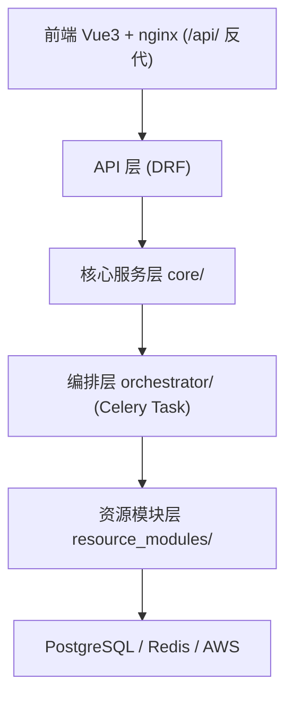
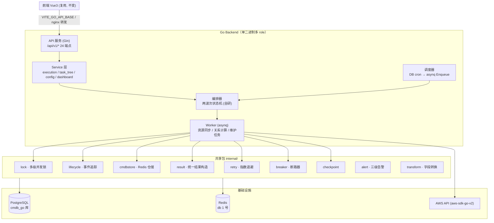
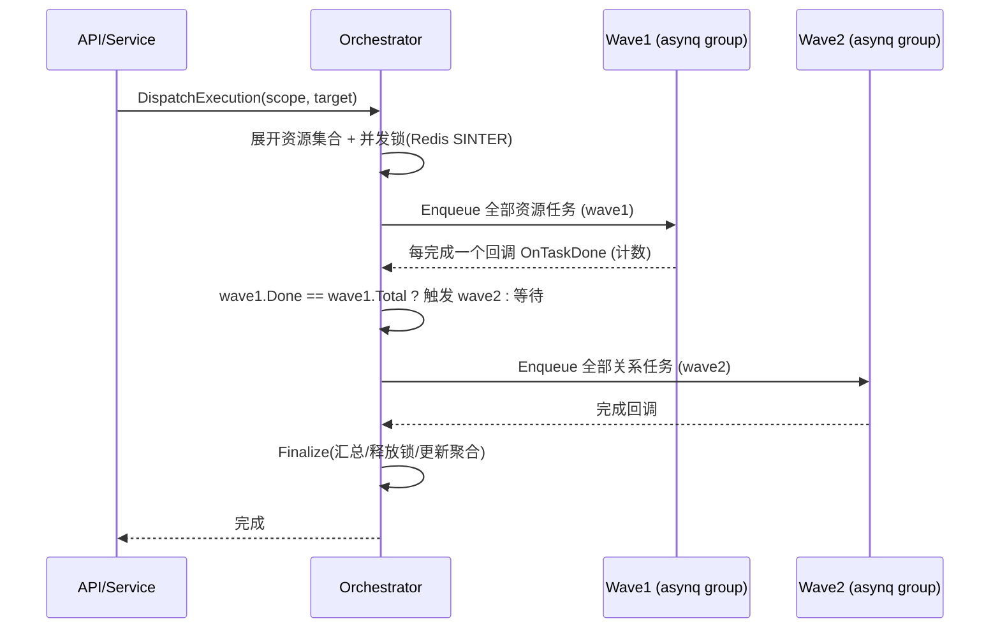

# Go 版 Backend 整体开发方案

> **状态**：草案（待审阅）
> **日期**：2026-08-03
> **定位**：基于现有 Python（Django + Celery）版本的 Go 重写方案，前端复用、同一 API 契约、可一键切换演示
> **契约依据**：`backend/openapi.json`（24 路径 / 0 错误，由 drf-spectacular 生成）

---

## 一、背景与目标

### 1.1 背景

项目为 CMDB 任务管理系统（demo），负责多账号 × 多区域的云资源同步任务编排、调度、执行历史与大盘监控。当前实现为 Python 技术栈（Django + DRF + Celery + Celery Beat），已在 `backend/` 完整落地（约 6,300 行 / 77 文件）。

工作中该版本因架构升级需求被替换为 Go 实现。为面试准备，需沉淀一个 **前端复用、后端可切换（Python ⇄ Go）、契约一致** 的可演示版本。

### 1.2 目标

| # | 目标 | 验收标准 |
|---|------|---------|
| 1 | Go 后端实现与 Python 版功能等价 | 通过 OpenAPI 契约对齐校验（24 端点全通） |
| 2 | 前端零改动切换演示 | 下拉切换后端，页面数据无缝切换 |
| 3 | 核心架构升级可讲 | 两波次编排从"Celery 原语"升级为"自研状态机" |
| 4 | 性能可量化对比 | 同一任务集，Python vs Go 输出耗时/内存对比 |
| 5 | 数据隔离 | Go 与 Python 各自独立库，互不污染 |

### 1.3 非目标（明确不做）

- 不做 Django Admin 等价物（管理功能收敛到前端）
- 不做与前端无关的冗余接口
- 不追求一次性全量迁移（按里程碑渐进落地）

---

## 二、现状分析（Python 版架构回顾）

### 2.1 分层结构



### 2.2 关键设计（Go 版必须等价保留）

| # | 设计 | Python 实现 | Go 版对应方案 |
|---|------|------------|--------------|
| 1 | **两波次编排** | Celery `chord(group, callback)` | 自研编排状态机（见 §6.2） |
| 2 | **多级并发锁** | Redis `SINTER` 交集检测 | go-redis 等价实现（直接移植） |
| 3 | **生命周期追踪** | Celery signals → `lifecycle_events` JSON | asynq Handler Middleware |
| 4 | **两级执行记录** | `ExecutionRecord` 自引用 parent FK | 同表结构，GORM 映射 |
| 5 | **任务树三源合并** | `task_tree_service` | 同逻辑，改 ORM 查询 |
| 6 | **调度层预建占位** | django-celery-beat PeriodicTask | 自研 DB scheduler |
| 7 | **Redis 虚拟 ORM** | `CmdbQuerySet`（Redis LIST + Lock） | go-redis Repository 封装 |
| 8 | **统一结果结构** | `ResultBuilder` | 标准 Go struct + JSON |
| 9 | **容错体系** | RetryEngine + CircuitBreaker + Checkpoint | go-retry / gobreaker + 自研 Checkpoint |
| 10 | **配置层** | AccountRegion 表（模拟 Apollo） | 同表结构 |

### 2.3 代码规模参照

| 层 | 文件 | 行数 | Go 预估 |
|----|------|------|---------|
| api (dashboard/tasks/config/history/docs) | — | 1,556 | 2,500 |
| core（服务层） | — | 2,840 | 4,000 |
| orchestrator（编排） | — | 502 | 1,200 |
| resource_modules（EC2/VPC/RDS） | — | 1,149 | 2,000 |
| config | — | 227 | 400 |
| **合计** | 77 | **6,300** | **~10,000** |

---

## 三、总体架构设计（Go）

### 3.1 目标架构



### 3.2 与 Python 版对照

| 维度 | Python 版 | Go 版 |
|------|----------|-------|
| 进程 | backend + celery_worker + celery_beat（3 容器） | 单二进制多 role：`--role=api` / `--role=worker` / `--role=scheduler`（可 3 容器或 1 容器） |
| 编排 | Celery chord/group/chain 原语 | 自研两波次状态机（Redis 驱动） |
| 队列 | Celery 队列（Redis db0） | asynq（Redis db1） |
| 调度 | django-celery-beat（DB 持久化） | 自研 scheduler（DB 持久化 + cron 解析） |
| ORM | Django ORM + 迁移 | GORM + golang-migrate |
| 序列化 | DRF | struct tag + go-playground/validator |
| AWS | boto3 | aws-sdk-go-v2（官方，原生分页） |
| 断路器 | pybreaker | sony/gobreaker |

### 3.3 进程模型

```
┌──────────────────────────────┐
│  Go Backend (单二进制)        │
│  cmdb-server --role=api      │  → HTTP :8080（Gin，同源反代 / 直连）
│  cmdb-server --role=worker   │  → asynq 消费（资源/关系/维护）
│  cmdb-server --role=scheduler│  → cron 轮询 DB → 投递 asynq
└──────────────────────────────┘
```
- **优势**：部署从 3 个不同运行时镜像收敛为 1 个镜像；交叉编译；内存占用低一个量级。
- **可选**：demo 演示时三 role 可合并在单进程内跑（`--role=all`），便于本地一键起。

---

## 四、技术选型与理由

| 组件 | 选型 | 版本 | 理由 |
|------|------|------|------|
| Web 框架 | **Gin** | v1.9+ | 生态最大、中间件丰富、性能好 |
| ORM | **GORM** | v1.25+ | 开发效率高，贴合"同表结构移植"诉求 |
| 数据库迁移 | **golang-migrate** | v4 | SQL 文件驱动，直接复用现有 DDL |
| 任务队列 | **asynq** | v0.24+ | 成熟、基于 Redis、支持优先级/延迟/周期任务 |
| 调度 | 自研（cron 解析 + DB 持久化） | — | 对齐 django-celery-beat 的"预建占位 + 动态启停"语义 |
| Redis | **go-redis/v9** | v9 | 事实标准 |
| AWS SDK | **aws-sdk-go-v2** | v1 | 官方维护、原生分页 paginator |
| 校验 | **go-playground/validator** | v10 | 请求参数校验 |
| 断路器 | **sony/gobreaker** | v2 | 轻量、成熟 |
| 日志 | **slog**（标准库） | Go 1.21+ | 零依赖，结构化日志 |
| 配置 | **viper** | v1 | 环境变量/文件统一 |
| 测试 | **testify** + httptest | v1 | 断言与 HTTP 测试 |

**关键选型决策（面试可讲）**：
1. **asynq 而非 machinery**：machinery 虽有 group/chord 原语但社区活跃度与生产验证弱于 asynq；asynq 无原语反而促使我们自研编排状态机——这正是"执行与编排解耦"的架构升级点。
2. **GORM 而非 ent**：需要逐字段对齐现有 PostgreSQL 表结构（含 JSON 字段），GORM 的 `mapstructure`/原生 SQL 更贴合；ent 适合 schema 从零设计。
3. **自研调度器**：django-celery-beat 的"PeriodicTask 预建占位 + enabled 开关 + 哨兵 cron"语义简单明确，一张表 + 一个 cron 轮询即可复刻，不值得引入重型调度框架。

---

## 五、目录结构设计

```
go-backend/
├── cmd/
│   └── server/
│       └── main.go              # 入口，--role=api|worker|scheduler|all
├── internal/
│   ├── config/                  # viper 配置加载 + 环境变量
│   ├── model/                   # GORM 模型（对应现有 PostgreSQL 表）
│   │   ├── execution_record.go  # 两级执行记录
│   │   ├── daily_task_stat.go   # 按天聚合
│   │   ├── account_region.go    # 配置层
│   │   └── periodic_task.go     # 调度层
│   ├── api/                     # Gin 路由 + handler（对应 api/ 4 个 app）
│   │   ├── router.go            # /api/v1 路由注册（对照 openapi.json）
│   │   ├── dashboard/
│   │   ├── tasks/
│   │   ├── config/
│   │   └── history/
│   ├── service/                 # 服务层（对应 core/ 服务）
│   │   ├── execution.go         # dispatch_execution 等价
│   │   ├── task_tree.go         # 三源合并
│   │   ├── schedule.go          # 调度管理
│   │   ├── metrics.go           # 大盘统计（对应 metrics_service）
│   │   └── config_svc.go        # 配置层
│   ├── orchestrator/            # 两波次编排状态机
│   │   ├── orchestrator.go      # 顶层编排
│   │   ├── wave.go              # Wave1/Wave2 状态机
│   │   └── registry.go          # 资源注册表（能力层）
│   ├── worker/                  # asynq 任务处理器
│   │   ├── resource_sync.go     # 资源同步（EC2/VPC/RDS）
│   │   ├── relation_task.go     # 关系计算
│   │   └── maintenance.go       # 清理任务
│   ├── pkg/                     # 共享包
│   │   ├── lock/                # 多级并发锁
│   │   ├── lifecycle/           # 生命周期事件
│   │   ├── cmdbstore/           # Redis 虚拟 ORM
│   │   ├── result/              # 统一结果构造
│   │   ├── retry/               # 指数退避重试
│   │   ├── breaker/             # 断路器封装
│   │   ├── checkpoint/          # 断点续跑
│   │   └── alert/               # 三级告警
│   ├── transform/               # 资源字段转换（对应 transform.py）
│   └── resource/                # 资源定义（对应 resource_modules/*）
│       ├── ec2/
│       ├── vpc/
│       └── rds/
├── migrations/                  # golang-migrate SQL（对照现有 Django migrations）
├── scripts/
│   ├── gen_contract.sh          # 从 openapi.json 生成 Go struct 骨架
│   └── perf_compare.sh          # Python vs Go 性能对比脚本
├── go.mod
└── Makefile
```

**依赖方向**：`cmd → internal/api → internal/service → internal/orchestrator → internal/pkg`，禁止反向依赖。

---

## 六、核心模块设计

### 6.1 数据模型（直接复用现有表结构）

| 表 | Python Django 模型 | Go GORM 模型要点 |
|----|-------------------|-----------------|
| `api_history_executionrecord` | ExecutionRecord | 自引用 `ParentID *int64`；`Result/LifecycleEvents/Params` 用 `datatypes.JSON` |
| `api_history_dailytaskstat` | DailyTaskStat | `UniqueIndex(stat_date, module)` |
| `core_accountregion` | AccountRegion | 唯一约束 `(account, region)` |
| 调度表 | django_celery_beat 系列 | 自研 `periodic_tasks` + `crontab_schedules` 两张表 |

> ⚠️ 注意：现有 Django 表名带 app 前缀（`api_history_*`、`core_*`）。Go 版若连独立库（`cmdb_go`），表名可重命名为干净命名（`execution_records` 等）；**若面试希望"连同一库对比"，则必须保持原名**。方案默认：**独立库 + 干净表名**（数据隔离原则）。

### 6.2 两波次编排状态机（核心亮点）

Python 版用 Celery `chord` 表达"先资源后关系"，Go 版自研状态机：

```go
// 状态机：TaskExecution
// 状态流转: PENDING → WAVE1_RUNNING → (全部资源完成) → WAVE2_RUNNING → FINALIZED
//          WAVE1_RUNNING ──(单个资源失败不阻塞, 计 failed)──→ 继续等其余完成
// 实现: Redis Hash 记录 wave1 任务计数 + 完成计数; asynq 任务回调触发检查

type Wave struct {
    ExecutionID string
    Kind        WaveKind // Resource | Relation
    Total       int
    Succeeded   int
    Failed      int
    Done        int
    Callback    string   // 全部完成后回调的编排步骤
}
```



**设计要点**：
- 单资源失败**不阻塞**组：任务返回 `failed` 结果而非抛异常（与 Python 版 `max_retries` 耗尽后返回失败一致）。
- 失败计数驱动状态：`wave1.Failed > 0 && wave1.Succeeded == 0` → 整体 `failed`；部分失败 → `partial`。
- 幂等：任务体以 `execution_id + resource_name` 为幂等键（Redis SETNX），重试不重复建子记录。
- 超时兜底：wave 有最大等待时长，超时进入 `finalize`（标记超时）。

### 6.3 多级并发锁（直接移植）

```go
// 资源 key: "{group}:{resource}" / "{group}:rel:{source}:{target}"
// Redis 结构: cmdb:locks:active(SET) / cmdb:locks:set:{id}(SET) / cmdb:locks:meta:{id}(HASH)
func (m *Manager) Acquire(account, region string, keys []string, scope, target string) (*Lock, error)
//  1. 遍历 active 锁集合，对每个做 SINTER 交集检测 → 有交集返回冲突
//  2. 无交集 → 写入 set/meta + active，TTL 4h 兜底
func (m *Manager) Release(lockID string) error
```
- **与 Python 版协议完全一致**（同一 key 结构），保证双后端不能同时持锁。

### 6.4 生命周期追踪

```go
// asynq Middleware：在 Handler 前后注入事件
func LifecycleMiddleware(next asynq.Handler) asynq.Handler {
    return asynq.HandlerFunc(func(ctx context.Context, t *asynq.Task) error {
        // prerun: append "received"
        err := next.ProcessTask(ctx, t)
        // postrun: err==nil ? append "completed" : append "failed"
        return err
    })
}
// append → UPDATE execution_records SET lifecycle_events = jsonb 追加
```

### 6.5 任务树三源合并

```
GET /api/v1/tasks/tree/
  ① 账号/区域    ← account_regions 表
  ② 资源组/资源/关系 ← registry（代码注册，同 Python 能力层）
  ③ cron 状态    ← periodic_tasks 表（一次批量查询，避免 N+1）
  ④ 锁状态       ← Redis active 锁
```

### 6.6 调度层（复刻预建占位语义）

| 阶段 | enabled | crontab | 行为 |
|------|---------|---------|------|
| 初始化预建 | false | 哨兵（2/31） | 不加载 |
| 前端设置 cron | true | 真实 cron | 正常调度 |
| 前端取消 | false | 哨兵 | 不再调度 |

Scheduler 进程每 30s 扫描 `periodic_tasks`，命中 cron 则向 asynq Enqueue `scheduled_dispatch`。

### 6.7 资源同步管线（对应 sync.py）

```
CMDB 存量读取(cmdbstore) → AWS 采集(aws-sdk-go-v2, paginator) → Diff → 批量写 → Checkpoint
```
- transform：Go struct tag + 显式转换函数（替代 Python descriptor 元编程）
- 关系计算：全局 CMDB 读 → 按关联 key 计算绑定

---

## 七、API 契约（基于 openapi.json）

**权威来源**：`backend/openapi.json`（Go 开发前应重新生成，保证最新）。

| 模块 | 方法 | 路径 | 说明 | 请求体 |
|------|------|------|------|--------|
| Dashboard | GET | `/dashboard/stats/` | 大盘摘要 | — |
| | GET | `/dashboard/workers/` | Worker 池状态 | — |
| | GET | `/dashboard/resource-health/` | 模块健康度 | — |
| | GET | `/dashboard/task-trend/` | 7 天趋势 | — |
| | GET | `/dashboard/health-ranking/` | 健康排行 | — |
| | GET | `/dashboard/current/` | 当前执行中 | — |
| | GET | `/dashboard/recent-events/` | 最近事件 | — |
| | GET | `/dashboard/resource-breakdown/` | 资源构成 | — |
| | GET | `/dashboard/aws-resources/` | AWS 资源树 | — |
| Tasks | GET | `/tasks/tree/` | 任务树 | — |
| | POST | `/tasks/execute/` | 下发同步 | JSON |
| | PUT | `/tasks/schedule/` | 设置/取消 cron | JSON |
| | GET | `/tasks/locks/` | 并发锁 | — |
| | POST | `/tasks/preview/` | 预览 Diff | — |
| | POST | `/tasks/test/run/` | 运行测试任务 | JSON |
| | GET | `/tasks/test/status/{task_id}/` | 测试任务状态 | — |
| | GET | `/tasks/test/file/` | 预览测试文件 | — |
| Config | GET/PUT | `/config/regions/` | 区域配置 | JSON(PUT) |
| | GET | `/config/accounts/` | 账号列表 | — |
| History | GET | `/history/` | 历史列表 | — |
| | GET | `/history/{record_id}/` | 历史详情 | — |
| | POST | `/history/{record_id}/retry/` | 一键重试 | — |
| Docs | GET | `/docs/` | 文档列表 | — |
| | GET | `/docs/{filename}` | 文档内容 | — |

**契约对齐要求**：
- 响应字段、嵌套结构、日期格式（`%Y-%m-%d %H:%M:%S`）、分页格式（`{records, total, page, page_size}`）、409 冲突体必须与 Python 版一致。
- 工具链建议：`oapi-codegen` 从 openapi.json 生成路由与模型骨架，再手工补充字段级结构（OpenAPI 只声明了 OBJECT 的端点需对照 Python 源码补字段）。

---

## 八、数据隔离与部署（与 Python 共存）

### 8.1 隔离方案（demo 足够）

| 资源 | Python 版 | Go 版 |
|------|----------|-------|
| PostgreSQL 实例 | 共用 | 共用 |
| PostgreSQL 库 | `cmdb` | `cmdb_go` |
| Redis 实例 | 共用 | 共用 |
| Redis db 编号 | db 0（Celery 队列/结果/锁/CMDB） | db 1（asynq 队列/锁/CMDB/checkpoint） |

> 要点：Redis 锁的 key 带前缀（`cmdb:locks:*`），即使同 db 也能区分；但**推荐 db 隔离**，避免误共享。

### 8.2 部署形态

```yaml
# docker-compose（新增 go-backend 服务组）
go-backend:
  build: ./go-backend
  command: server --role=all --port=8080
  environment:
    DB_DSN: postgres://cmdb:cmdb_dev@db:5432/cmdb_go
    REDIS_ADDR: redis:6379
    REDIS_DB: "1"
```

### 8.3 前端切换接入

前端已实现下拉切换（`frontend/src/api/index.js` 的 `BACKENDS`）：
- Python：`base: '/api/v1'`（同源反代）
- Go：`base: VITE_GO_API_BASE || 'http://localhost:8080/api/v1'`

**联调要求**：Go 后端需支持 CORS（`Access-Control-Allow-Origin: *`，开发期），或通过 nginx 反代同源。

---

## 九、开发里程碑（分期计划）

### M1 — 骨架与契约（第 1-2 周）
- [x] openapi.json 契约冻结（已完成）
- [ ] 初始化 Go module / 目录结构 / Makefile
- [ ] `oapi-codegen` 生成路由 + 模型骨架
- [ ] 配置加载（viper）、日志（slog）、DB/Redis 连接
- [ ] golang-migrate 建表（`cmdb_go` 库）
- [ ] 健康检查 `/healthz`

### M2 — 主链路 API（第 3-4 周）
- [ ] `tasks/tree/`（三源合并）
- [ ] `tasks/execute/`（派发 + 并发锁 + 父记录）
- [ ] `history/` 列表/详情/重试
- [ ] `config/regions|accounts`
- [ ] `dashboard/stats`（聚合表）
- **验收**：前端切 Go 后主链路页面（任务管理/执行历史/大盘概览）可用

### M3 — 编排与 Worker（第 5-7 周）
- [ ] 两波次编排状态机（§6.2）
- [ ] asynq worker：EC2/VPC/RDS 资源同步
- [ ] 关系计算任务
- [ ] 生命周期 Middleware
- [ ] 调度器（预建占位 + cron）
- **验收**：下发区域级任务，真实跑通 Wave1→Wave2→Finalize，历史记录/生命周期/锁状态完整

### M4 — 完整性打磨（第 8-10 周）
- [ ] 剩余 dashboard 端点（recent-events/breakdown/aws-resources/workers）
- [ ] 测试任务（test/run、test/status、test/file）
- [ ] docs 端点
- [ ] 单元测试 + 契约对齐测试（对照 openapi.json）
- [ ] Docker/K8s 部署文件
- **验收**：24 端点全通，前端全页面可用

### M5 — 性能对比与文档（第 11-12 周）
- [ ] `scripts/perf_compare.sh`：同任务集 Python vs Go 对比（耗时/内存）
- [ ] 架构对照文档（面试叙事）
- [ ] 稳定性压测（并发下发、锁冲突、异常恢复）

> **降档路径**（时间紧张时）：跳过 M4 中 test/docs 的完整实现（返回兼容 stub），主链路保证即可演示。

---

## 十、工作量与人力估算

| 里程碑 | 单人全职 | 2 人团队 |
|--------|---------|---------|
| M1 骨架 | 2 周 | 1 周 |
| M2 主链路 API | 2 周 | 1 周 |
| M3 编排 + Worker | 3 周 | 1.5 周 |
| M4 完整性 | 3 周 | 1.5 周 |
| M5 对比 + 文档 | 2 周 | 1 周 |
| **合计** | **~12 周（3 个月）** | **~6 周（1.5 个月）** |

> 前提：开发者熟悉 Go + Gin + asynq。若同时熟悉现有 Python 代码语义，可再压缩 20%。

---

## 十一、风险与对策

| # | 风险 | 影响 | 对策 |
|---|------|------|------|
| 1 | 两波次状态机并发竞争（计数/回调顺序） | 编排错乱 | Redis 原子操作（INCR/HGETALL）+ 幂等键；M3 专项测试 |
| 2 | 契约字段级对齐遗漏 | 前端渲染异常 | M4 引入契约对齐测试（请求/响应 golden file）；响应先对照 Python 源码 |
| 3 | asynq 重试语义与 Celery 不一致 | 行为差异 | 明确重试策略映射：Celery `max_retries` ↔ asynq `Retry` + 自研退避 |
| 4 | 双后端同时操作同一 Redis 锁/CMDB | 数据污染 | db 隔离 + 锁协议一致；演示时明确"同时只开一个" |
| 5 | 前端 fallback 掩盖后端错误 | 联调误判 | 切换后用浏览器 Network 面板确认请求真实落到 8080 |
| 6 | 范围蔓延（想做全） | 延期 | 严守"主链路优先"，test/docs 允许 stub |

---

## 十二、验收标准

1. **契约**：Go 后端通过 `scripts/contract_check.sh`（基于 openapi.json 的 smoke 测试），24 端点全部 200。
2. **功能等价**：下发 region/group/resource/relation 四级任务，历史记录、生命周期、锁、聚合统计与 Python 版一致。
3. **切换演示**：前端下拉切 Go → 任务管理/执行历史/大盘全部渲染真实数据。
4. **性能对比**：同一任务集（如 EC2 全量同步），输出耗时/内存对比表。
5. **健壮性**：并发下发冲突返回 409；单资源失败不阻塞组；断点续跑可用。

---

## 附录 A：依赖清单（go.mod 草案）

```
github.com/gin-gonic/gin
gorm.io/gorm
gorm.io/driver/postgres
github.com/golang-migrate/migrate/v4
github.com/hibiken/asynq
github.com/redis/go-redis/v9
github.com/aws/aws-sdk-go-v2
github.com/aws/aws-sdk-go-v2/config
github.com/aws/aws-sdk-go-v2/service/ec2
github.com/aws/aws-sdk-go-v2/service/rds
github.com/aws/aws-sdk-go-v2/service/sts
github.com/go-playground/validator/v10
github.com/sony/gobreaker
github.com/spf13/viper
github.com/stretchr/testify
github.com/oapi-codegen/oapi-codegen/v2  (代码生成工具)
```

## 附录 B：面试叙事（三阶段演进）

1. **Python 版**：Celery chord 表达两波次 → 功能完整、可演示
2. **架构升级驱动**：高并发吞吐 / 低资源占用 / 部署简化 → 技术选型对比
3. **Go 版**：asynq + 自研状态机 → "执行与编排解耦"架构升级 + 契约驱动 + 性能对比
   - 亮点话术："前端零改动，切换后端即可对比同一契约下两套实现的性能差异"
