# 菜单导航重新设计 · 深度分析

> 版本：v1.1（2026-08-04）
> 状态：✅ 已实施（菜单重构 + 黑盒能力显性化）
> 范围：现有系统能力盘点 → 问题诊断 → 业界参考 → 菜单重设计方案 → 实施记录

---

## 一、现有系统能力全景盘点

### 1.1 后端已实现能力

| 模块 | 能力 | 前端页面 | 状态 |
|------|------|----------|------|
| `processes` | 流程定义 CRUD / 发布 / 停用 | `ProcessDefinitionList` / `Editor` | ✅ 可用 |
| `processes` | 流程实例 / 节点任务 / 审批记录 / 时间线 | `TaskList` / `TaskDetail` | ✅ 可用 |
| `processes` | FlowChecker 流程检查（6 类检查） | `FlowCheckPanel` | ✅ 可用（新增） |
| `tickets` | 工单类型 / 工单生命周期 / 评论 / 通知 | `TicketCreate` / `List` / `Detail` | ✅ 可用 |
| `capabilities` | 能力注册 + Mock/HTTP 执行器 | `CapabilityList` | ⚠️ 半成品（schema 未可视化、无调试） |
| `capabilities` | TaskJob 任务执行记录 | **无** | 🔴 黑盒 |
| `events` | EventLog 事件日志 | **无** | 🔴 黑盒 |
| `events` | Webhook 订阅 / 投递记录 | **无**（前端 admin.js 有 API 但未接通） | 🔴 黑盒 |
| `accounts` | 用户 / 部门 / 角色 | `UserList` / `DepartmentList` | ✅ 可用 |
| `common` | AIConfig + AI 表单生成（6 模型） | FormBuilder 抽屉内 | ⚠️ 无独立管理入口 |

### 1.2 前端 API 层已具备但未接通的调用

- `admin.js`：`getWebhooks / createWebhook / testWebhook`（后端 events 实际路由是 `webhook-subscriptions`，**路径对不上，处于悬空状态**）
- `capability.js`：`getTaskJobs / getTaskJob / getTaskJobLogs`（后端已有 `task-jobs` 路由，前端无页面消费）
- `ticket.js`：`updateTicketStatus / closeTicket / reopenTicket`（部分被 TicketDetail 使用）

---

## 二、现有菜单问题诊断

当前菜单结构：

```
首页
流程配置            ← 一级菜单直接是"配置"
发起工单            ← 一级菜单直接是"操作"
我的工单
待办任务
系统管理
  ├─ 能力管理
  ├─ 用户管理
  └─ 部门管理
```

**问题清单：**

1. **层级混乱**：一级菜单混着"功能操作"（发起工单）与"列表"（我的工单），无业务分类
2. **办理维度不全**：已办、抄送我、我发起的都藏在 `TaskList` 的 Tab 里，无独立入口
3. **任务平台缺失**：能力注册、任务执行记录、Webhook、事件日志这些"自动化/集成"能力没有入口，全部是黑盒
4. **配置入口分散**：工单类型、通知、AI 配置、流程分组均无管理入口
5. **命名不统一**：已有"流程配置"但菜单仍叫"流程配置"与页面 title 混用"模版"

---

## 三、业界参考（工单 / 审批平台能力模型）

参考 Jira、ServiceNow ITSM、飞书审批、钉钉 OA、ONES、Tapd 等主流平台，一个成熟的工单平台通常分 **8 层能力**：

```mermaid
graph TD
    A[工作台] --> A1[待办汇总]
    A --> A2[快捷入口]
    A --> A3[数据概览]
    B[流程办理] --> B1[发起申请]
    B --> B2[我的申请]
    B --> B3[待办审批]
    B --> B4[已办审批]
    B --> B5[抄送我的]
    C[流程配置] --> C1[流程分组]
    C --> C2[流程定义]
    C --> C3[表单设计]
    C --> C4[审批策略]
    D[任务平台] --> D1[任务中心/执行记录]
    D --> D2[能力注册/连接器]
    D --> D3[定时任务]
    D --> D4[任务编排]
    E[集成中心] --> E1[Webhook]
    E --> E2[事件日志]
    E --> E3[API 令牌]
    F[组织权限] --> F1[用户/部门/角色]
    F --> F2[操作审计]
    G[数据分析] --> G1[流程效率]
    G --> G2[工单统计]
    G --> G3[人员负载]
    H[系统设置] --> H1[通知]
    H --> H2[参数]
    H --> H3[AI 配置]
```



---

## 四、能力矩阵（当前 vs 业界）

### 4.1 已有且可用 ✅

- 流程引擎（定义/实例/任务/审批记录）
- 流程设计器（Beeflow）+ 表单设计器（form-create）+ 流程检查
- 工单全生命周期（类型/创建/分配/处理/解决/关闭/评论）
- AI 表单生成（小米/OpenAI/DeepSeek/智谱/通义/Ollama）
- 组织架构（用户/部门/角色）

### 4.2 后端已实现但前端是"黑盒"——**最值得先展示出来** 🔴

| 能力 | 后端现状 | 建议前端落地 |
|------|----------|--------------|
| **任务执行记录（TaskJob）** | 完整：状态机/输入/输出/错误/耗时 | 任务中心：列表 + 详情 + 执行日志 + 重试 |
| **事件日志（EventLog）** | 完整：全链路事件（process/task/ticket） | 事件审计：按类型/实例/时间查询 |
| **Webhook 订阅 + 投递** | 完整：订阅/secret/签名/投递状态 | Webhook 管理：订阅 CRUD + 投递日志 + 测试 |
| **通知（Notification）** | 完整：类型/已读/批量已读 API | 通知中心：顶栏铃铛 + 未读角标 |
| **能力 Schema** | input/output JSON Schema | 能力详情：Schema 可视化 + 输入表单化调试执行 |

### 4.3 业界有、当前缺失（可规划）🟡

| 能力 | 说明 | 依赖 |
|------|------|------|
| 流程分组管理 | `ProcessDefinition.group_id` 已加字段，但无分组表/CRUD | 新建 `FlowGroup` 模型 |
| 定时任务 | 已部署 celery beat + django-celery-beat，可做 Cron UI | 复用现有基础设施 |
| 操作审计日志 | 谁在何时改了流程/工单/配置 | 中间件 + 审计模型 |
| 报表统计 | 流程平均耗时 / 工单按类型/优先级分布 / 人员负载 | 聚合 API + 图表 |
| 工单类型管理 | 后端已有 `TicketType` CRUD，无前端页面 | 简单列表页 |
| 消息模板 / 公告 | 审批通知内容模板化 | 新建模型 + 页面 |
| 流程版本历史 | `version` 字段已存在，无版本对比 | 版本列表 + diff |
| 超时催办执行逻辑 | 字段已加（timeout_hours/action），无调度执行 | Celery 定时扫描 |

---

## 五、菜单重设计方案（建议）

### 5.1 目标结构

```
┌─ 工作台 ──────────────────────────────────────────────
│  首页 /dashboard               待办汇总、快捷入口、统计
│
├─ 流程办理（全员）─────────────────────────────────────
│  发起申请   /apply             选择已发布流程发起
│  我的申请   /my/applications   我发起的（含草稿/进行中/已撤回）
│  待办审批   /my/todo           待我处理
│  已办审批   /my/done           我已处理
│  抄送我的   /my/cc             抄送给我
│
├─ 流程配置（管理员）───────────────────────────────────
│  流程分组   /admin/flow-groups      分组维护
│  流程配置   /admin/process-definitions
│  表单模板   /admin/form-templates   （规划）
│
├─ 任务平台（自动化/集成）──────────────────────────────
│  任务中心   /admin/task-jobs        执行记录/日志/重试
│  能力注册   /admin/capabilities     连接器 + Schema + 调试
│  定时任务   /admin/schedules        （规划，celery beat）
│
├─ 集成中心 ────────────────────────────────────────────
│  Webhook 订阅 /admin/webhooks       订阅 CRUD + 投递日志
│  事件日志   /admin/events           全链路事件审计
│
├─ 组织权限 ────────────────────────────────────────────
│  用户管理   /admin/users
│  部门管理   /admin/departments
│  角色管理   /admin/roles
│
└─ 系统设置 ────────────────────────────────────────────
   工单类型   /admin/ticket-types
   通知中心   /notifications
   AI 配置    /admin/ai
   操作日志   /admin/audit-logs   （规划）
```

### 5.2 设计原则

1. **按业务域分类**：办理（人人可用）→ 配置（管理员）→ 平台（集成/自动化）→ 系统（运维）
2. **办理类以"我的视角"命名**：申请/待办/已办/抄送，符合用户心智
3. **黑盒能力显性化**：TaskJob、EventLog、Webhook、Notification 全部给入口
4. **旧路由兼容**：`/tickets/new` `/tickets` `/tasks` `/process-definitions` 保留并重定向，避免破坏已有链接
5. **按角色显隐**（规划）：普通用户只见"工作台+流程办理"，管理员才见配置/平台/系统

### 5.3 待确认决策点

- [x] 分类层级：采用 7 个一级分类
- [x] 实施范围：菜单重构 + 黑盒能力页面全做
- [x] 角色显隐：基于 `is_staff` 实现（普通用户仅见工作台+流程办理）
- [x] 旧路由：保留并重定向到新路由

---

## 六、实施记录（v1.1）

### 6.1 后端改动

| 文件 | 改动 |
|------|------|
| `config/urls.py` | Django Admin 迁移到 `/django-admin/`，释放 `/admin/*` 给前端 |
| `apps/processes/views.py` | `NodeTaskViewSet` 支持 `?type=todo\|done\|cc\|created` 用户视角过滤 + `my` action；`ProcessInstanceViewSet` 支持 `?mine=1` |
| `apps/capabilities/views.py` | `Capability.test`（调试执行）、`TaskJob.stats`、`TaskJob.execute`（重试） |
| `apps/capabilities/services/executor.py` | Mock 编码兼容点号/下划线 |
| `apps/tickets/views.py` | `NotificationViewSet` 默认按当前用户过滤 + `my` action（含 unread_count） |

### 6.2 前端改动

| 文件 | 改动 |
|------|------|
| `router/index.js` | 全新 7 分类路由 + 旧路由重定向 |
| `views/layout/AppLayout.vue` | 7 分类侧边栏 + `is_staff` 角色显隐 + 通知铃铛（未读角标，60s 轮询） |
| `views/process/ApplyPage.vue` | 发起申请（选流程→填表→提交） |
| `views/process/MyApplications.vue` | 我的申请（基于流程实例） |
| `views/task/ApprovalTaskList.vue` | 统一审批列表（todo/done/cc 三模式） |
| `views/admin/TaskJobList.vue` | 任务中心（统计/列表/详情/重试） |
| `views/admin/WebhookList.vue` | Webhook 订阅 CRUD + 投递日志抽屉 |
| `views/admin/EventLogList.vue` | 事件日志（类型筛选 + payload 详情） |
| `views/notification/NotificationCenter.vue` | 通知中心（类型 Tab + 已读管理） |
| `views/admin/TicketTypeList.vue` | 工单类型管理 |
| `views/admin/RoleList.vue` | 角色管理 |
| `views/admin/AiConfigPage.vue` | AI 配置独立页 |
| `views/admin/CapabilityDetail.vue` | 能力详情（Schema 可视化 + 输入表单化 + 调试执行） |
| `views/admin/CapabilityList.vue` | 重写匹配后端模型（execute_mode/endpoint/input_schema） |
| `api/modules/events.js` `notifications.js` `ticket-types.js` | 新增 API 模块 |
| `api/modules/admin.js` | 修复悬空路径（/admin/* → 实际路由） |
| `frontend/docker/nginx.conf` | `/admin/` 代理改为 `/django-admin/` |

### 6.3 验证

- 前端 Docker 构建通过
- Django `manage.py check` 通过
- 浏览器端到端：菜单 7 分类渲染、普通用户角色显隐、发起申请/我的申请/待办审批/任务中心/Webhook/事件日志/通知中心/AI 配置/能力详情调试 全部可用
- 旧路由 `/tickets` `/tasks` `/process-definitions` 重定向正常
- 后端接口：task-jobs/stats、notifications/my、node-tasks?type、capabilities/test 全部正常

### 6.4 遗留（可规划）

- [ ] 流程分组管理（FlowGroup 模型 + CRUD，`ProcessDefinition.group_id` 已预留）
- [ ] 定时任务 UI（celery beat 已就绪）
- [ ] 操作审计日志
- [ ] 报表统计（流程效率 / 工单分布 / 人员负载）
- [ ] 流程版本历史与对比
- [ ] 超时催办调度执行逻辑（字段已加）
