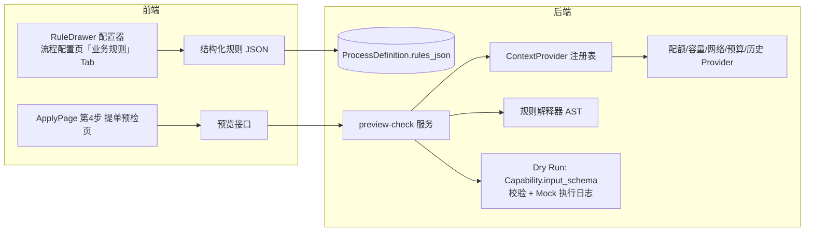

# 业务规则引擎实施计划（方案 B · 结构化 AST）

> 版本：v1.1（2026-08-12）
> 状态：✅ 已完成（阶段一~四，浏览器端到端验证通过）
> 前置文档：`docs/09-流程配置优化工作总结.md`、`plans/下一轮开发计划.md`
> 交互原型：`docs/design-drafts/demo-rule-config.html`（规则配置器 Demo）、`docs/design-drafts/demo-biz-precheck.html`（业务预检 + Dry Run Demo）

---

## 实施完成记录（2026-08-12）

| 阶段 | 内容 | 验证 |
|------|------|------|
| 一 | 后端：`rules_json` 字段 + migration、`context.py`（ContextProvider 注册表）、`rules.py`（AST 解释器）、`rule_meta.py`、`preview.py`（base+rules+dryrun）、`rule-meta`/`preview-check`/`submit-check` 接口、`flow_checker` 规则校验 | shell + HTTP 验证：正常/拦截/警告场景均正确；4 流程 check errors=0 |
| 二 | 前端：`RuleMeta.js`、`RuleDrawer.vue`（配置器）、`RulePanel.vue`（规则列表）、编辑页新增「业务规则」步骤 | 浏览器实测：5 条规则回显、新增配置器数据源分组（表单字段+上下文指标）、保存/编辑/删除可用 |
| 三 | ApplyPage 扩展 4 步（提单预检第 4 步）：汇总横幅 + 基础校验折叠 + 业务规则命中 + 审批路径办理节点点击查看 Dry Run；提交前 `submitCheck` 权威复检 | 浏览器实测：拦截场景（预检未通过禁用提交）+ 通过场景（全部通过可提交）均正确；提交成功跳转 |
| 四 | 4 流程示例规则：server_apply 5 条、permission_apply 2 条、new_service_apply 1 条 | FlowChecker 规则配置校验 errors=0 |

---

## 一、背景与目标

### 1.1 背景

现有表单基础校验（必填 / 范围 / 枚举 / 联动）在表单配置层已被前端拦截、后端兜底，价值有限。用户更关心**业务性 / 复杂规则校验**：开机器前的配额检测、容量预留、网络可达、部门预算、规格合理性、重复申请等——这类判断目前散落在业务代码里，无法配置、无法审计、无法热更新。

### 1.2 目标

1. 提供一套**表单化配置的业务规则引擎**：不写表达式，下拉选数据源 → 选操作符 → 填/引用参考值
2. 规则数据化（可入库 / 可审计 / 可灰度 / 可热更新），后端权威求值
3. 落地为「提单预检 + 流程 Dry Run」：提单第 4 步展示预检结果与办理节点模拟执行
4. 能力输入约束（`Capability.input_schema`）自动纳入校验，零配置

### 1.3 非目标（明确不做）

- ❌ 不做企业级 BRMS（Drools 等）——对轻量预检过度
- ❌ 规则不做真实执行动作（只做预检/提醒；权威校验由后端 `submit_check` 兜底）
- ❌ 不做需要真实执行才能判断的规则（只能 DRY 预演）
- ❌ 不做跨系统实时联动决策 / 高并发实时计费

---

## 二、方案选型：B（结构化 AST）

### 2.1 选型结论

| 方案 | 结论 | 理由 |
|------|------|------|
| A. JSON Logic | 作为**后端求值载体**可复用 | 通用标准、可转可审计；但前端不直接暴露 |
| **B. 结构化 AST（主）** | ✅ **采用** | 前端配置器直接产出 `{source, op, ref}` 结构，与现有 `ConditionDrawer` 交互天然衔接；自定义操作符灵活 |
| C. 受限 DSL | 仅作**兜底**（高级表达式） | 现有 `evaluate_condition` 保留，不承担主规则形态（eval 风险 / 不可审计） |
| D. CEL | 不引入 | 需新依赖，与现有配置器耦合度低 |
| E. 决策表 | 预留进阶 | 规则量 >20 条且非技术维护时再考虑，底层仍是 B |
| F. 代码即规则 | 用于**平台内置权威校验** | `submit_check` 核心判定用 Python 策略写死，职责分离 |

### 2.2 规则数据形态（前端存储 / 后端求值）

```jsonc
// 每条规则
{
  "id": "RULE-001",
  "name": "部门配额检测",
  "level": "error",                 // error=提交拦截 / warning=提醒附注
  "message": "部门 CPU/内存配额不足",
  "suggestion": "请先申请扩容配额或释放资源",
  "groups": [                        // 多组 = 或
    [                                // 组内 = 且
      {
        "source": "cpu",             // 数据源（表单字段或上下文指标）
        "op": ">",                   // 操作符
        "refType": "field",          // fixed=固定值 / field=引用字段/指标
        "fixed": null,               // refType=fixed 时
        "refField": "dept.cpu_quota.remaining",  // refType=field 时
        "offset": 0                  // 参考值偏移（如容量预留 -8）
      }
    ]
  ]
}
```

- **数据源字典**：`表单字段`（来自 `form_schema`）+ `业务上下文指标`（由 ContextProvider 暴露）
- **操作符**（按数据源类型动态提供）：
  - 数字/金额：`>` `>=` `<` `<=` `==` `!=`
  - 枚举/文本：`==` `!=` `contains` `not_contains`
  - 数组（可达列表等）：`in` `not_in`
  - 扩展预留：`matches`（正则）等，引擎侧注册表可增
- **后端求值**：解释器遍历 AST 直接求值；如需标准化/审计，可派生输出 JSON Logic 快照存留

---

## 三、总体架构



---

## 四、后端设计

### 4.1 数据模型（轻量，不建独立表）

| 项 | 方案 | 说明 |
|----|------|------|
| 规则存储 | `ProcessDefinition` 新增 `rules_json` 字段（JSONField, default=list） | 规则随流程定义一起版本化、一起发布，最贴合现有模型 |
| 上下文指标 | **ContextProvider 注册表**（代码注册，不落库） | 各 provider 暴露指标名/类型/说明/取值函数 |

> 独立 `RuleSet` 表仅当需要"规则跨流程复用 / 多版本规则灰度"时再引入（预留演进路径，本期不做）。

**Provider 注册表接口约定（伪代码）**：

```python
@context_provider(name="quota")
def quota_provider(context):        # context: 表单数据 + 发起人 + 流程
    dept = get_dept_quota(context.initiator)
    return {
        "dept.cpu_quota.remaining": dept.cpu_quota_remaining,
        "dept.mem_quota.remaining": dept.mem_quota_remaining,
    }

@context_provider(name="budget")
def budget_provider(context):
    return {"dept.budget_remaining": get_dept_budget_remaining(...),
            "estimate.cost_month": estimate_cost(context.form)}

# 指标字典（给前端配置器做下拉）：名称 / 标签 / 类型 / 单位 / provider
```

### 4.2 规则解释器

| 文件 | 职责 |
|------|------|
| `apps/processes/services/rules.py`（新增） | AST 求值：`evaluate_rules(rules, data) -> [RuleResult]`；数据源解析（`form.` 兜底同 Demo）；操作符分派；多组 OR / 组内 AND |
| `apps/processes/services/context.py`（新增） | ContextProvider 注册表 + 聚合快照：`build_context(definition, form_data, user) -> dict` |
| `apps/processes/services/flow_checker.py` | 规则配置校验：数据源是否存在、操作符是否合法、参考值是否完整、field 引用是否存在 |

**求值结果结构**：

```jsonc
{ "rule_id": "RULE-001", "name": "部门配额检测", "level": "error",
  "passed": false, "message": "…", "suggestion": "…",
  "detail": { "matched": ["申请CPU核数 大于 部门剩余CPU配额(8)"], "data": {…} } }
```

### 4.3 预检接口

| 接口 | 方法 | 说明 |
|------|------|------|
| `POST /process-definitions/{id}/preview-check/` | 新增 | 入参 `{form_data}`；返回 `{ base: [基础校验], rules: [RuleResult], dryrun: [节点任务结果], summary: {…} }` |
| `POST /process-definitions/{id}/preview-path/` | 已有 | 保留（审批路径预览） |
| `GET  /process-definitions/{id}/rule-meta/` | 新增 | 返回数据源字典（表单字段 + 上下文指标 + 操作符），供前端配置器下拉 |

### 4.4 Dry Run 模拟执行

- 遍历流程定义中的办理节点（type:handle）绑定的能力任务
- 对每个能力：用 `Capability.input_schema` 校验输入（必填 / 类型 / 枚举 / 范围）→ 通过则 Mock 执行并产日志（复用 `TaskJob.logs` 结构：`{time, level, msg}`）
- 前序失败则后续动作标记「待确认 / 跳过」
- 输出 `dryrun` 结构（对齐 Demo：任务卡片 + 输入/输出/日志 + 状态）

### 4.5 提交权威校验（防绕过）

- 新增 `submit_check`（提交前权威复检）：调用同一套规则求值 + schema 校验，error 级规则命中则拒绝提交
- 规则引擎负责「预检/提醒」，`submit_check` 负责「权威兜底」，两者共用同一解释器

---

## 五、前端设计

### 5.1 规则配置器（RuleDrawer）

| 文件 | 说明 |
|------|------|
| `frontend/src/components/flow/drawer/RuleDrawer.vue`（新增） | 复用 `ConditionDrawer` 交互范式：规则名称 / 条件组（多条件=且、多组=或）/ 数据源下拉（分组：表单字段+上下文指标）/ 操作符（按类型联动）/ 参考值（固定值 ↔ 引用字段/指标 + 偏移）/ 级别 / 命中提示 / 建议 |
| `frontend/src/components/flow/common/RuleMeta.js`（新增） | 数据源字典、操作符表、AST↔JSON Logic 派生、人话生成（`groupsHuman`）——从 Demo 迁移 |
| `frontend/src/views/process/ProcessDefinitionEditor.vue` | 新增「业务规则」Tab（步骤条内）：规则列表卡片 + 新增/编辑/删除 + 模拟检测（改表单值实时命中） |

**配置器能力边界（来自 Demo，已实机验证）**：
- 数据源 = 表单字段 + 上下文指标（各带类型/单位/provider 说明）
- 参考值支持「固定值」「引用字段/指标」「字段对字段 + 偏移」（容量预留 `申请内存 > 资源池可用内存 − 8`）
- 多条件 = 且、多条件组 = 或
- 级别：错误（提交拦截）/ 警告（提醒附注）
- 实时预览：人话 + 底层 JSON Logic（可展开查看）

### 5.2 提单预检页（ApplyPage 第 4 步）

| 项 | 说明 |
|----|------|
| 入口 | `ApplyPage.vue` 3 步向导 → 扩展为 4 步（选择流程 → 填写表单 → 审批路径预览 → **提单预检与预演**） |
| 内容 | 汇总横幅（通过/警告/错误）+ 基础校验（折叠）+ **业务规则命中列表**（规则卡片：ID/级别/命中条件/建议）+ 审批路径（办理节点可点击）+ **该节点 Dry Run 任务**（输入/输出/日志） |
| 数据 | `preview-check` 接口返回；前端仅展示，提交按钮在 error 命中时禁用 |

---

## 六、实施阶段与任务拆分

### 阶段一：后端（规则引擎 + 预检 API）【预估 3 天】

| # | 任务 | 涉及文件 | 验证清单 |
|---|------|---------|---------|
| 1 | `ProcessDefinition` 增加 `rules_json` 字段 + migration | `models.py`、`migrations/` | 迁移成功，字段默认 `[]` |
| 2 | ContextProvider 注册表 + 4 个 Provider（配额/容量/网络/预算/历史） | `services/context.py` 新增 | shell 调 `build_context` 返回指标快照 |
| 3 | 规则解释器 `evaluate_rules`（AST 求值 + form. 兜底 + 自定义操作符） | `services/rules.py` 新增 | shell 用 6 条示例规则（对齐 Demo）验证命中/通过 |
| 4 | `rule-meta` 接口（数据源字典 + 操作符） | `views.py`、`serializers.py` | 返回表单字段 + 上下文指标分组 |
| 5 | `preview-check` 接口（rules + dryrun + summary） | `views.py`、`services/preview.py` 新增 | 对齐 Demo 场景：正常 / 配额网络预算拦截 / 规格预算警告 |
| 6 | Dry Run：能力 schema 校验 + Mock 日志 | `services/dryrun.py` 新增、`capabilities/models.py` | 输入超范围 / 缺必填 → 预检失败 + 日志；前序失败跳过 |
| 7 | 规则配置校验（flow_checker 扩展）+ `submit_check` 权威复检 | `flow_checker.py`、`services/submit_check.py` | 错误级命中拒绝提交（API 级验证） |

### 阶段二：前端规则配置器【预估 2 天】

| # | 任务 | 涉及文件 | 验证清单 |
|---|------|---------|---------|
| 1 | `RuleMeta.js`（数据源字典/操作符/人话/JSON Logic） | `common/RuleMeta.js` 新增 | 从 Demo 迁移，单测通过 |
| 2 | `RuleDrawer.vue` 配置器 | `drawer/RuleDrawer.vue` 新增 | 新增/编辑/删除规则；固定值 ↔ 引用字段切换；实时预览 |
| 3 | 编辑页「业务规则」Tab | `ProcessDefinitionEditor.vue` | 规则列表 + 新增规则保存到 `rules_json`；回显 |
| 4 | 模拟检测（改表单值实时命中） | `ProcessDefinitionEditor.vue` | 对齐 Demo 联动效果 |

### 阶段三：提单预检接入 + 端到端【预估 2 天】

| # | 任务 | 涉及文件 | 验证清单 |
|---|------|---------|---------|
| 1 | `ApplyPage` 扩展第 4 步（预检 + 办理节点 Dry Run） | `ApplyPage.vue` | 4 步向导；error 命中禁用提交 |
| 2 | 4 个流程配置示例业务规则（server_apply 配额/容量/网络/预算/规格；permission_apply 授权校验等） | `seed` 或配置页操作 | 每个流程预检场景正确 |
| 3 | 端到端：提单 → 预检拦截 → 修改 → 通过 → 提交 → 流转 | 浏览器实测 | 全链路走通 |

### 阶段四：收尾【预估 1 天】

| # | 任务 | 说明 |
|---|------|------|
| 1 | 预警规则（L4）示例落地 | 规格建议、重复申请作为 warning 附注 |
| 2 | 审计与灰度预留 | 规则命中日志落 `ApprovalRecord` 或独立审计表（本期可先落日志） |
| 3 | 文档归档 | 更新 `docs/09`、本文档验收状态；决策记录入库 |

> **总计预估：8 天**。优先级：阶段一（后端）→ 阶段二（配置器）→ 阶段三（提单接入）。阶段四可并行。

---

## 七、能力边界（实现时守住）

| 层 | 规则类型 | 配置方式 | 说明 |
|----|---------|---------|------|
| L1 | 表单内（必填/范围/枚举/联动） | 表单配置层 | 前端拦截 + 后端兜底 |
| L2 | 表单 × 上下文（数值/字段对字段/包含/聚合） | **RuleDrawer** | 核心价值 |
| L3 | 能力输入约束 | `input_schema` 声明即得 | 零配置 |
| L4 | 预警类（不阻断附注） | RuleDrawer 级别=警告 | 提交附注 |
| ❌ | 真实执行判断 / 跨系统实时决策 / 高并发计费 | — | 不做 |

---

## 八、验收标准

1. 配置器：纯下拉表单化配置一条规则，全程不写表达式；多条件/多组/固定值/字段引用/偏移均可用
2. 后端：`preview-check` 对 3 个场景（正常/拦截/警告）返回与 Demo 一致的结果
3. 权威校验：绕过前端直接调提交接口，error 规则命中被拒绝
4. 提单页：第 4 步展示规则命中 + 办理节点 Dry Run；error 命中禁用提交
5. 4 个流程均配置 ≥2 条业务规则并跑通端到端

---

## 九、风险与决策记录

| # | 决策项 | 结论 |
|---|--------|------|
| 1 | 规则引擎方案 | **B 结构化 AST**（主）+ A JSON Logic（求值/审计载体）+ C DSL（兜底）+ F 代码即规则（权威校验） |
| 2 | 规则存储 | `ProcessDefinition.rules_json`（随定义版本化）；独立 `RuleSet` 表预留演进 |
| 3 | 上下文指标 | ContextProvider 注册表（代码注册），本期不落库 |
| 4 | 求值安全 | 解释器遍历 AST，**不用 eval**；DSL 兜底仍走受限白名单 |
| 5 | 权威校验 | `submit_check` 与规则引擎共用解释器，防绕过 |
| 6 | 交互原型 | `docs/design-drafts/demo-rule-config.html` / `demo-biz-precheck.html` 为最终实现参考基准 |
