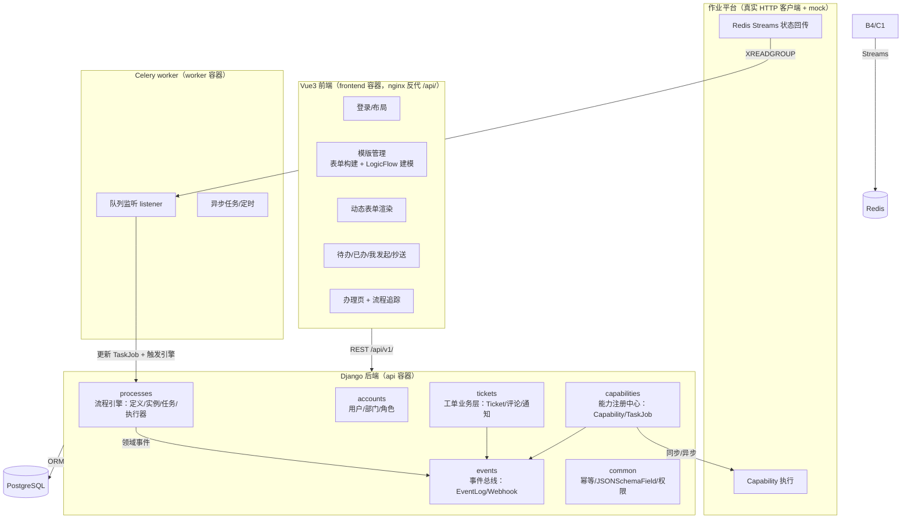

# 工单系统 Demo 项目实施计划

> 版本：v1.0（2026-08-03）
> 状态：待审查
> 前置文档：`docs/01-行业调研报告.md`、`docs/02-差距分析.md`、`docs/03-系统设计方案.md`

---

## 一、项目定位与目标

### 1.1 产品定位（一句话）

> **流程驱动的业务自动化平台**：以流程为载体、以原子能力为执行单元、以自动办理为效率手段，帮助用户"把事办成"——而不仅仅是"把流程走完"。

### 1.2 与 ITSM 的差异（面试必讲）

| 维度 | 本系统（业务自动化平台） | ITSM（ServiceNow/Jira SM） |
|---|---|---|
| 核心价值 | **自动执行、提效**：帮用户做事 | **服务管理**：管好 IT 服务 |
| 核心抽象 | 表单 + 流程节点 + 原子能力 | 服务目录 + 工单生命周期 + SLA |
| 主角 | 原子能力与自动办理 | 状态机与队列分派 |
| 典型场景 | 申请服务器自动开通、自动执行任务 | 故障恢复、服务请求、受控变更 |

**关系**：两者不冲突——审批/办理本质是"状态机里的特殊等待态"。本系统以流程驱动为主，吸收 ITSM 的工单生命周期、优先级、评论、通知作为增强。

### 1.3 项目目标

1. 复刻并升级旧版工单系统的全部核心能力（见 `docs/02-差距分析.md`）
2. 落地行业最佳实践：状态机、定义/实例分离、会签/或签语义、流程变量、事件驱动、幂等、能力契约化
3. 形成可演示、可讲述、可扩展的面试 demo（含演示剧本与 seed 数据）
4. 沉淀一套"能力开发规范"（复刻旧版四层结构 + JSON Schema 契约 + 脚手架）

### 1.4 非目标（明确不做）

- ❌ 完整 BPMN 2.0 引擎（并行网关 AND、事件补偿、Token 树）
- ❌ ITSM 的 SLA 计时、服务目录、升级机制（SLA 暂缓）
- ❌ 移动端、邮件/IM 集成（仅预留 Webhook 扩展点）
- ❌ 高可用、水平扩展、分布式事务（demo 用单事务 + 幂等演示）

---

## 二、已确认决策记录

| # | 决策项 | 结论 | 来源 |
|---|---|---|---|
| 1 | 语言/框架 | Python + Django 5 + DRF | 用户 |
| 2 | 前端 | **完整 Vue 3 前端**，选型由 AI 决定 | 用户 |
| 3 | 部署 | Docker Compose + OrbStack（postgres/redis/api/celery/frontend） | 用户 |
| 4 | 作业平台 | 真实 HTTP 客户端（接口抽象 + mock 备用） | 用户 |
| 5 | ITSM 增强 | 基础版：优先级 + 评论 + 站内通知；SLA 暂缓 | 用户 |
| 6 | 工单建模 | 独立 Ticket 业务层，经 business_key 关联 ProcessInstance | 用户 |
| 7 | 流程引擎 | **自研轻量引擎**（JSON 节点模型 + 状态机执行器），API 对齐行业标准（可替换） | 讨论 |
| 8 | 并行能力 | 会签（流程内并行）做扎实；**服务节点多能力并行编排：支持但不侧重** | 讨论 |
| 9 | 审批人解析 | 完整保留动态审批人体系：直属/上级 N 级/指定/角色/表单字段/兜底 | 用户旧版 |
| 10 | 自动办理 | 策略驱动 + 审计留痕；随机代理保留为策略之一（责任人模型） | 讨论 |
| 11 | 能力开发 | 复刻旧版四层结构 + JSON Schema 契约 + 脚手架 | 用户旧版 |
| 12 | 队列监听 | Redis Streams + 独立 worker + XACK + 重试 + 死信 + 幂等 | 讨论 |
| 13 | 条件路由 | 条件路由（命中条件 + 默认路径）= BPMN 排他网关语义 | 用户旧版 |
| 14 | 前端组件 | LogicFlow（流程建模）+ **form-create / form-create-designer（表单配置与渲染）** + Element Plus | AI 决策 |
| 15 | 开发节奏 | **一次性做完**，最后统一审查 | 用户 |

---

## 三、技术选型

### 3.1 后端

| 用途 | 选型 | 说明 |
|---|---|---|
| Web 框架 | Django 5 + DRF | 用户熟悉 |
| 认证 | djangorestframework-simplejwt | JWT |
| API 文档 | drf-spectacular | OpenAPI 3.1 |
| 状态机 | django-fsm + django-fsm-log | 生命周期 FSM + 审计日志 |
| 动态表单校验 | jsonschema[format] | JSON Schema 2020-12 |
| 异步任务 | celery[redis] + django-celery-beat | 队列监听、超时扫描 |
| 队列/Streams | redis | 作业平台状态回传 |
| 权限 | django-guardian | 对象级权限 |
| 筛选 | django-filter | 列表查询 |
| 数据库 | PostgreSQL（psycopg） | 生产一致 |
| HTTP 客户端 | requests | 作业平台 HTTP 调用 |

### 3.2 前端

| 用途 | 选型 | 说明 |
|---|---|---|
| 框架 | Vue 3 + Vite + JavaScript | 简单直接 |
| UI | Element Plus | 表格/表单/布局 |
| 状态 | Pinia + Vue Router + Axios | 标准栈 |
| 流程建模 | **LogicFlow**（滴滴开源） | 自定义节点对应 JSON 节点模型 |
| 表单设计器 | **form-create-designer** | 可视化拖拽配置表单（中文文档，基于 Element Plus） |
| 表单渲染 | **form-create** | 设计器配套渲染器，开箱即用 |
| 表单校验 | `jsonschema`（后端） | 转换层：form-create 规则 ↔ 标准 JSON Schema |

> 决策理由：流程建模器（拖拽画图）是前端最难点，必须用开源（LogicFlow）；表单配置（设计器 + 渲染器）用 form-create 体系——现成可视化设计器省掉最大开发量、中文文档友好。代价是 form-create 使用自家 rule JSON 而非标准 JSON Schema，需一层**转换层**（设计器规则 → 标准 JSON Schema 存储/校验 → 渲染），转换层同时是可讲的工程点。若动工时验证 form-create 的 Vue3 兼容性有问题，退回"自研轻量渲染器 + 字段式编辑器"。

### 3.3 部署（OrbStack 规范）

```
服务：postgres / redis / api(Django+gunicorn) / worker(celery worker+beat) / frontend(nginx 反代 /api/)
域名：api.workflow.orb.local、frontend.workflow.orb.local（dev.orbstack.domains 标签）
.env：COMPOSE_PROJECT_NAME=workflow
ALLOWED_HOSTS 包含 frontend 域名（nginx 反代传 Host）
同源访问，无 CORS
```

---

## 四、总体架构



---

## 五、核心概念与设计决策

### 5.1 流程引擎（自研轻量，可替换）

- **模型本质是 DAG**（节点 + 边 + 条件，保证无环）——呼应"用 DAG 重构"的行业说法
- JSON 节点模型对标钉钉/飞书：`start / approve / handle / service / cc / condition / end`
- **引擎 API 对齐行业标准**（`start`/`complete`/`claim`/`delegate`/`suspend`/`resume`/`terminate`/`rejectTo`），保持可替换性——上生产可无缝接 Camunda/Temporal（"引擎是可替换组件"的行业思想）
- 定义（静态）与实例（运行时）分离 + **版本化**（key+version 唯一，实例绑定启动版本，发布后不可变）

### 5.2 状态机（两层 FSM + 引擎推进）

| 对象 | 状态 | 管理方式 |
|---|---|---|
| Ticket（业务） | 新建→待分派→处理中→已解决→已关闭（+取消/重开） | django-fsm，显式迁移规则 |
| ProcessInstance（流程） | running / suspended / completed / terminated | django-fsm |
| NodeTask（任务） | pending / claimed / completed / cancelled / skipped | 枚举 + 引擎单事务校验 |

> 核心原则：**状态是引擎执行的结果投影，不是散落的状态判断**；流程推进在**单个数据库事务**内完成（锁行→校验→记录→会签计数→推演→生成任务）。

### 5.3 会签/或签（多实例 + 完成条件）

| mode | 语义 | 完成条件 |
|---|---|---|
| single | 单人 | 1 个任务完成 |
| countersign | 会签（全部通过） | completed == total 且全部通过 |
| or_sign | 或签（任一通过） | completed >= 1 且任一通过 |
| sequential | 依次审批 | 顺序生成子任务 |
| percent | 百分比通过（扩展） | completed >= total * p% |

实现：`NodeTask` + `TaskInstance`（子任务表）+ 实例级计数。

### 5.4 条件路由（= 排他网关语义）

- 节点类型 `condition`：按配置顺序求值 `branches[].condition`，命中第一条走对应 `next`；都不命中走 `else_next`（默认路径）
- 条件表达式：基于表单字段/流程变量，`{amount} > 10000`，支持比较运算、逻辑与或（表达式解析器）
- 与 BPMN 排他网关 XOR + default flow 语义一致

### 5.5 审批人解析（动态审批人，国内特色）

```json
{"type": "specified", "users": ["u1"]}            // 指定人员
{"type": "manager_level", "level": 1}             // 发起人第 N 级主管
{"type": "department_manager"}                     // 指定部门主管
{"type": "role", "role": "cfo"}                    // 角色
{"type": "field", "field": "approver"}             // 表单字段指定
{"type": "initiator_choice", "candidates": [...]}  // 发起人自选
// 所有类型均支持 fallback（兜底人），解析失败兜底，避免任务掉黑洞
```

### 5.6 流程变量传递（恢复旧版被阉割能力）

- `ProcessInstance.variables`：全局变量（表单数据 + 节点输出）
- 服务节点输出写入变量；条件分支、下游节点入参引用 `{var}`

### 5.7 自动办理（策略驱动 + 审计留痕）

```json
{ "auto_handle": true, "auto_policy": "auto_approve"|"random_proxy"|"condition_auto",
  "auto_condition": "{amount} <= 1000", "auto_result": "approve" }
```

- 满足条件 → 系统代理执行 + 审计记录（"Auto-approved by policy #X" / "proxy by policy #X 抽取了谁"）
- 随机代理保留为 `random_proxy` 策略（责任人模型：一致性 + 可追溯 + 失败可人工介入）
- 服务节点本就自动化，直接创建 TaskJob 执行

### 5.8 能力注册中心（复刻旧版四层结构）

| 旧版四层 | demo 对应 |
|---|---|
| 任务注册文件 | `Capability` 注册 + `input_schema`（JSON Schema 契约） |
| 参数检查文件 | `jsonschema` 校验 |
| 参数转换层 | 能力实现内声明式转换器 |
| 任务定义层 | `Capability.code` + 绑定实现 |

- 内置原子能力：`cmdb.create_host`、`dns.add_record`、`mail.send`、`external.approve` 等（本地 Python 实现 + mock 异步）
- 脚手架：`manage.py makecapability` 一键生成能力模块骨架
- **服务节点多能力并行编排**：一个 service 节点可配置多个能力，无依赖并行提交（异步），有依赖串行——**支持但不侧重**

### 5.9 同步/异步任务与作业平台

- `TaskJob` 记录（job_id、status、输入/输出快照、sync/async）
- 同步：调用后等待结果，更新节点状态
- 异步：提交后立即返回，节点转"办理中"，等队列回传
- `JobPlatformClient` 接口：`HttpJobPlatformClient`（真实 HTTP，可配置 URL）+ `MockJobPlatformClient`（备用）
- **状态以 DB 为准，队列只投递，Worker 幂等**

### 5.10 队列监听（at-least-once + 幂等 + 死信）

- Redis Streams 消费组（XREADGROUP）+ 手动确认（XACK）
- 独立 Celery worker 进程（隔离，防拖垮主服务）
- 失败重试（指数退避）→ 多次失败进**死信队列（DLQ）** → 定时重放
- 消费者幂等：以 DB 状态为准

### 5.11 事件总线

- 领域事件：`ticket.created/completed/terminated`、`task.created/claimed/completed/rejected`、`job.submitted/succeeded/failed`
- `EventLog` 全量记录（流程追踪时间线数据源）
- 订阅者：审计（django-fsm-log）、站内通知、Webhook（HMAC 签名 + 重试 + 幂等键）

### 5.12 权限（RBAC + 对象级）

- 角色：admin（管理员）/ agent（代理/办理人）/ user（普通用户）
- 数据范围：待办=assignee/候选；已办=completed_by；我发起=started_by；抄送=cc_users；管理员=全部
- 对象级：django-guardian（查看/办理权限）

### 5.13 幂等设计

- 写操作支持 `Idempotency-Key` 请求头（中间件）
- 任务完成：任务 ID + 状态校验 + 行锁防重复
- 程序提单：`business_key` 唯一约束，重复发起返回已存在实例

---

## 六、功能模块与数据模型

### 6.1 模块划分（Django apps）

```
backend/apps/
├── accounts/      用户（自定义 User）、部门（上级链）、角色（Group）
├── processes/     流程引擎：ProcessDefinition/Instance/NodeTask/TaskInstance/ApprovalRecord + 执行器
├── tickets/       工单业务：TicketType/Ticket/Comment/Notification + ITSM 状态机
├── capabilities/  能力注册：Capability/TaskJob + 执行器 + 内置原子能力 + makecapability 脚手架
├── jobplatform/   作业平台：JobPlatformClient 接口 + HTTP/mock 实现 + 队列监听
├── events/        事件总线：EventLog/WebhookSubscription/Delivery + 订阅者
└── common/        幂等中间件、JSONSchemaField、权限、异常
```

### 6.2 核心数据模型

```
ProcessDefinition: key, name, version, status(draft/published/disabled),
                   definition_json(JSON), form_schema(JSON Schema), created_by
ProcessInstance:   definition, instance_no(WO+日期+序号), status(FSM), current_node_key,
                   variables(JSON), business_key(唯一), started_by, started_at, ended_at
NodeTask:          instance, node_key/name/type, assignee, candidate_users(JSON),
                   status, result(approve/reject/submit), opinion, due_at, countersign(JSON), 时间戳
TaskInstance:      task, assignee, status, result, opinion   （会签子任务）
ApprovalRecord:    instance/task, user, action, opinion      （只增不改）
Capability:        code, name, description, input_schema(JSON), output_schema(JSON),
                   execute_mode(sync/async), endpoint, is_active
TaskJob:           instance/task, capability, job_id, status(queued/running/succeeded/failed),
                   input_data/output_data(JSON), sync, error_message, 时间戳
TicketType:        code, name, priority_matrix(JSON, 可选)
Ticket:            ticket_type, instance(OneToOne), form_data(JSON),
                   status(FSM: 新建/待分派/处理中/已解决/已关闭/已取消), priority, title
Comment:           ticket, user, content, visibility(internal/external)
Notification:      user, type, title, content, is_read
EventLog:          instance/task(可空), type, payload(JSON), created_at
WebhookSubscription/Delivery: url, events, secret; attempt, status, last_response
Department:        name, parent(上级链), manager(主管)
User(自定义):      username, department, groups(角色)
```

---

## 七、API 设计概览（/api/v1/）

```
认证：POST /auth/token/（JWT）

流程引擎：
  POST   /processes/{key}/start             启动（前端提单/程序提单，支持 business_key + Idempotency-Key）
  GET    /process-definitions/              模版列表（含版本）
  POST   /process-definitions/              创建/发布模版（发布后不可变）
  GET    /instances/                        实例列表（我发起/全部）
  GET    /instances/{id}/                   实例详情（表单 + 变量 + 状态）
  GET    /instances/{id}/timeline           流程追踪时间线
  POST   /instances/{id}/suspend|resume|terminate

任务：
  GET    /tasks?scope=todo|done|cc|created  待办/已办/抄送/我发起
  GET    /tasks/{id}/                       任务详情（含表单 + 可操作）
  POST   /tasks/{id}/claim|complete|delegate|reject

能力：
  GET    /capabilities/                     能力注册列表（办理节点可绑定）
  GET    /task-jobs/{id}/                   异步任务状态查询（前端轮询）

工单：
  GET/POST /tickets/                        工单列表/发起
  GET    /tickets/{id}/                     详情
  POST   /tickets/{id}/comments/            评论（internal/external）
  GET    /notifications/                    站内通知

管理：
  users / departments / roles / webhook-subscriptions

OpenAPI：GET /api/v1/schema/（swagger-ui）
```

---

## 八、前端方案

### 8.1 页面结构

```
/login                    登录
/                         首页（统计卡片）
/process-definitions       模版列表（新建/编辑/发布/查看版本）
/process-definitions/new   模版编辑器：基本信息 + form-create 表单配置 + LogicFlow 流程建模
/tickets/new               发起工单（选模版 → 动态表单 → 提交）
/tickets                   我发起的工单列表 + 详情/流程追踪
/tasks?tab=todo|done       待办/已办（办理页：表单只读 + 审批操作 + 意见）
/tasks?tab=cc              抄送我的
/admin/capabilities        能力管理（列表）
/admin/users|departments   用户/部门管理
```

### 8.2 关键组件

1. **表单配置**（模版编辑器内）：接入 **form-create-designer** 可视化拖拽配置表单，生成 form-create 规则
2. **表单渲染**：接入 **form-create** 渲染规则；**转换层**将 form-create 规则 ↔ 标准 JSON Schema（存储与后端校验用 JSON Schema）
3. **LogicFlow 建模器**：自定义节点（start/approve/handle/service/cc/condition/end），节点点击弹出配置面板（审批人/会签模式/条件/能力绑定/自动办理），导出 JSON 节点模型
4. **流程追踪**：基于 EventLog 的时间线（步骤 + 状态 + 操作人 + 时间）

---

## 九、目录结构

```
workflow/
├── docker-compose.yml
├── .env / .env.example
├── README.md
├── docs/                    # 调研/差距分析/设计文档
├── plans/                   # 本计划
├── backend/
│   ├── manage.py / requirements.txt / Dockerfile
│   ├── config/              # settings(base/dev/prod) / urls / wsgi / asgi
│   ├── apps/                # accounts/processes/tickets/capabilities/jobplatform/events/common
│   ├── scripts/             # 演示脚本（自动跑通完整流程）
│   ├── seed/                # 初始数据（用户/角色/部门/能力/演示模版）
│   └── capabilities/scaffold_templates/   # makecapability 脚手架模板
└── frontend/
    ├── package.json / vite.config.js / Dockerfile
    ├── docker/nginx.conf    # 反代 /api/ → api 容器
    └── src/
        ├── api/             # axios 封装
        ├── router/ stores/ views/ components/
        ├── components/FormBuilder/         # form-create-designer 封装（表单配置）
        ├── components/FormRenderer/        # form-create 封装（表单渲染）
        ├── components/SchemaConverter/     # form-create 规则 ↔ JSON Schema 转换层
        └── components/FlowModeler/         # LogicFlow 封装
```

---

## 十、里程碑与任务分解

> 开发节奏：**一次性做完**（M1→M7 顺序实施，最后统一审查）。以下任务分解是开发顺序，非中途审查点。

### M1 项目骨架与基础设施

**任务**
1. Docker Compose（OrbStack 规范）+ .env + nginx 反代配置
2. Django 项目 + settings 分环境 + URL 结构 + apps 骨架
3. 自定义 User 模型 + Department + JWT 认证 + 角色（Group）
4. drf-spectacular OpenAPI + 幂等中间件 + 统一异常
5. 前端 Vue3 + Vite + Element Plus 工程 + 登录/布局/路由

**验收**：`docker compose up` 后 api/frontend 可访问；JWT 登录成功；swagger 可看；前端可登录跳转首页

### M2 流程引擎核心（最重要）

**任务**
1. 模型：ProcessDefinition / ProcessInstance / NodeTask / TaskInstance / ApprovalRecord
2. 状态机：Instance（FSM）、Task（枚举）
3. 执行器：`start`/`complete`/`claim`/`delegate`/`reject`/`suspend`/`resume`/`terminate`（单事务）
4. 审批人解析器（6 种类型 + 兜底）
5. 条件路由求值器（表达式解析）
6. 会签/或签/依次/百分比（多实例计数）
7. 流程变量读写
8. 引擎 API + 序列化器 + 权限校验

**验收**：curl 跑通"发起→串行审批→条件分支→会签/或签→完成"完整流程；非法流转被拒绝；审批记录完整

### M3 能力中心与异步

**任务**
1. 模型：Capability / TaskJob
2. 能力开发规范落地（四层结构）+ 内置原子能力（cmdb.create_host 等，含 mock 异步）
3. `makecapability` 脚手架命令
4. 本地执行器（同步）+ 作业平台 HTTP 客户端 + mock 客户端
5. Redis Streams 队列监听（独立 worker + XACK + 重试 + 死信）
6. 服务节点多能力并行编排（支持不侧重）
7. 自动办理（策略 + 随机代理 + 审计）
8. TaskJob 状态查询 API

**验收**：同步能力即时完成；异步能力经 mock 作业平台 + 队列回传自动推进流程；自动办理审计完整；死信可见

### M4 工单业务层

**任务**
1. 模型：TicketType / Ticket（ITSM 状态机）/ Comment / Notification
2. JSON Schema 表单校验（JSONSchemaField）
3. Ticket 生命周期 API（新建/分派/处理中/解决/关闭/取消/重开）
4. 待办/已办/我发起/抄送查询（数据范围）
5. 权限：RBAC（角色×权限点）+ guardian（对象级）
6. 优先级 + 评论（internal/external）+ 通知

**验收**：三种角色权限正确；Ticket 状态机流转合规；评论内外可见性正确

### M5 事件与审计

**任务**
1. EventBus + EventLog（全量领域事件）
2. 订阅者：审计 / 站内通知 / Webhook
3. WebhookSubscription / Delivery（签名 + 重试 + 幂等）
4. 流程追踪时间线 API（基于 EventLog）

**验收**：任意操作可查完整事件链；webhook 可投递且重试正常；时间线完整

### M6 前端

**任务**
1. 技术验证：form-create / form-create-designer 的 Vue3 + Element Plus 兼容性（失败退回自研渲染器方案）
2. 接入表单设计器（form-create-designer 可视化配置表单）
3. 接入表单渲染器（form-create）+ 转换层（form-create 规则 ↔ 标准 JSON Schema）
4. LogicFlow 流程建模器（自定义节点 + 配置面板 + JSON 导出）
5. 模版管理页（列表/新建/编辑/发布/版本）
6. 发起工单页（选模版→填表→提交）
7. 任务办理页（表单只读 + 审批/办理操作 + 意见 + 会签展示）
8. 待办/已办/抄送/我发起列表
9. 工单详情 + 流程追踪时间线
10. 管理后台（用户/部门/能力）

**验收**：浏览器完成"配置模版→发起→审批→自动办理→抄送→追踪"完整演示

### M7 演示与收尾

**任务**
1. seed 数据（用户/角色/部门/能力/2-3 个演示模版）
2. 演示脚本（`scripts/demo.py` 自动跑通完整流程 + 程序提单 + 幂等演示）
3. README（架构说明 + 快速开始 + 面试要点）
4. 全链路回归 + 整体审查

**验收**：`docker compose up` 后按演示剧本一键演示成功

---

## 十一、演示剧本（面试用）

1. **登录**：admin / agent / user 三种角色
2. **配置**：admin 创建"服务器申请"模版——表单（主机名/CPU/金额/用途）+ 流程（部门审批[会签] → 金额条件[>1万走 CFO] → 自动开通[异步能力] → 抄送管理员）
3. **发起**：user 填表提交 → 生成工单（WO 单号）+ 待办
4. **审批**：agent 认领 → 会签审批（演示多实例）
5. **条件路由**：小金额直通自动开通；大金额进 CFO
6. **自动办理**：异步能力 → TaskJob 状态回传 → 流程自动推进（演示提效价值）
7. **抄送**：管理员收到抄送 + 站内通知
8. **追踪**：查看流程时间线（EventLog）
9. **程序提单**：API 以 business_key 发起（幂等演示）
10. **权限**：非处理人看不到/不能办别人的任务

---

## 十二、种子数据（seed）

| 类别 | 内容 |
|---|---|
| 用户 | admin / agent1..3（运维组）/ user1..3（业务组）/ cfo |
| 部门 | 技术部（IT 运维组/研发组）/ 财务部，含上级链 + 主管 |
| 角色 | admin / agent / user（Group） |
| 能力 | cmdb.create_host（异步 mock）、dns.add_record（同步）、mail.send（同步）、external.approve（异步） |
| 模版 | 服务器申请（含条件/会签/自动办理）、权限开通（简单串行）、故障报修（ITSM 生命周期演示） |

---

## 十三、风险与开放问题

| 风险/问题 | 应对 |
|---|---|
| LogicFlow 接入成本（前端最难点） | 建模器是独立组件，先行技术验证；失败可退化为"JSON 流程编辑 + 预览" |
| django-fsm 3.x 与 Django 版本兼容 | 锁定已验证版本组合，requirements 精确 |
| 一次性做完范围大 | 任务按 M1-M7 顺序推进，核心引擎优先保证质量 |
| 前端工作量 | 已用开源组件压缩（LogicFlow + form-create 体系）；表单配置/渲染基本零开发，页面自研组装 |
| form-create Vue3 兼容性 | M6 先行技术验证；失败退回自研轻量渲染器 + 字段式编辑器 |
| 作业平台真实 HTTP 无真实服务 | mock 平台提供确定性演示，HTTP 客户端保留集成能力 |
| 面试讲述侧重（架构 vs 实现） | 代码注释 + docs 双轨：核心引擎注释详尽，架构讲解放 docs |

---

## 十四、面试讲述要点（沉淀）

1. **架构认知**：定义/实例分离 + 版本化；状态机驱动而非状态字段；引擎可替换（API 对齐行业标准）
2. **流程引擎原理**：Token 思想、会签/或签 = 多实例 + 完成条件、条件路由 = 排他网关 + 默认流
3. **自动化提效**：能力注册中心（契约化）、同步/异步任务、队列监听（at-least-once + 幂等 + 死信）、自动办理（策略 + 审计）
4. **旧版改进叙事**：状态字段→状态机；阉割的输出→流程变量；随机抽人→策略+审计；失去开放性→JSON Schema 前后端共用
5. **工程能力**：能力开发规范（四层结构 + 脚手架）、事件驱动解耦、幂等设计、RBAC + 对象级权限
6. **行业视野**：BPMN 2.0 五大元素、钉钉/飞书 JSON 节点模型、ITSM 差异、为什么 Python 生态没有商用 BPM 引擎
