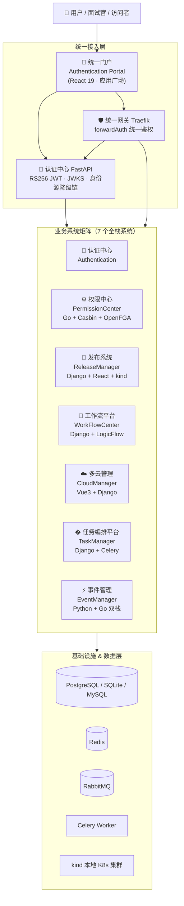
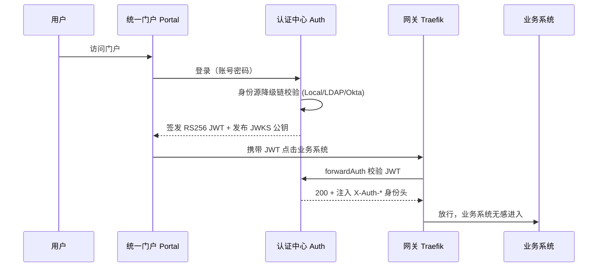
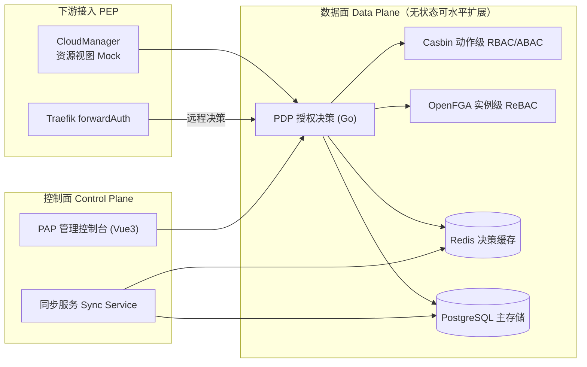
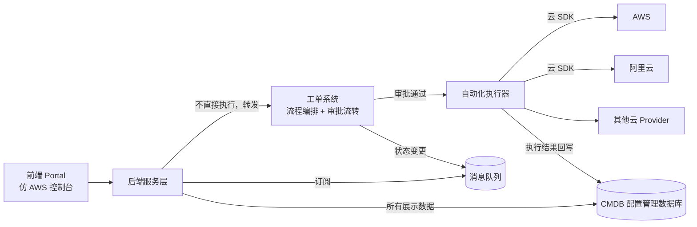
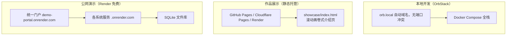

# DevOps 平台合集 —— 整体架构图

> 本文档是 DevOpsPlatform 全家桶的逻辑架构总览，含多层视图。
> 动态交互版见 [showcase/index.html](../showcase/index.html)。

---

## 1. 系统全景（总览视图）

---

## 2. 认证与统一访问视图

---

## 3. 权限中心（IAM）外部化授权视图

---

## 4. 多云管理（CloudManager）操作治理视图

> 核心设计：**前端/后端不直接调云 API**，所有资源变更先走工单审批，保证合规与留痕；**CMDB（云管资源视图）为系统内唯一数据源**，保证多页面数据一致。

> **平台数据边界原则**：各业务系统**数据自治**——共享同一 PostgreSQL 实例、**逻辑库隔离**（devops_event / devops_cmdb / …），互不直读直写；系统间只通过平台网关 API 交互，调用方身份由统一认证中心 JWT 标识。资源管理内置在 CloudManager 内（本图及各技术梳理文档中的 “CMDB” 均指**云管资源视图**，Demo 以多态资源表模拟）；**不引入独立 CMDB 系统**——生产权威 CMDB 为独立平台（如蓝鲸配置平台，一云一模型集分组管理），云管在其之上做汇聚读模型，**读写分离：云管拥有视图，权威源拥有真相**。

---

## 5. 部署形态视图

---

## 6. 技术栈矩阵

| 层级 | 技术选型 |
|------|----------|
| 前端 | React 19 / React 18 / Vue 3 · Ant Design / Element Plus · Vite · LogicFlow |
| 后端 | Python（FastAPI / Django / DRF / Ninja）+ Go（Gin / GORM）+ Celery |
| 网关 | Traefik（forwardAuth 统一鉴权） |
| 认证 | RS256 JWT + JWKS · SSO · OIDC · 身份源降级链（Local / LDAP / Okta） |
| 授权 | Casbin（RBAC/ABAC）· OpenFGA（ReBAC）· PEP/PDP 外部化授权 |
| 数据库 | SQLite / PostgreSQL / MySQL |
| 缓存/消息 | Redis · RabbitMQ · Celery Beat |
| 容器编排 | Docker Compose · OrbStack · kind（本地 K8s） |

---

## 7. 各系统详情入口

| 系统 | 架构文档 |
|------|----------|
| Authentication | [docs/02-系统架构设计.md](../Authentication/docs/02-系统架构设计.md) |
| CloudManager | [docs/02-系统架构设计.md](../CloudManager/docs/02-系统架构设计.md) |
| EventManager | [README](../EventManager/README.md) |
| PermissionCenter | [docs/architecture.md](../PermissionCenter/docs/architecture.md) |
| ReleaseManager | [SPEC.md](../ReleaseManager/SPEC.md) |
| TaskManager | [README](../TaskManager/README.md) |
| WorkFlowCenter | [docs/03-系统设计方案.md](../WorkFlowCenter/docs/03-系统设计方案.md) |
