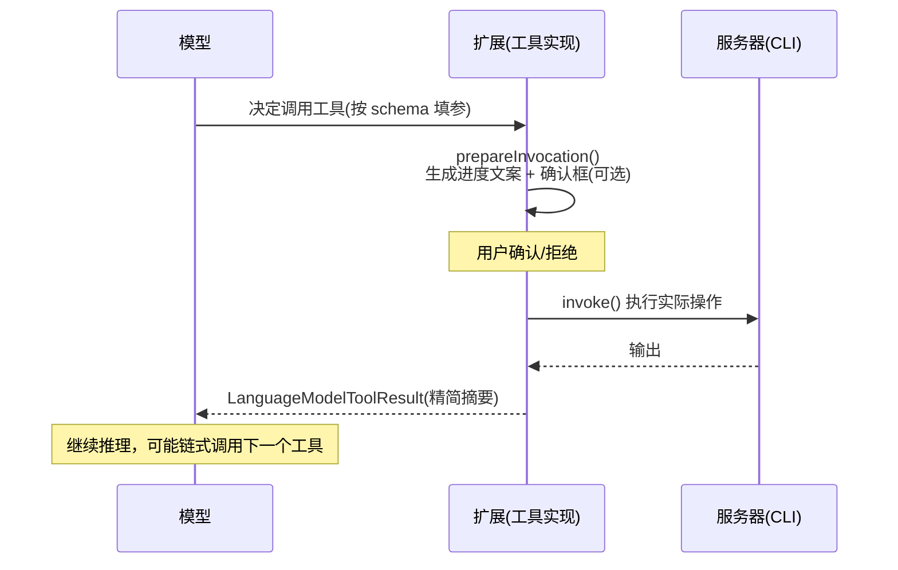
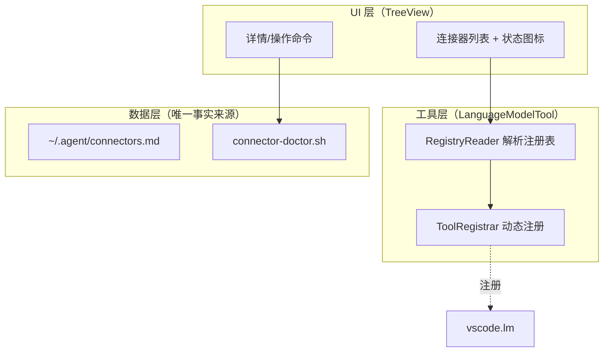

# VS Code 连接器管理插件开发指导

> 版本：v1.0（2026-09-05）
> 状态：待审阅
> 前置阅读：`docs/lark-cli-飞书文档操作调研.md`（§8 连接器统一管理方案）
> 目标读者：本插件开发者（AI Agent 或人工）

---

## 1. 目标与定位

### 1.1 要解决的问题

- VS Code Copilot 没有 Trae 式的"连接器面板"，Agent 跨对话/跨项目不知道服务器装了哪些能力（lark-cli 等）
- 每次新对话都要人工告知"服务器有 lark-cli"，不稳当、不便利
- 未来会装更多连接器（Notion、Confluence…），需要统一管理

### 1.2 插件的三重价值（按优先级）

1. **工具注册（核心价值）**：通过 `LanguageModelTool` API 把连接器的高频操作注册为 Copilot Agent 可**自主调用**的结构化工具。模型靠工具描述获得能力感知，从根上消除"人工告知"
2. **显式面板**：侧边栏 TreeView 展示已注册连接器及健康状态，接近 Trae 体验
3. **一键注册**：点击即可把新连接器写入三件套（注册表 + instructions + doctor 脚本）

### 1.3 设计红线（不可违背）

- **注册表是唯一事实来源**：插件不建私有存储，启动时解析 `~/.agent/connectors.md` 渲染面板、注册工具。插件卸载后三件套体系依然完整
- **插件只跑在服务器端**：它要操作的注册表、脚本、CLI 全在远程服务器上
- **写操作必须过确认**：所有有副作用的工具调用必须实现 `confirmationMessages`

---

## 2. 核心机制：LanguageModelTool API 详解

### 2.1 它是什么

VS Code 官方开放的工具注册协议（`vscode.lm` 命名空间）。扩展注册工具后：

- Copilot Chat（Agent/Ask 模式）的模型自动"看见"该工具（name + description + inputSchema）
- 模型在对话中**自主决定**何时调用、如何填参
- VS Code 执行扩展的 `invoke()`，结果以 `LanguageModelToolResult` 喂回模型继续推理
- 用户也可用 `#工具名` 语法显式引用强制调用

这正是 Copilot 内置工具（读文件/跑终端）的同款机制。

### 2.2 工具生命周期



要点：

- `prepareInvocation` **必须无副作用**，且被调用不代表一定会 `invoke`（用户可能拒绝）
- `toolInvocationToken` 来自 Chat 请求时传入，用于在聊天界面展示进度与确认框；独立调用传 `undefined`
- 工具内部可再调用其他已注册工具（传递同一个 token）

### 2.3 注册签名（准确版）

```typescript
const disposable = vscode.lm.registerTool<T>('tool_name', {
  // —— 元信息：模型靠这三样决定何时/如何调用 ——
  description: string,          // 写清"做什么 + 何时用 + 何时不用"
  inputSchema: object,          // JSON Schema，参数描述要具体
  tags?: string[],              // 能力标签，供调用方过滤

  // —— 行为 ——
  prepareInvocation?(options, token): PreparedToolInvocation,
  invoke(options, token): ProviderResult<LanguageModelToolResult>
});
// disposable 放入 context.subscriptions，随扩展卸载自动注销
```

- `options.input` 即模型按 `inputSchema` 生成的参数对象（类型 `T`）
- 返回值 `LanguageModelToolResult` 由若干 `LanguageModelTextPart`（或图片部分）组成，**内容是给模型看的，要精简、结构化**

### 2.4 确认机制（安全闸门）

`prepareInvocation` 返回 `confirmationMessages` 即触发用户确认框：

```typescript
return {
  invocationMessage: '正在创建飞书文档…',
  confirmationMessages: {
    title: '创建飞书文档',
    message: new vscode.MarkdownString(`将在飞书创建「**${input.title}**」`)
  }
};
```

分级策略：

| 操作类型 | 确认策略 | 示例 |
|---|---|---|
| 纯读 | 不确认，仅 `invocationMessage` | 搜索文档、读 wiki |
| 写（可逆） | 确认一次 | 创建文档、追加内容 |
| 写（覆盖/删除） | 确认 + 红字警示 | `docs overwrite`、删除文档 |

### 2.5 动态注册（本插件的杀手锏）

`vscode.lm.registerTool` 可在运行时任意时机调用。插件启动时读注册表，为每个连接器循环注册其声明的工具；注册表更新后可 `dispose` 旧的再重新注册。**新连接器 = 注册表加条目，零代码改动。**

相关 API：

- `vscode.lm.tools`：当前所有已注册工具的只读列表（可用于去重/诊断）
- `vscode.lm.onDidChangeTools`：工具集变化事件（可用于面板刷新）

---

## 3. 架构设计

### 3.1 三层结构



### 3.2 注册表格式规范（`~/.agent/connectors.md`）

采用 frontmatter + 分节格式，机器可解析、人可读：

```markdown
---
version: 1
updated: 2026-09-05
---

## lark-cli
- type: cli
- path: ~/.npm-global/bin/lark-cli
- env_path: ~/.npm-global/bin        # 需要追加进 PATH 的目录
- version_cmd: lark-cli --version
- doctor_cmd: lark-cli doctor
- enabled: true

### tools
- name: lark_doc_create
  title: 创建飞书文档
  cmd: docs create {title}
  risk: write
- name: lark_doc_overwrite
  title: 覆写飞书文档内容(Markdown)
  cmd: docs overwrite {doc_id} --content-file {file}
  risk: high-risk-write
```

解析规则：

- `## <连接器名>` 开启一个连接器块，键值对用 `- key: value`
- `### tools` 子节声明该连接器暴露给 Agent 的工具（name/title/cmd/risk）
- `cmd` 中的 `{xxx}` 为参数占位符，与 `inputSchema` 的属性一一对应
- `risk` 决定确认策略：`read` 不确认 / `write` 确认 / `high-risk-write` 确认+警示

> MVP 阶段工具实现可以硬编码 lark-cli 的 5~8 个工具（质量更高），注册表的 `tools` 节作为声明与面板展示用；二期再做"纯声明式 cmd 模板 → 自动生成工具"的通用引擎。

### 3.3 工具命名规范

- 前缀 = 连接器名：`lark_*`、`notion_*`、`confluence_*`
- 动词后缀：`_search` / `_get` / `_create` / `_append` / `_overwrite` / `_delete`
- 全局唯一，注册前用 `vscode.lm.tools` 查重

---

## 4. 项目结构

```
connector-hub/
├── package.json                 # 贡献点 + extensionKind
├── tsconfig.json
├── src/
│   ├── extension.ts             # 激活入口：读注册表 → 注册工具 → 创建视图
│   ├── registry.ts              # 注册表解析/写入（原子写）
│   ├── toolRegistrar.ts         # 动态注册/注销 LanguageModelTool
│   ├── tools/
│   │   ├── base.ts              # 通用 CLI 工具基类（exec + 确认 + 结果裁剪）
│   │   └── lark.ts              # lark-cli 具体工具（MVP 硬编码）
│   ├── tree/
│   │   ├── connectorProvider.ts # TreeDataProvider
│   │   └── connectorItem.ts
│   └── doctor.ts                # 调 doctor 脚本，缓存健康状态
├── resources/
│   └── icons/                   # 连接器图标（lark.svg 等）
└── .vscode-test.mjs
```

---

## 5. 关键实现代码

### 5.1 `package.json`（核心片段）

```jsonc
{
  "name": "connector-hub",
  "publisher": "ailexc",
  "engines": { "vscode": "^1.100.0" },
  "extensionKind": ["workspace"],          // 关键：跑在远程服务器端
  "activationEvents": [],
  "contributes": {
    "viewsContainers": {
      "activitybar": [{
        "id": "connector-hub",
        "title": "Connectors",
        "icon": "resources/icons/hub.svg"
      }]
    },
    "views": {
      "connector-hub": [{
        "id": "connectorHub.list",
        "name": "Connectors"
      }]
    },
    "commands": [
      { "command": "connectorHub.refresh", "title": "刷新连接器", "icon": "$(refresh)" },
      { "command": "connectorHub.doctor", "title": "健康检查" },
      { "command": "connectorHub.register", "title": "一键注册三件套" },
      { "command": "connectorHub.showDetails", "title": "查看详情" }
    ],
    "menus": {
      "view/title": [
        { "command": "connectorHub.refresh", "group": "navigation", "when": "view == connectorHub.list" }
      ],
      "view/item/context": [
        { "command": "connectorHub.doctor", "when": "view == connectorHub.list" },
        { "command": "connectorHub.showDetails", "when": "view == connectorHub.list" }
      ]
    }
  }
}
```

> `extensionKind: ["workspace"]` 是远程场景的**硬要求**：缺省时 UI 扩展可能跑在本地 Mac 端，读不到服务器的注册表和 CLI。

### 5.2 通用 CLI 工具基类（`tools/base.ts`）

```typescript
import * as vscode from 'vscode';
import { execFile } from 'child_process';

export interface CliToolOptions { [k: string]: unknown }

export abstract class CliToolBase implements vscode.LanguageModelTool<CliToolOptions> {
  constructor(
    protected readonly cmd: string,          // 可执行文件绝对路径
    protected readonly envPath?: string      // 需要追加的 PATH
  ) {}

  abstract buildArgs(input: CliToolOptions): string[];
  abstract get risk(): 'read' | 'write' | 'high-risk-write';
  abstract describe(input: CliToolOptions): string;   // 确认框/进度文案

  prepareInvocation(options: vscode.LanguageModelToolInvocationPrepareOptions<CliToolOptions>) {
    const conf = this.risk === 'read' ? undefined : {
      title: this.describe(options.input),
      message: new vscode.MarkdownString(
        this.risk === 'high-risk-write'
          ? `⚠️ **覆盖/删除操作**：${this.describe(options.input)}\n\n该操作不可逆，确认继续？`
          : `将执行：${this.describe(options.input)}，确认？`
      )
    };
    return { invocationMessage: this.describe(options.input), confirmationMessages: conf };
  }

  async invoke(options: vscode.LanguageModelToolInvocationOptions<CliToolOptions>, token: vscode.CancellationToken) {
    const stdout = await this.run(this.buildArgs(options.input), token);
    return new vscode.LanguageModelToolResult([new vscode.LanguageModelTextPart(this.summarize(stdout))]);
  }

  protected async run(args: string[], token: vscode.CancellationToken): Promise<string> {
    return new Promise((resolve, reject) => {
      const p = execFile(this.cmd, args, {
        timeout: 60_000, maxBuffer: 10 * 1024 * 1024,
        env: { ...process.env, PATH: `${this.envPath ?? ''}:${process.env.PATH}` }
      }, (err, stdout) => err ? reject(err) : resolve(stdout));
      token.onCancellationRequested(() => p.kill());
    });
  }

  /** 结果裁剪：给模型的摘要，不是原始输出 */
  protected summarize(stdout: string): string {
    try {
      const j = JSON.parse(stdout);
      return '```json\n' + JSON.stringify(j, null, 2).slice(0, 2000) + '\n```';
    } catch {
      return stdout.slice(0, 2000);
    }
  }
}
```

### 5.3 lark 工具示例（`tools/lark.ts`）

```typescript
export class LarkDocCreateTool extends CliToolBase {
  static readonly meta = {
    name: 'lark_doc_create',
    description: '在飞书云空间创建新文档。仅用于飞书在线文档；不要用于本地 md 文件（直接写文件即可）。成功返回 document_id 与 url。',
    inputSchema: {
      type: 'object',
      properties: {
        title: { type: 'string', description: '文档标题' }
      },
      required: ['title']
    },
    tags: ['lark', 'docs']
  };
  constructor() { super(`${process.env.HOME}/.npm-global/bin/lark-cli`, `${process.env.HOME}/.npm-global/bin`); }
  get risk() { return 'write' as const; }
  buildArgs(input: CliToolOptions) { return ['docs', 'create', String(input.title)]; }
  describe(input: CliToolOptions) { return `创建飞书文档「${input.title}」`; }
}
```

### 5.4 动态注册器（`toolRegistrar.ts`）

```typescript
export class ToolRegistrar {
  private disposables: vscode.Disposable[] = [];

  registerAll(tools: { impl: vscode.LanguageModelTool<any> } & { name: string; description: string; inputSchema: object; tags?: string[] }[]) {
    this.disposeAll();
    for (const t of tools) {
      this.disposables.push(vscode.lm.registerTool(t.name, {
        description: t.description, inputSchema: t.inputSchema, tags: t.tags ?? [],
        prepareInvocation: (o, tk) => t.impl.prepareInvocation?.(o, tk),
        invoke: (o, tk) => t.impl.invoke(o, tk)
      }));
    }
  }
  disposeAll() { this.disposables.forEach(d => d.dispose()); this.disposables = []; }
}
```

### 5.5 激活入口（`extension.ts`）

```typescript
export async function activate(context: vscode.ExtensionContext) {
  const registry = await Registry.load();            // 解析 ~/.agent/connectors.md
  const registrar = new ToolRegistrar();
  registrar.registerAll(buildLarkTools(registry));   // MVP：lark 工具集
  context.subscriptions.push(...registrar.disposeInto());

  const provider = new ConnectorProvider(registry);
  context.subscriptions.push(
    vscode.window.registerTreeDataProvider('connectorHub.list', provider),
    vscode.commands.registerCommand('connectorHub.refresh', () => provider.refresh()),
    vscode.commands.registerCommand('connectorHub.doctor', () => runDoctor(registry))
  );
}
```

---

## 6. 远程开发注意事项（本场景必读）

| 事项 | 说明 |
|---|---|
| `extensionKind` | 必须声明 `["workspace"]`，否则扩展跑在 UI 端（Mac），读不到服务器文件系统 |
| PATH 问题 | 服务器上 npm 全局目录是 `~/.npm-global/bin`，`execFile` 不继承 shell 的 PATH 追加，必须显式传 `env.PATH` |
| 绝对路径 | CLI 路径从注册表 `path` 字段读取，不硬编码 |
| 扫码类操作 | OAuth/Device Flow **不在插件内做**：面板显示"待扫码"状态 + 复制链接按钮，交互留给终端 |
| 调试 | Remote-SSH 下 F5 调试会在服务器端起 Extension Development Host，与生产环境一致 |

---

## 7. 开发与安装流程

```bash
# 开发（服务器或本地均可，产物装到服务器端）
npm install
npm run compile

# 打包 vsix（需 npm i -g @vscode/vsce）
vsce package --no-verify-publisher   # 私用可跳过 publisher 校验

# 安装到远程（VS Code 命令面板）
#   Extensions: Install from VSIX... → 选择 connector-hub-0.0.1.vsix
#   （Remote 环境下会自动装到服务器端 extensionKind=workspace）
```

验证清单：

1. 侧边栏出现 Connectors 图标，列表显示 lark-cli（含版本/状态）
2. Copilot Chat（Agent 模式）输入"帮我创建一个飞书文档测试插件"→ 模型应自主调用 `lark_doc_create`，弹出确认框
3. 确认后文档真实创建，聊天中返回 document_id + url
4. `#lark_doc_create` 显式引用可用
5. 拒绝确认时工具不执行，模型收到取消信息并继续对话
6. 修改注册表（enabled: false）→ 刷新 → 工具从 `vscode.lm.tools` 消失

---

## 8. MVP 范围与里程碑

### M1（0.5 天）：核心验证
- [ ] 扩展骨架 + `extensionKind: workspace`
- [ ] 注册表解析（只读）
- [ ] 硬编码 3 个 lark 工具：`lark_doc_create` / `lark_doc_append` / `lark_doc_get`
- [ ] **验证 Copilot 能自主调用**（这是整个项目的核心假设，最先验证）

### M2（0.5 天）：面板与安全
- [ ] TreeView 面板（列表 + 状态图标 + 详情）
- [ ] doctor 健康检查集成
- [ ] 确认分级（read/write/high-risk-write）完整落地

### M3（1 天）：一键注册与扩展性
- [ ] "一键注册三件套"命令（原子写注册表 + instructions + doctor 条目，支持 dry-run）
- [ ] 工具启用/禁用（注册表 enabled 字段 → 动态注册/注销）
- [ ] 第二个连接器（如 notion-cli）接入验证通用性

### 明确不做（v1）
- 连接器安装本身（装 CLI 仍走终端）
- OAuth 扫码内嵌
- 市场发布（.vsix 私用分发）

---

## 9. 风险与限制（诚实清单）

| 风险 | 影响 | 缓解 |
|---|---|---|
| `lm.registerTool` 仅在 Copilot Chat 流程可见 | 其他 AI 扩展用不到 | 主战场就是 Copilot，可接受；MCP 通道兜底 |
| API 仍标注 proposed/实验性的部分（随版本演进） | 升级 VS Code 可能 breaking | 锁定 `engines.vscode` 下限，升级前跑验证清单 |
| 模型误调用（该用本地文件却调飞书） | 多余确认框打扰 | description 写清"何时不用"；读操作免确认降低打扰 |
| 工具数量膨胀 | 模型选择困难 | 每连接器只注册 5~8 个高频业务级工具，长尾走 MCP |
| 插件 bug | 面板/工具失效 | 数据层独立（注册表），最坏情况退回三件套纯文本方案 |

---

## 10. 附录：与既有体系的关系

- **三件套**（注册表/instructions/doctor）：数据层，插件是它的 UI 壳，先于插件存在且独立可用
- **lark-mcp**：MCP 通道兜底全量飞书 API；插件注册的是业务级高频工具，两者互补
- **用户记忆**（`/memories/connectors.md`）：Copilot 记忆通道，与工具注册互补（记忆管"知道"，工具管"能做"）
