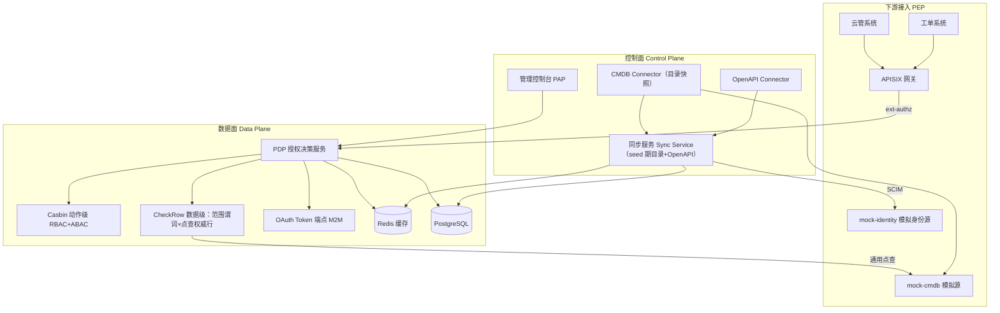

# 权限中心 (IAM) 重构设计文档

> **背景叙事（面试用）**：真实工作中开发过一套权限中心，因强耦合 CMDB（CMDB 崩 → 全系统崩）、数据膨胀、权限配置繁琐、未调研业界方案而难用。本 demo 系统按照"重构后的现代化方案"设计，用于回忆知识点、架构经验，以及面试展示讲解。

---

## 1. 目标与非目标

### 目标
- 满足 IAM 核心需求：**API 层面权限管控** + **数据层面权限管控**，下游通过网关统一接入。
- 引入业界最佳实践：外部化授权（PEP/PDP/PAP/PIP）、控制面/数据面分离、策略即数据、数据源解耦与优雅降级、可观测与审计。
- 开放、自服务、弱管理员：应用自注册、权限市场、资源 owner 授权、审计管理员只读。
- 可作为面试叙事：每条设计决策都能对应"旧痛点 → 现代实践"的故事。

### 非目标
- 不做完整 IDaaS（不实现 OAuth2/OIDC/SAML 全套身份联邦，只做轻量登录/用户身份）。
- 不追求生产级多租户隔离（demo 单租户，模型预留租户字段）。
- 不实现真实 CMDB，用内置 mock 服务模拟。

---

## 2. 术语表

| 术语 | 含义 |
|------|------|
| PAP | Policy Administration Point，策略管理点（管理控制台） |
| PDP | Policy Decision Point，策略决策点（鉴权执行服务） |
| PEP | Policy Enforcement Point，策略执行点（APISIX 网关 / 下游中间件） |
| PIP | Policy Information Point，策略信息点（用户属性、点查权威行等数据来源） |
| 权限点 (Action) | 规范化权限标识，格式 `{app}:{resource}:{operation}`，如 `cmdb:host:create`；三段式登记（含读写/取材声明，§路由表） |
| 权限模板 (Template) | 由 OpenAPI 解析生成的、按板块组织的权限点分组 |
| 资源目录（快照） | seed 时从 CMDB 拉取的资源模型/实例目录（申请选择器数据源，A7）——**非判定数据**；判定一律点查权威行 |
| 数据策略 | 针对数据级资源的策略：主体 + 动作 + 资源范围（条件谓词/实例集/全量） |
| 程序授权 (M2M) | 下游应用以自身身份访问其他系统的授权，OAuth2 Client Credentials |
| 应用 owner | 注册应用的所有者，管理自家应用的权限点暴露与授权审批 |
| 权限市场 | 应用双向开放：暴露权限点（入方向）与申请访问他人资源（出方向） |
| 身份源 (Identity Source) | 用户/组织的 Source of Truth（HR/AD/通讯录），IAM 通过 SCIM 同步副本 |
| JML | Joiner-Mover-Leaver：入职/调动/离职的权限自动跟随 |
| 数据契约（Data Contract） | 数据级能力包发布必填：判定字段清单（fields）+ 算法档位 + 承诺参数——fields 同时是点查模型白名单 |
| 通用点查约定 | 应用注册一系统一约定：中心按 (model, id) 回查权威行（`__perm/query`，M2M 凭证，内部地址零豁免） |
| fail-closed（失败关闭） | 判定依据缺失时拒绝（判少可修，判多是事故）；数据判定路径永不 fail-open——取材失败/行缺失/缺范围参数一律拒 |
| 数据平面 / 执行平面 | 权限数据的**来源**系统 vs 操作**真正发生**的系统——上游挂 ≠ 执行面挂（点查 fail-closed 论证的地基，见 7.6） |
| TOCTOU | time-of-check to time-of-use（检查时与使用时之间的时间差漏洞）——写方向用短时效令牌封顶（见 5.8） |

---

## 3. 总体架构

```
┌─────────────────────────────────────────────────────────────┐
│ 控制面 Control Plane（低 QPS、管理操作）                        │
│                                                             │
│  PAP 管理控制台 (Vue3 + Element Plus)                          │
│   用户/组织/自建组/应用/角色/策略/模板/申请审批/权限市场/审计       │
│                                                             │
│  同步服务 Sync Service（1.5：仅 seed 期目录取数 + OpenAPI 解析）  │
│    OpenAPI Connector ──→ 解析生成权限模板（权限点+动作码登记）  │
│    CMDB Connector   ──→ seed 时拉取资源目录快照（选择器数据源） │
├─────────────────────────────────────────────────────────────┤
│ 数据面 Data Plane（高 QPS、鉴权执行、无状态可水平扩展）            │
│                                                             │
│  PDP 授权决策服务 (Go + Gin)                                   │
│    API 鉴权：Casbin（RBAC + ABAC 条件，动作级）                  │
│    数据鉴权：范围谓词 × 点查权威行（CheckRow，材料随请求到达）  │
│    程序授权：OAuth Token 端点（Client Credentials，M2M）          │
│                                                             │
│  Redis（策略缓存 / 决策缓存）                                    │
│  PostgreSQL（用户 / 组织 / 策略 / 路由表 / 资源目录 / 审计）       │
├─────────────────────────────────────────────────────────────┤
│ 下游接入（PEP）                                                │
│  APISIX：ext-authz 插件 → PDP（远程决策 + 本地缓存）             │
│  （进阶）策略分发：策略 bundle 推送到网关，边缘本地决策             │
│  mock-cmdb：权威源 mock（模型/实例/OpenAPI/回查端点 __perm/query） │
│  mock-identity：内置模拟身份源（用户/组织/SCIM），演示身份同步   │
└─────────────────────────────────────────────────────────────┘
```



---

## 4. 技术选型

| 层 | 选型 | 理由 |
|----|------|------|
| 后端 | Go + Gin | IAM 业界主流、单二进制、性能叙事 |
| API 授权引擎 | Casbin（嵌入） | 动作级 RBAC/ABAC，嵌入 PDP |
| 数据授权引擎 | 自研 CheckRow（嵌入 PDP） | 范围谓词 × 点查权威行（1.5：数据随请求到达判定点，无投影无关系引擎） |
| 策略模型层 | 自研 | 策略/资源范围/版本化/审计 + 路由表动作码登记 |
| 程序授权 | OAuth 2.0 Client Credentials（自研轻量） | 下游应用 M2M 身份，client_id+secret → access token |
| 身份同步 | SCIM 2.0 风格（自研轻量） | 从身份源同步用户/组织 + 变更事件 | 完整 SCIM 服务（重） |
| 存储 | PostgreSQL + Redis | 主存储 + 缓存/热索引 |
| 网关 | APISIX | 与真实背景一致，ext-authz 对接 |
| 管理台 | Vue3 + Element Plus | 国内生态、中文面试场景 |
| 数据源 | 内置 mock-cmdb | 权威源 mock：OpenAPI + 模型/实例 + 回查端点（`__perm/query`） |

**引擎选型叙事（面试可讲，1.5 口径）**：数据级判定一度引入 OpenFGA 关系引擎（实例级 ReBAC）——依赖投影副本喂关系锚点，数据散在各业务库时"上帝视角"前提不成立（同老系统全量灌库的结构病）；1.5 裁决退役，收敛为**范围谓词 × 点查权威行**（材料随请求到达判定点：网关持有 URI 自取、业务带体调用 fetch-and-bring）——动作级 Casbin（RBAC/ABAC）不变，数据级无投影无关系引擎、即时撤销零传播窗口；并借鉴 OPA bundle 的决策分发思想落地网关本地决策（仅动作级）。

---

## 5. 核心设计决策

### 5.1 鉴权与数据源解耦（1.5：点查自足，无投影）
- **判定材料决定判定点（1.5 核心判据）**：条件式判定需要行属性——请求自带（信封 meta，创建类）就用带的；不带（变更/删除类）就**按通用点查约定回查权威行**（中心 → 应用 `__perm/query`，M2M 凭证、内部地址零豁免，行用完即丢不落库）。
- **供材通道分形态**：真实 APISIX 链内插件看得见全请求（整包转发，内部量级够用，演进=就地抠 meta）；Demo Traefik 只带 path/query → URL 材料走网关链路即判、body 材料走业务**带体调用**（fetch-and-bring，与创建共用同一通道）。
- **可用性账（对称依赖）**：点查失败 = fail-closed（DATA_SOURCE_UNAVAILABLE），无隐式降级——中心→应用点查与应用→中心判定互为依赖（应用挂了编辑也做不了），不新增风险；动作级判定读策略快照，**不依赖任何上游**。
- **与 02-CloudManager 对照（同一权威源、两种消费策略）**：云管查询经仿制层**直读** CMDB（用户看列表、低频、要最新）；权限中心**按 id 点查单行**（判定、毫秒级、只取判定字段）——都不拷贝副本，无新鲜度税、无同步管道。
- **资源目录（seed 快照）**：申请选择器（A7）需要的资源模型/实例目录在 seed 时从 CMDB 拉取一次（`resource_models`/`resource_instances` 表）——它是**目录不是判定数据**，判定零读取。
- **进程形态（1.5）**：`iam-server` 纯判定/API（可独立多副本）+ `iam-sync` 仅存 TTL 到期回收循环（单活锁 + 逐轮 recover）；健康探活走容器内 `/healthz`（不映射宿主口）。CMDB 事件消费/巡检/深对账循环已随投影退役下线。

### 5.2 控制面 / 数据面分离
- 管理配置（低 QPS）与鉴权执行（高 QPS）分层；PDP 无状态可水平扩展。
- Redis 承载策略缓存 + 决策缓存（TTL）。

### 5.3 API 鉴权：RBAC + ABAC，模板规范化
- OpenAPI → 规范化权限点（`{app}:{resource}:{operation}`）→ 按板块组织成模板。
- 引入角色层：模板 → 角色 → 用户/组，避免逐条勾选。
- 策略支持 ABAC 条件（时间、IP、数据属性）。
- **deny-by-default**：OpenAPI 更新产生的新权限点默认不授予任何角色/策略，需显式授权（防权限漂移）。
- **路由三分类（deny-by-default 的落点，2026-09-22 补）**——路由分类发生在鉴权判定**之前**：
  - Public（登录页本身、健康检查、公开文档）→ 网关**显式不挂** forwardAuth 中间件（Traefik 按 router 挂载，不挂=直达）；
  - Protected（全部业务 API）→ 挂 PEP，两级判定；
  - **未分类 → 归入 Protected**（没分类=要鉴权）。白名单改动是管理面操作、要审计（谁把哪个路由改成公开、何时），粒度到 path；**免鉴权 ≠ 免防护**（HTTPS/防爆破照旧）。

### 5.4 数据鉴权：范围谓词 × 点查权威行（1.5，CheckRow）
- 判定链（点操作）：**动作级 Casbin 短路 → 取材 → 范围谓词求值**。取材按路由表登记的【取材声明】三选一：① id 路径（path/body）→ 通用点查取权威行；② 信封字段路径（创建类，"未来的行"）；③ 补救回源（历史接口兜底）。
- 范围谓词三形态：**全量**（无 scope → 动作级放行即放行）/ **条件谓词**（属性式：对权威行/信封伪行求值）/ **实例集**（集合式：点查行 id 与集合比对）。
- 对外接口（数据级唯一路径）：**网关链路**（path 材料，业务零配合）+ **`/v1/authz/check-material` 带体调用**（body/信封材料，业务持有请求体 fetch-and-bring）。
- fail-closed 三态：行不存在 = `DATA_MISSING`；取材失败/未配置回查 = `DATA_SOURCE_UNAVAILABLE`/`DATA_SOURCE_UNCONFIGURED`；谓词不命中 = `NO_PERMISSION`——判少可修，判多是事故。
- **不存在的东西**（如实）：无投影读取、无关系引擎、无新鲜度门槛、无孤儿清理——判定材料永远是实时行，行用完即丢。

### 5.5 数据膨胀治理
- 判定不落库：权威行用完即丢（点查即实时，无副本膨胀面）。
- 决策缓存 + 策略分发（网关本地决策），IAM 不背每请求 QPS。
- 审计日志追加写 + 分区 + 归档。

### 5.6 可观测性 & 审计
- 决策日志（请求/决策/原因/耗时）、审计日志（谁改了什么策略）、指标（延迟、命中率）。
- 策略版本化（version 字段 + policy_versions 历史表），支持回滚与权限 review。
- 版本化/审计的组件化落地见 5.9。

### 5.7 策略分发与本地决策（借鉴 OPA bundle）
- 目标：把"每请求远程打 IAM"改为"策略下发到边缘、本地决策"，消除中心瓶颈。
- 思路：中心 PDP 只负责管理与发布；网关旁挂轻量 **PDP agent（sidecar）**，agent 内嵌 Casbin + 自研策略模型层。
- Bundle 内容：Casbin model + 策略快照（角色/动作/策略/组成员关系）+ 元数据（revision、app、有效期）+ 签名（可选）。
- 版本与激活：策略变更 → revision++ → 生成全量 bundle 发布到 `/v1/bundles/{app}`；agent 轮询/长轮询拉取，校验后**原子激活**，失败保留 last-known-good。
- 下发粒度：按 app 拆分 bundle 控制包体；demo 用全量 + 版本号，增量 diff 列为可选项。
- 一致性：本地决策为最终一致（变更生效有秒~分钟级窗口）。（1.5 注：force-remote 强一致档已随投影退役——点查即实时，无前置同步对象）
- 数据级策略：**不进入 bundle**——数据级=点查权威行（范围谓词×实时行），回源中心 PDP 判定；agent 只承载动作级 Casbin 判断。
- 降级：agent 拉取失败/包过期 → 默认 fail-closed（拒绝），可配置 fail-open 或回源中心。
- 可观测：agent 上报当前 revision、激活时间、本地决策计数、命中率；控制面可查看各 agent 升级率。
- 与 CMDB 同步层的区别（面试可讲）：CMDB Connector 是把外部数据**同步进中心**（解耦外部依赖）；bundle 分发是把中心策略**下发到边缘**（解耦中心瓶颈），两个方向相反的数据流。
- **后台任务防重与进程隔离（1.5 收口）**：投影循环（事件消费/巡检深对账）已随投影退役下线——`iam-sync` 仅存 **TTL 到期回收**循环（独立进程、单活锁 `SET NX PX` + Lua 仅-owner 释放 + 逐轮 recover + status 守卫幂等兜底）；判定进程 iam-server 无后台循环，可独立多副本。
- **（1.5 注）force-remote 强一致档已退役**：`Policy.ForceRemote` 字段、bundle force_remote 列表、agent 回源比对均已移除——点查取材即实时（无副本即无强一致问题），历史机制见 1.x 实施清单（A6）。

### 5.8 程序授权（M2M / 服务间授权）
- 下游应用（云管/工单/事件）作为**主体 service**，与用户共用同一 PDP/网关，只是主体类型不同（Casbin 主体为字符串，零引擎改动）。
- 标准：**OAuth 2.0 Client Credentials**——应用凭 client_id+secret 换取 access token（JWT，sub=client:xxx，scope 限定），请求经 APISIX → PDP 按 service 主体鉴权。
- 场景授权：
  - 云管：只读（仅授予 read 权限点）
  - 事件：CRUD（限定模型/范围）
  - 工单：查询走普通 service token；**审批后写操作签发"审批受限令牌"**（scope+TTL），不授予长期写权限
- 审批受限令牌：审批通过时由 IAM 签发，限定动作与数据范围、有时效；PDP 校验 scope+时效，过期失效，全程审计。
- 权限来源：**应用 owner 通过申请获得访问他人资源的权限**（非管理员分配），见 5.10/5.12。
- 双主体（用户+程序）方案：**暂不实现**（明确排除）。

### 5.9 版本化与审计的组件化
- 三层拆解：
  - **业务语义层（自写，很薄）**：`policy_versions` 策略快照 + 回滚；`audit_logs`/`decision_logs`（追加写、PG 按月分区）。
  - **引擎白送层（组件）**：Casbin 策略规则随快照构建；判定审计随决策日志白送（动作码 + 路由表版本快照，判定可复现）。
  - **基础设施层（组件）**：审计/决策事件走 **Redis Streams** 异步落库，且复用为 CMDB webhook 事件入口（一个组件两用）；生产可演进到 ClickHouse/ES 存储。
- 进阶（可选叙事）：策略即数据 + GitOps——策略导出 YAML 入 Git 仓库，版本历史/diff/审批/回滚白嫖 Git 能力。
- 面试要点：业务语义审计无现成组件（Keycloak/Casdoor 亦自建），但该层很薄；真正用组件的是"存储与异步化 + 引擎白送能力"。
- **现状注记（1.5）**：audit/decision 事件为 goroutine 直写 PG（Streams 化 = 设计目标）；CMDB 事件通道及其消费组已随投影退役下线。

### 5.10 权限分配与申请治理（Access Governance）
- **去中心化 / 弱管理员模型**：无执行能力的管理员；安全靠**所有权 + 审批 + 审计 + SoD 机制**，而非管理员把关。
- 角色模型：
  - 用户：查看自己的权限，为自己/自己的组/自己的程序申请权限
  - 应用 owner：管理自家应用（暴露权限点、申请访问他人资源、审批对自家应用的申请）
  - 审计管理员：全局只读（审计/权限全景/异常），**无任何授权与配置能力**；处置（封禁/转移/下线）走工单审批，不直接执行
- 审批人模型：申请访问他人资源 → **资源 owner** 审批（不是管理员）；组织经理审批仅保留在"用户为自己/自己组申请组织内权限"场景。
- 申请渠道：对外申请 API（业务系统对接）+ 管理台自助页（demo 演示机制）。
- 闭环：**自助申请 → 资源 owner 风险分级审批 → 自动开通（复用策略发布）→ 有效期/JIT 到期回收 → 全程审计**。
- 审批流按风险分级：低风险（只读）一级 / 中风险（写）两级（经理+资源 owner）/ 高风险（数据范围）多级+人工确认。
- **SoD（职责分离）为必需**：申请人与审批人互斥；应用 owner 不能自批自家应用的申请。
- **定期审阅为必需**：资源 owner 定期 review 谁访问了自己的资源，回收异常授权。
- 开通动作复用"策略发布"链路：审批通过 → publish（版本化）→ 写 Casbin 策略快照 → 自动生效；带有效期则定时任务到期回收（JIT）。
- 审批流引擎：demo 用**自建轻量状态机**（薄）；真实场景的处置/下线/转移等走工单系统，可演进 Temporal/Flowable。
- **数据契约门禁（发布时点）**：勾选数据级的能力包**发布必须携带数据契约**（判定字段清单 fields + 试算自检：按取材声明真取一次行）——**机器自动校验、不是人工管理员把关**，与弱管理员模型不冲突；取不出行的发布方出路 = 不勾数据级、只发接口级（数据级本就是可选深度）。

### 5.11 身份源与组织架构同步（Identity Sync / JML）
- 用户/组织的 Source of Truth 在**身份源**（HR/AD/通讯录），IAM 通过 **SCIM 2.0 风格协议**同步副本，IAM 只负责授权、不手工维护主数据。
- 组织架构副本用途：按组织定位授权（权限挂组织单元）、审批流定位（直线经理/数据 Owner）、定期审阅。
- 组双轨制：`org` 组织架构组（身份源同步、只读）与 `custom` 自建组（IAM 管理）分离。
- **JML 生命周期**：入职自动进部门得权限、调岗权限跟随、离职停用回收（P6 演示）。
- demo 落地：`mock-identity` 独立身份源（SCIM 风格 API + 事件）+ Sync Service 的 Identity Connector；users/groups 带 `source` 标记（identity=只读 / manual=可编辑）。

### 5.12 开放应用注册与权限市场
- 应用**自注册**：符合 OpenAPI 规范即可注册，注册者成为应用 owner。
- **真实场景说明**：真实注册涉及网络打通等，流程为"提交工单 → 审批 → 办理（自动+人工打通网络）→ 注册"；**demo 用简化审批（自审批）演示机制**，注释真实情况。
- 应用双向权限（权限市场）：
  - **出方向**：owner 为自家应用申请访问其他应用/数据的权限
  - **入方向**：owner 暴露自家应用权限点（OpenAPI 自动生成），供他人申请
- 应用 owner 模型：`apps.owner_id`（注册者）+ `app_owners` **至少 2 个负责人**；负责人失联时按组织树向上查找领导作为处理人（决定转移负责人/自己负责/下线），处置走审批流。
- 处置（封禁/转移/下线）：真实场景走工单审批；demo 简化（审计管理员发起，走审批流，无直接执行）。
- **能力包生命周期（2026-09-22 补）**：
  - **发放两形态**：① 申请式（AccessRequest → 资源 owner 审批 → 自动开通，本节主线）；② 直授式（Policies 直授表单——**"授权即审批"**，source=owner、理由必填、TTL 到期回收防游离碎片；申请者自助只有按包申请，"自选动作"入口 = 演进项）。
  - **更新四方向（已授权用户要不要重新申请）**：新增接口 → deny-by-default **显式才授**；删除接口 → 自动失效；范围缩小 → 自动收窄；**范围扩大 → 不隐式生效**（集合式实例清单天然不覆盖新数据；属性式走版本锚定 + 影响面重新确认）。**收紧自动生效、扩权从不隐式生效**——对标 OAuth2 scope 快照（token 过期封顶）。

### 5.13 数据契约（1.5：登记面保留，指纹/巡检/时钟机制已退役）
- **数据契约（Data Contract）**：数据级验证的能力包**发布必填** `data_contract{fields, algorithm, staleness_sla_sec[, degrade_max_age_sec]}`——**fields = 判定字段清单**，同时是点查模型白名单（中心只对已登记域回查，防"查任意表"）。
- **发布门禁（试算自检）**：按路由表登记的【取材声明】真取一次行（id 路径→通用回查 / 信封→字段路径 / 补救→绑定回源）——取不出 → 400 拒绝发布 + 出路（不勾数据级、只发接口级）。
- **发布方责任制**（业内 producer owns data quality 同款）：发布方负责**数**（行数据与判定字段、回查端点可用性），权限中心负责**判**（正确/快速/可审计）——点查失败 fail-closed，中心不为上游数据兜底。
- **历史注记（1.5 T3 退役）**：集合指纹/确认制时钟/指纹巡检/深对账/upsert 三道门为 1.x 投影时代机制，随投影管线一并下线（判定材料改为实时点查，无副本即无对账对象）；机制完整记录见《实施清单-IAM数据契约与指纹同步层》（历史存档）。

---

## 6. 核心数据模型

```
users (id, username, email, status, attributes jsonb, source[identity|manual], token_version)
groups (id, name, parent_id, type[org|custom], source)    -- 组织架构树
user_group (user_id, group_id)
clients (id, app_id, client_id, client_secret_hash, status) -- 程序身份(M2M)
app_owners (app_id, user_id, is_primary)                   -- 应用负责人(≥2)

apps (id, code, name, type, openapi_url, status, owner_id, owner_group_id)
actions (id, app_id, code, name, resource, operation, method, path,  -- 权限点/路由表行
          rw, need_data, material jsonb, scope_param jsonb, status)      -- 五格登记：读写/取材声明/范围参数/归档
permission_templates (id, app_id, name)                    -- 板块
template_actions (template_id, action_id)

roles (id, name, description, app_id, is_system)
role_actions (role_id, action_id)

policies (id, name, version, effect[allow|deny],
          subject_type[user|group|role|service], subject_id,
          app_id, action_ids, resource_scope jsonb, conditions jsonb,

          status, created_by)
resource_models (id, source_id, name, fp)                -- seed 期目录取数的模型登记（历史列 fp 保留）
resource_instances (id, model_id, external_id, name, attributes jsonb)
                    -- 资源目录快照（seed 期拉取；申请选择器数据源 A7，判定零读取）

data_contracts (id, app_id, model_code, fields jsonb, algorithm[L1|L2|L3],
                staleness_sla_sec, degrade_max_age_sec, enabled)
                -- 1.5：登记面（fields=判定字段清单/点查白名单）；时钟/水位列已随投影退役（列保留不再写入）

policy_versions (id, policy_id, version, content, changed_by, reason)
audit_logs (id, actor, action, resource, detail, ip, at)
decision_logs (id, req, decision, reason, latency_ms, at)
```

> （1.5 注）OpenFGA 关系数据已随投影机制退役——数据级判定不依赖任何关系引擎。

---

## 7. 鉴权流程

### 7.1 API 鉴权（网关链路）
```
前端 → APISIX → ext-authz 调 PDP POST /v1/authz/check
        body: { user, app, action, resource, context{ip,time} }
action 由网关按路由表查表所得（登记制，运行期零推断；未登记 → deny-by-default）
PEP→PDP 之间以共享密钥建立信任（防绕过网关直连 PDP）
PDP: 查用户 → 角色（缓存）→ 加载策略（版本化缓存）→ Casbin 求值
→ 200 allow / 403 deny + 错误码（前端 i18n）
```

### 7.2 数据鉴权（点查链路，1.5）
```
URL 材料（点操作，业务零配合）:
  网关 forwardAuth/插件 → 中心查路由表得动作码 + 提取 (model, id)
  → 按通用点查约定回查权威行 → 范围谓词求值 → 200 / 403（DATA_MISSING 等）
body/信封材料（创建 / 存量 body-id）:
  业务带体调用 POST /v1/authz/check-material { user, app, action, material }
  → 取材声明分发（body 抠 id 点查 / 信封伪行 / 补救回源）→ 谓词求值
fail-closed 三态：行缺失 DATA_MISSING / 取材失败 DATA_SOURCE_UNAVAILABLE / 谓词不命中 NO_PERMISSION
```

### 7.3 本地决策链路（策略分发，进阶）
```
APISIX 请求 → 本机 PDP agent（sidecar）本地决策（毫秒级，动作级）
agent 无 bundle / 包过期 / 失配 → 回源中心 PDP check
数据级 → 一律回源中心 PDP（点查权威行，不进 bundle）
```

### 7.4 程序授权链路（M2M，Client Credentials）
```
下游服务 → POST /v1/oauth/token (client_id+secret) → access token(JWT, sub=client:xxx)
服务请求 + token → APISIX → PDP check(subject=service) → 放行/拦截
工单审批通过 → IAM 签发受限令牌(scoped+TTL) → 凭令牌执行写操作 → PDP 校验 scope/时效
```

### 7.5 应用注册与权限市场（开放自服务）
```
用户提交应用注册(OpenAPI) → demo 简化自审批（真实走工单+网络打通）
→ 成为 owner + 绑定≥2 负责人 → OpenAPI 同步生成权限点（入方向暴露）
→ 他人申请访问 → owner 审批；owner 为自家应用申请访问他人资源（出方向）
→ 审批通过 → 策略发布（自动生效）
```

### 7.6 数据级 fail-closed 语义（1.5，替代原"新鲜度三态"）
判定材料 = 实时权威行（点查），无副本无时钟——数据级拒绝条件收敛为三种，全部 fail-closed：

| 场景 | 条件 | 网关/带体响应 | 说明 |
|------|------|----------------|------|
| **行不存在** | 点查 404（行已删/不存在） | 403 DATA_MISSING | 判少可修，幽灵授权不存在（行没了就判不了"有"） |
| **取材失败** | 应用不可达/未配置回查 | 403 DATA_SOURCE_UNAVAILABLE / DATA_SOURCE_UNCONFIGURED | 无隐式降级、无静默放行 |
| **谓词不命中** | 行在但条件不满足 | 403 NO_PERMISSION | 各域独立判定 |

- **恢复语义**：上游恢复即复通（点查即实时，无缓存放行、无"恢复不解禁"等待）；动作级判定读策略快照，**上游挂不影响动作级**。
- **双平面论证（保留）**：数据平面（CMDB，权限数据来源）挂 ≠ 执行平面（云 API + 工单，操作真正发生处）挂——1.5 的答案更简单：**上游挂时数据级 fail-closed**（判少），执行面死活归网关熔断与业务 503 处理，IAM 永远照常判定（授权系统必须比被保护系统更可用）；写方向风险另由审批受限令牌（scope+TTL）封顶（5.8）。
- **决策日志 reason（可检索）**：`data_missing` / `DATA_SOURCE_UNAVAILABLE` / `scope not matched`（带 material 材料上下文与 route_version 快照，判定可复现）。

---

## 8. 仓库结构（单仓库）

```
projects/PermissionCenter/
├── backend/                 # Go 单仓库（go.mod 在此；2026-09-22 核对的真实结构）
│   ├── cmd/                 # iam-server（PDP+管理 API）/ iam-sync（仅 TTL 回收+healthz）/ iam-agent / mock-cmdb / mock-identity
│   ├── internal/            # api / authz / bundle / sync / model / store / config / auth / material / knowledge
│   │                        # ⚠️ 无独立 internal/audit 包——审计=audit_logs 表（store 读写）+ api 层 logDecision 写入
│   ├── Dockerfile           # 运行时镜像（宿主机交叉编译产物 COPY；make backend-image 用）
│   └── Dockerfile.build     # 容器内多阶段编译（compose build 用；GOPROXY 走本地缓存双通道）
├── frontend/                # Vue3 + Element Plus 管理控制台（src/views、components）
├── scripts/                 # demo.sh 一键演示（22 场景，IAM_DEMO/GW_DEMO 可覆盖访问地址）
├── deploy/                  # docker-compose（iam-server + iam-sync + traefik + mock-* + frontend + iam-agent）
├── docs/                    # 本文档 + 实施清单
└── README.md
```

> ⚠️ 顶层曾存在游离残留 `cmd/`、`internal/`（不在 go.mod 覆盖内、**不可构建**，系历史迁移遗留）——**一切新代码落点必须带 `backend/` 前缀**，残留由 feature 分支清理（实施清单施工红线）。

---

## 9. 里程碑

| 阶段 | 内容 | 产出 |
|------|------|------|
| P0 | 架构设计 + 数据模型 + 项目骨架 | 本文档 + 可运行骨架 |
| P1 | 基础域：用户/组织/组/应用 + 轻量登录 | 管理 API |
| P2 | OpenAPI → 权限模板 + 动作规范化 | mock-cmdb 的 OpenAPI + 同步 |
| P3 | API 鉴权：RBAC + Casbin + PDP + APISIX 集成 | 网关鉴权链路通 |
| P4 | 数据鉴权：点查取材 + 数据策略（条件/集合/全量）+ 身份同步 | 数据级鉴权通（点查 fail-closed 演示）+ 组织同步 |
| P5 | 管理控制台（Vue3 + Element Plus，含申请/审批/权限市场） | Web UI |
| P6 | 进阶：审计、决策缓存、策略分发、压测对比、降级演练、JML 演示 | 完整演示 + 面试叙事材料 |
