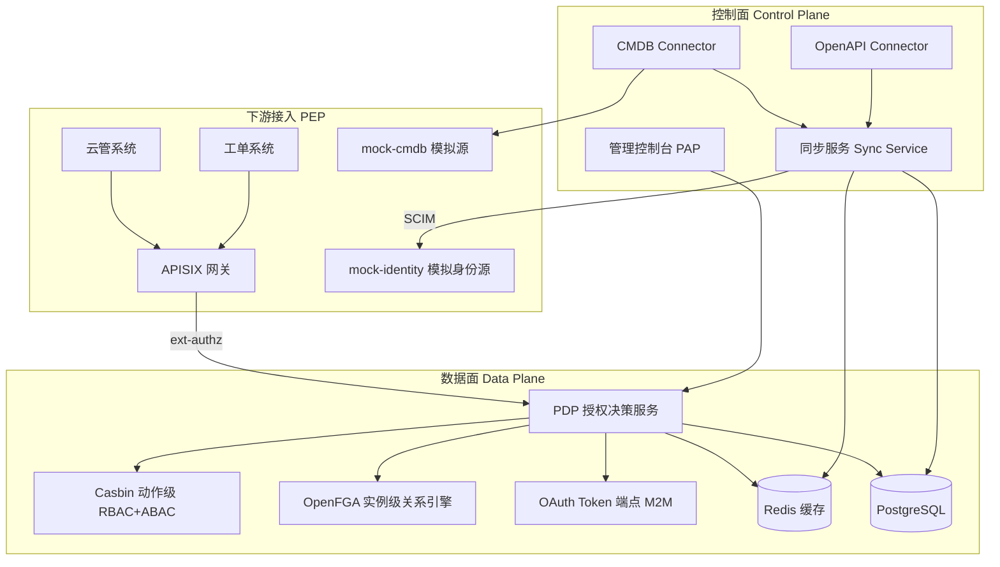

# 权限中心 (IAM) 重构设计文档

> **背景叙事（面试用）**：真实工作中开发过一套权限中心，因强耦合 CMDB（CMDB 崩 → 全系统崩）、数据膨胀、权限配置繁琐、未调研业界方案而难用。本 demo 系统按照"重构后的现代化方案"设计，用于回忆知识点、架构经验，以及面试展示讲解。

---

## 1. 目标与非目标

### 目标
- 满足 IAM 核心需求：**API 层面权限管控** + **数据层面权限管控**，下游通过网关统一接入。
- 引入业界最佳实践：外部化授权（PEP/PDP/PAP/PIP）、控制面/数据面分离、策略即数据、数据源解耦与优雅降级、可观测与审计。
- 开放、自服务、弱管理员：应用自注册、权限市场、资源 owner 授权、审计管理员只读。
- 可作为面试叙事：每条设计决策都能对应"旧痛点 → 现代实践"的故事。

### 非目标
- 不做完整 IDaaS（不实现 OAuth2/OIDC/SAML 全套身份联邦，只做轻量登录/用户身份）。
- 不追求生产级多租户隔离（demo 单租户，模型预留租户字段）。
- 不实现真实 CMDB，用内置 mock 服务模拟。

---

## 2. 术语表

| 术语 | 含义 |
|------|------|
| PAP | Policy Administration Point，策略管理点（管理控制台） |
| PDP | Policy Decision Point，策略决策点（鉴权执行服务） |
| PEP | Policy Enforcement Point，策略执行点（APISIX 网关 / 下游中间件） |
| PIP | Policy Information Point，策略信息点（用户属性、资源索引等数据来源） |
| 权限点 (Action) | 规范化权限标识，格式 `{app}:{resource}:{operation}`，如 `cmdb:host:create` |
| 权限模板 (Template) | 由 OpenAPI 解析生成的、按板块组织的权限点分组 |
| 资源索引 (Resource Index) | 从外部数据源（CMDB）同步到 IAM 本地的权限判断投影 |
| 数据策略 | 针对数据级资源的策略：主体 + 动作 + 资源范围（实例集/关系/属性条件） |
| 程序授权 (M2M) | 下游应用以自身身份访问其他系统的授权，OAuth2 Client Credentials |
| 应用 owner | 注册应用的所有者，管理自家应用的权限点暴露与授权审批 |
| 权限市场 | 应用双向开放：暴露权限点（入方向）与申请访问他人资源（出方向） |
| 身份源 (Identity Source) | 用户/组织的 Source of Truth（HR/AD/通讯录），IAM 通过 SCIM 同步副本 |
| JML | Joiner-Mover-Leaver：入职/调动/离职的权限自动跟随 |
| 数据契约（Data Contract） | 数据级能力包发布必填：指纹字段 + 算法档位 + 新鲜度承诺；"指纹契约"=其指纹义务部分的通称 |
| 集合指纹 / 记录级指纹（fp） | 域级 hash(ID集合)⊕hash(时间集合)（管"拉不拉"）/ 判定字段规范化哈希（管"写不写"、深对账差异定位） |
| 确认制时钟 / fresh_age | `last_confirmed_fresh_at`（同步成功落地 或 指纹比对一致 才刷新）及其年龄——新鲜度三态的唯一判定量 |
| 巡检日志（patrol_log） | 指纹巡检失败历史（reachable/fingerprint_match/sync_ok/fresh_age）——观测与告警分级进，**判定不读此表** |
| 三元素 | 指纹可判定的三种数据变化：**新增 / 删除 / 更新**——数据契约对发布方的最低要求 |
| fail-closed（失败关闭） | 判定依据缺失时拒绝（判少可修，判多是事故）；数据判定路径永不 fail-open |
| 数据平面 / 执行平面 | 权限数据的**来源**系统 vs 操作**真正发生**的系统——上游挂 ≠ 执行面挂（新鲜度论证的地基，见 7.6） |
| TOCTOU | time-of-check to time-of-use（检查时与使用时之间的时间差漏洞）——写方向用短时效令牌封顶（见 5.8） |

---

## 3. 总体架构

```
┌─────────────────────────────────────────────────────────────┐
│ 控制面 Control Plane（低 QPS、管理操作）                        │
│                                                             │
│  PAP 管理控制台 (Vue3 + Element Plus)                          │
│   用户/组织/自建组/应用/角色/策略/模板/申请审批/权限市场/审计       │
│                                                             │
│  Sync Service 同步服务（解耦关键）                              │
│    OpenAPI Connector ──→ 解析生成权限模板（权限点）               │
│    CMDB Connector   ──→ 事件驱动 + 增量同步 → 本地资源索引        │
├─────────────────────────────────────────────────────────────┤
│ 数据面 Data Plane（高 QPS、鉴权执行、无状态可水平扩展）            │
│                                                             │
│  PDP 授权决策服务 (Go + Gin)                                   │
│    API 鉴权：Casbin（RBAC + ABAC 条件，动作级）                  │
│    数据鉴权：OpenFGA（关系引擎，Check / ListObjects，实例级）      │
│    程序授权：OAuth Token 端点（Client Credentials，M2M）          │
│                                                             │
│  Redis（策略缓存 / 决策缓存 / 资源热索引）                       │
│  PostgreSQL（用户 / 组织 / 策略 / 资源索引 / 审计）               │
│  OpenFGA（关系引擎 + 自有 datastore）                           │
├─────────────────────────────────────────────────────────────┤
│ 下游接入（PEP）                                                │
│  APISIX：ext-authz 插件 → PDP（远程决策 + 本地缓存）             │
│  （进阶）策略分发：策略 bundle 推送到网关，边缘本地决策             │
│  mock-cmdb：内置模拟 CMDB（模型/实例/OpenAPI），演示同步+降级      │
│  mock-identity：内置模拟身份源（用户/组织/SCIM），演示身份同步   │
└─────────────────────────────────────────────────────────────┘
```



---

## 4. 技术选型

| 层 | 选型 | 理由 |
|----|------|------|
| 后端 | Go + Gin | IAM 业界主流、单二进制、性能叙事 |
| API 授权引擎 | Casbin（嵌入） | 动作级 RBAC/ABAC，嵌入 PDP |
| 数据授权引擎 | OpenFGA（独立服务） | 实例级 ReBAC，CNCF 项目，Check/ListObjects |
| 策略模型层 | 自研 | 策略/资源范围/版本化/审计 + scope→OpenFGA 翻译适配 |
| 程序授权 | OAuth 2.0 Client Credentials（自研轻量） | 下游应用 M2M 身份，client_id+secret → access token |
| 身份同步 | SCIM 2.0 风格（自研轻量） | 从身份源同步用户/组织 + 变更事件 | 完整 SCIM 服务（重） |
| 存储 | PostgreSQL + Redis | 主存储 + 缓存/热索引 |
| 网关 | APISIX | 与真实背景一致，ext-authz 对接 |
| 管理台 | Vue3 + Element Plus | 国内生态、中文面试场景 |
| 数据源 | 内置 mock-cmdb | 演示 OpenAPI 同步 + 数据同步 + 降级 |

**引擎选型叙事（面试可讲）**：授权按"动作级 + 实例级"双引擎拆分——动作级用 Casbin（RBAC/ABAC，嵌入 PDP）；实例级评估过自研与 OPA，最终引入 OpenFGA（CNCF 项目，原生授权模型版本化 + Check/ListObjects，与自研策略版本化叙事契合）；并借鉴 OPA bundle 的决策分发思想落地网关本地决策。

---

## 5. 核心设计决策

### 5.1 鉴权与数据源解耦（治"CMDB 崩 → 全崩"）
- Connector 抽象 + 事件驱动（webhook）+ 定时增量同步 → 本地资源索引（投影，只存权限判断所需字段）。
- 鉴权只读本地索引，**绝不实时查询外部数据源**（唯一例外：高风险 force-remote 动作判定前的指纹快查+前置同步，判定主体仍是权限中心，见 7.6）。
- CMDB 宕机时 IAM 用"最后同步数据"降级服务；同步水位（synced_at）可见、延迟可告警。
- **同步三问（2026-09-22 补）**：
  - **怎么抄**：事件通道（Redis Streams → upsert，秒级）+ 指纹巡检增量（`updated_after` 水位回拨重叠窗口，分钟级）双通道，深对账（天级全量）兜底三类差异（更新 / 孤儿双侧清理 / 静默漂移告警）——三通道与 upsert 三道门（单调守卫 → fp 去重 → 时间戳回填）见 5.13。
  - **抄到哪**：PG 投影表（resource_instances）+ OpenFGA 关系 + Redis 热索引三分落点；只抄权限判断所需字段（投影裁剪，防数据膨胀）。
  - **多久过期**：**副本无 TTL——它不是缓存语义**，靠同步持续收敛（删除=事件级联清理+深对账兜底）；新鲜度由数据契约的确认制时钟衡量（5.13），降级演示的 synced_at/fresh_age 全程可观测。
- **与 02-CloudManager 对照（同一权威源、两种消费策略）**：云管查询经 QuerySet 仿制层**直读** CMDB（用户看列表、低频、要最新），权限中心把判断数据**投影进本地**（每请求都要判、毫秒级、可用性优先）——查询路径不拷数据、鉴权路径拷投影，各自选择解耦深度，不构成矛盾。

### 5.2 控制面 / 数据面分离
- 管理配置（低 QPS）与鉴权执行（高 QPS）分层；PDP 无状态可水平扩展。
- Redis 承载策略缓存 + 决策缓存（TTL）。

### 5.3 API 鉴权：RBAC + ABAC，模板规范化
- OpenAPI → 规范化权限点（`{app}:{resource}:{operation}`）→ 按板块组织成模板。
- 引入角色层：模板 → 角色 → 用户/组，避免逐条勾选。
- 策略支持 ABAC 条件（时间、IP、数据属性）。
- **deny-by-default**：OpenAPI 更新产生的新权限点默认不授予任何角色/策略，需显式授权（防权限漂移）。
- **路由三分类（deny-by-default 的落点，2026-09-22 补）**——路由分类发生在鉴权判定**之前**：
  - Public（登录页本身、健康检查、公开文档）→ 网关**显式不挂** forwardAuth 中间件（Traefik 按 router 挂载，不挂=直达）；
  - Protected（全部业务 API）→ 挂 PEP，两级判定；
  - **未分类 → 归入 Protected**（没分类=要鉴权）。白名单改动是管理面操作、要审计（谁把哪个路由改成公开、何时），粒度到 path；**免鉴权 ≠ 免防护**（HTTPS/防爆破照旧）。

### 5.4 数据鉴权：OpenFGA（ReBAC）+ check / filter 双接口
- 执行层采用 **OpenFGA**（CNCF 项目，Zanzibar 开源实现）：数据策略经自研翻译层映射为 OpenFGA 授权模型与关系（Write），鉴权调用 `Check` / `ListObjects`。
- 对外接口：
  - `check-instance`：单点判断（增删改单条）= Casbin(动作) + OpenFGA(实例) 叠加
  - `filter`：返回允许实例集（= OpenFGA ListObjects）
- 自研部分收缩为**翻译/适配层**：数据策略 scope（集合式/关系式/属性式）→ OpenFGA 关系；资源索引同步层照旧（喂关系锚点与属性）。
- 关系数据物化在 OpenFGA 自有存储，**不依赖外部数据源**（CMDB 崩不影响 Check/ListObjects）。
- **孤儿清理**：删除用户/组/实例时级联清理策略引用与 OpenFGA 关系；CMDB 实例删除同步清理 tuple（防关系图膨胀）。

### 5.5 数据膨胀治理
- 投影存储（不同步全量业务数据）。
- 决策缓存 + 策略分发（网关本地决策），IAM 不背每请求 QPS。
- 审计日志追加写 + 分区 + 归档。

### 5.6 可观测性 & 审计
- 决策日志（请求/决策/原因/耗时）、审计日志（谁改了什么策略）、指标（延迟、命中率）。
- 策略版本化（version 字段 + policy_versions 历史表），支持回滚与权限 review。
- 版本化/审计的组件化落地见 5.9。

### 5.7 策略分发与本地决策（借鉴 OPA bundle）
- 目标：把"每请求远程打 IAM"改为"策略下发到边缘、本地决策"，消除中心瓶颈。
- 思路：中心 PDP 只负责管理与发布；网关旁挂轻量 **PDP agent（sidecar）**，agent 内嵌 Casbin + 自研策略模型层。
- Bundle 内容：Casbin model + 策略快照（角色/动作/策略/组成员关系）+ 元数据（revision、app、有效期）+ 签名（可选）。
- 版本与激活：策略变更 → revision++ → 生成全量 bundle 发布到 `/v1/bundles/{app}`；agent 轮询/长轮询拉取，校验后**原子激活**，失败保留 last-known-good。
- 下发粒度：按 app 拆分 bundle 控制包体；demo 用全量 + 版本号，增量 diff 列为可选项。
- 一致性：本地决策为最终一致（变更生效有秒~分钟级窗口）。**风险分级（force-remote）**：普通请求本地决策，高风险写操作（action 打标记）回源中心做强一致 check。
- 数据级策略：**不进入 bundle**——实例级关系查询需要关系图，回源中心 OpenFGA（Check/ListObjects），配合决策缓存兜底；agent 只承载动作级 Casbin 判断。
- 降级：agent 拉取失败/包过期 → 默认 fail-closed（拒绝），可配置 fail-open 或回源中心。
- 可观测：agent 上报当前 revision、激活时间、本地决策计数、命中率；控制面可查看各 agent 升级率。
- 与 CMDB 同步层的区别（面试可讲）：CMDB Connector 是把外部数据**同步进中心**（解耦外部依赖）；bundle 分发是把中心策略**下发到边缘**（解耦中心瓶颈），两个方向相反的数据流。
- **force-remote 的数据级挂接（2026-09-22 补）**：标记复用是真的（`Policy.ForceRemote` → bundle 动作码列表 → agent 比对回源，既有链路）；数据级请求**不进 bundle**、本就在中心 PDP 判定——其"强一致档"= 判定前指纹快查 + 失配触发前置同步（见 7.6）。**标记复用、数据级行为是本轮新增**——面试如实讲，勿称"完全同一机制"。

### 5.8 程序授权（M2M / 服务间授权）
- 下游应用（云管/工单/事件）作为**主体 service**，与用户共用同一 PDP/网关，只是主体类型不同（Casbin/OpenFGA 主体均为字符串，零引擎改动）。
- 标准：**OAuth 2.0 Client Credentials**——应用凭 client_id+secret 换取 access token（JWT，sub=client:xxx，scope 限定），请求经 APISIX → PDP 按 service 主体鉴权。
- 场景授权：
  - 云管：只读（仅授予 read 权限点 + OpenFGA reader 关系）
  - 事件：CRUD（限定模型/范围）
  - 工单：查询走普通 service token；**审批后写操作签发"审批受限令牌"**（scope+TTL），不授予长期写权限
- 审批受限令牌：审批通过时由 IAM 签发，限定动作与数据范围、有时效；PDP 校验 scope+时效，过期失效，全程审计。
- 权限来源：**应用 owner 通过申请获得访问他人资源的权限**（非管理员分配），见 5.10/5.12。
- 双主体（用户+程序）方案：**暂不实现**（明确排除）。

### 5.9 版本化与审计的组件化
- 三层拆解：
  - **业务语义层（自写，很薄）**：`policy_versions` 策略快照 + 回滚；`audit_logs`/`decision_logs`（追加写、PG 按月分区）。
  - **引擎白送层（组件）**：OpenFGA `WriteAuthorizationModel` 原生授权模型多版本；OpenFGA `ReadChanges` 记录关系（tuple）变更时间线，数据级授权变更审计免费获得。
  - **基础设施层（组件）**：审计/决策事件走 **Redis Streams** 异步落库，且复用为 CMDB webhook 事件入口（一个组件两用）；生产可演进到 ClickHouse/ES 存储。
- 进阶（可选叙事）：策略即数据 + GitOps——策略导出 YAML 入 Git 仓库，版本历史/diff/审批/回滚白嫖 Git 能力。
- 面试要点：业务语义审计无现成组件（Keycloak/Casdoor 亦自建），但该层很薄；真正用组件的是"存储与异步化 + 引擎白送能力"。
- **现状注记（2026-09-22 代码核对，防面试超前宣称）**：Redis Streams 异步落库**当前仅 CMDB 事件一路实装**（audit/decision 事件的 Streams 化 = 设计目标，现状为 goroutine 直写 PG）；iam-server 的事件消费 XRead 暂无 consumer group——单实例够用，扩多副本前需先补（upsert 幂等、危害有限但需知情）。

### 5.10 权限分配与申请治理（Access Governance）
- **去中心化 / 弱管理员模型**：无执行能力的管理员；安全靠**所有权 + 审批 + 审计 + SoD 机制**，而非管理员把关。
- 角色模型：
  - 用户：查看自己的权限，为自己/自己的组/自己的程序申请权限
  - 应用 owner：管理自家应用（暴露权限点、申请访问他人资源、审批对自家应用的申请）
  - 审计管理员：全局只读（审计/权限全景/异常），**无任何授权与配置能力**；处置（封禁/转移/下线）走工单审批，不直接执行
- 审批人模型：申请访问他人资源 → **资源 owner** 审批（不是管理员）；组织经理审批仅保留在"用户为自己/自己组申请组织内权限"场景。
- 申请渠道：对外申请 API（业务系统对接）+ 管理台自助页（demo 演示机制）。
- 闭环：**自助申请 → 资源 owner 风险分级审批 → 自动开通（复用策略发布）→ 有效期/JIT 到期回收 → 全程审计**。
- 审批流按风险分级（与 force_remote 一致）：低风险（只读）一级 / 中风险（写）两级（经理+资源 owner）/ 高风险 多级+人工确认。
- **SoD（职责分离）为必需**：申请人与审批人互斥；应用 owner 不能自批自家应用的申请。
- **定期审阅为必需**：资源 owner 定期 review 谁访问了自己的资源，回收异常授权。
- 开通动作复用"策略发布"链路：审批通过 → publish（版本化）→ 写 Casbin/OpenFGA → 自动生效；带有效期则定时任务到期回收（JIT）。
- 审批流引擎：demo 用**自建轻量状态机**（薄）；真实场景的处置/下线/转移等走工单系统，可演进 Temporal/Flowable。
- **数据契约门禁（发布时点，2026-09-22 补）**：勾选数据级的能力包**发布必须携带可算的数据契约**（结构校验 + 指纹端点可达自检，失败二分见 5.13）——这是**机器自动校验、不是人工管理员把关**，与弱管理员模型不冲突（§5.10 反对的是"人治把关"）；算不出指纹的发布方出路 = 不勾数据级、只发接口级（数据级本就是可选深度）。

### 5.11 身份源与组织架构同步（Identity Sync / JML）
- 用户/组织的 Source of Truth 在**身份源**（HR/AD/通讯录），IAM 通过 **SCIM 2.0 风格协议**同步副本，IAM 只负责授权、不手工维护主数据。
- 组织架构副本用途：按组织定位授权（权限挂组织单元）、审批流定位（直线经理/数据 Owner）、定期审阅。
- 组双轨制：`org` 组织架构组（身份源同步、只读）与 `custom` 自建组（IAM 管理）分离。
- **JML 生命周期**：入职自动进部门得权限、调岗权限跟随、离职停用回收（P6 演示）。
- demo 落地：`mock-identity` 独立身份源（SCIM 风格 API + 事件）+ Sync Service 的 Identity Connector；users/groups 带 `source` 标记（identity=只读 / manual=可编辑）。

### 5.12 开放应用注册与权限市场
- 应用**自注册**：符合 OpenAPI 规范即可注册，注册者成为应用 owner。
- **真实场景说明**：真实注册涉及网络打通等，流程为"提交工单 → 审批 → 办理（自动+人工打通网络）→ 注册"；**demo 用简化审批（自审批）演示机制**，注释真实情况。
- 应用双向权限（权限市场）：
  - **出方向**：owner 为自家应用申请访问其他应用/数据的权限
  - **入方向**：owner 暴露自家应用权限点（OpenAPI 自动生成），供他人申请
- 应用 owner 模型：`apps.owner_id`（注册者）+ `app_owners` **至少 2 个负责人**；负责人失联时按组织树向上查找领导作为处理人（决定转移负责人/自己负责/下线），处置走审批流。
- 处置（封禁/转移/下线）：真实场景走工单审批；demo 简化（审计管理员发起，走审批流，无直接执行）。
- **能力包生命周期（2026-09-22 补）**：
  - **发放两形态**：① 申请式（AccessRequest → 资源 owner 审批 → 自动开通，本节主线）；② 直授式（Policies 直授表单——**"授权即审批"**，source=owner、理由必填、TTL 到期回收防游离碎片；申请者自助只有按包申请，"自选动作"入口 = 演进项）。
  - **更新四方向（已授权用户要不要重新申请）**：新增接口 → deny-by-default **显式才授**；删除接口 → 自动失效；范围缩小 → 自动收窄；**范围扩大 → 不隐式生效**（集合式实例清单天然不覆盖新数据；属性式走版本锚定 + 影响面重新确认）。**收紧自动生效、扩权从不隐式生效**——对标 OAuth2 scope 快照（token 过期封顶）。

### 5.13 数据契约与指纹对账（2026-09-22 落地，实施清单 A2/A3/A4/A5b）
- **数据契约（Data Contract，主词）**：数据级验证的能力包**发布必填** `data_contract{fields, algorithm, staleness_sla_sec[, degrade_max_age_sec]}`——字段须可算出**三元素**（新增/删除/更新）确定性指纹。**失败二分**：字段不可算 → 400 拒绝发布 + 算法建议 + 出路（不勾数据级、只发接口级）；发布方指纹端点不可达 → 502 retryable（可重试提示，**不计契约拒绝**——注册是控制面操作、调外部符合 Sync 既有设计，不违反数据面解耦红线）。
- **算法菜单**：L1 count+max(updated_at) / **L2 集合哈希**（推荐：hash(ID 集合) ⊕ hash(updated_at 集合)）/ L3 判定字段全量哈希。两侧算法**逐字一致**（契约成文于 mock-cmdb `/sync/fingerprint` 代码注释，IAM 侧 `ResourceRepo.SetFingerprint` 同款）；version/count/max_updated_at 为观测字段**不进判定**——判定只认指纹比对、不数版本（版本号发布方自编可能跳号）。
- **三通道对账**：事件快通道（秒级，Redis Streams）→ **指纹巡检增量**（分钟级，`PATROL_INTERVAL`；⚠️ 设计约束：**巡检周期必须显著小于契约 SLA**，否则 Fresh 态不可达、stale 标注常驻）→ **深对账**（天级全量，`RECONCILE_INTERVAL` + 手动 `POST /api/v1/sync/reconcile`）：三类差异 = 常规更新 upsert / **孤儿双侧清理**（PG 投影 + OpenFGA tuple——天级兜事件删除漏网，幽灵授权=判多红线）/ **静默漂移告警**（ts 相同但记录 fp 不同——L1/L2 集合指纹盲区的唯一兜底）。
- **upsert 三道门**（增量拉取的写库语义）：① 单调守卫（上游时间戳倒退 → 跳过，防事件乱序旧覆新，regression_skip 日志）→ ② 记录级 fp 去重（判定字段未变不写库）→ ③ 时间戳回填（fp 未变但 ts 推进 → 只回填 ts 列，防集合指纹 ts 侧永不失配死循环）。水位推进语义：**批末推进**（全部写成功才推）、水位值 = 本次查询起始时间戳（不是批内 max——后者在上游乱序时产生永不重拉盲区）、重叠窗口回拨兜两侧时钟偏差。
- **确认制时钟**：`data_contracts.last_confirmed_fresh_at` 仅在「同步成功落地 或 集合指纹比对一致」时刷新——**不是写入制**（上游三天无变更 = 指纹持续匹配 = 一直新鲜；写入制会把无变更系统误判为太旧）。`fresh_age = now − last_confirmed_fresh_at` 是三态判定的唯一输入（见 7.6）。
- **观测面**：`patrol_logs` 巡检失败历史（判定**不读**此表，只供观测与告警分级：连续失败 1-2 次记日志、≥3 次通知发布方 owner）；API = `GET /api/v1/sync/contracts`（时钟/水位/承诺参数）、`GET /api/v1/sync/patrol-logs`。
- **发布方责任制**（业内 producer owns data quality 同款）：发布方负责**数**（新鲜度 SLA、事件推送、指纹契约三元素可判定），权限中心负责**判**（正确/可用/快速/可审计）——IAM 可以做缓存与加速，**不为任何上游数据兜底**；兜底的唯一例外是判定可用性（缓存 + 降级扛，见 7.6）。

---

## 6. 核心数据模型

```
users (id, username, email, status, attributes jsonb, source[identity|manual], token_version)
groups (id, name, parent_id, type[org|custom], source)    -- 组织架构树
user_group (user_id, group_id)
clients (id, app_id, client_id, client_secret_hash, status) -- 程序身份(M2M)
app_owners (app_id, user_id, is_primary)                   -- 应用负责人(≥2)

apps (id, code, name, type, openapi_url, status, owner_id, owner_group_id)
actions (id, app_id, code, name, resource, operation, method, path)  -- 权限点
permission_templates (id, app_id, name)                    -- 板块
template_actions (template_id, action_id)

roles (id, name, description, app_id, is_system)
role_actions (role_id, action_id)

policies (id, name, version, effect[allow|deny],
          subject_type[user|group|role|service], subject_id,
          app_id, action_ids, resource_scope jsonb, conditions jsonb,
          force_remote,          -- 高风险动作标记（强一致档与 5.7 策略分发同一标记）
          status, created_by)
resource_models (id, source_id, name, fp)                -- 同步自 CMDB 的模型(表)；fp=模型定义指纹
resource_instances (id, model_id, external_id, name, attributes jsonb,
                    fp,                                 -- 记录级指纹（判定字段哈希：写库去重 + 深对账定位）
                    upstream_updated_at,                -- 上游最后修改时间（对账基准 + 单调守卫）
                    synced_at)

data_contracts (id, app_id, model_code, fields jsonb, algorithm[L1|L2|L3],
                staleness_sla_sec, degrade_max_age_sec, enabled,
                last_confirmed_fresh_at,                -- 确认制时钟（同步落地或指纹一致才刷新）
                sync_watermark_at)                      -- 增量水位（批末推进 = 本批查询起始时间戳）
patrol_logs (id, domain, at, reachable, fingerprint_match,
             sync_ok, fresh_age_sec)                    -- 巡检失败历史（观测/告警；判定不读）

policy_versions (id, policy_id, version, content, changed_by, reason)
audit_logs (id, actor, action, resource, detail, ip, at)
decision_logs (id, req, decision, reason, latency_ms, at)
```

> **OpenFGA 侧数据**：授权模型（type/relation）与"主体↔实例"关系存储于 OpenFGA 自有 datastore（独立 PG 库），由 IAM 通过 OpenFGA SDK 管理（WriteAuthorizationModel / Write）；IAM 的 resource_instances 仅保留投影字段与关系锚点，用于 scope 翻译与降级兜底。

---

## 7. 鉴权流程

### 7.1 API 鉴权（网关链路）
```
前端 → APISIX → ext-authz 调 PDP POST /v1/authz/check
        body: { user, app, action, resource, context{ip,time} }
action 由 APISIX 按 app+method+path 映射（依据同步生成的 actions 表）
PEP→PDP 之间以共享密钥建立信任（防绕过网关直连 PDP）
PDP: 查用户 → 角色（缓存）→ 加载策略（版本化缓存）→ Casbin 求值
→ 200 allow / 403 deny + 错误码（前端 i18n）
```

### 7.2 数据鉴权（下游业务链路）
```
点操作: POST /v1/authz/check-instance { user, action, instanceId }
        = Casbin(动作) → OpenFGA Check(实例) → allow/deny
列表:   POST /v1/authz/filter  { user, model, query }
        = OpenFGA ListObjects → 允许实例集
PDP 一律走 OpenFGA 关系引擎与本地资源索引，不查外部数据源
```

### 7.3 本地决策链路（策略分发，进阶）
```
APISIX 请求 → 本机 PDP agent（sidecar）本地决策（毫秒级）
agent 无 bundle / 包过期    → 回源中心 PDP check
高风险写操作（force-remote） → 直接回源中心 PDP 强一致 check
```

### 7.4 程序授权链路（M2M，Client Credentials）
```
下游服务 → POST /v1/oauth/token (client_id+secret) → access token(JWT, sub=client:xxx)
服务请求 + token → APISIX → PDP check(subject=service) → 放行/拦截
工单审批通过 → IAM 签发受限令牌(scoped+TTL) → 凭令牌执行写操作 → PDP 校验 scope/时效
```

### 7.5 应用注册与权限市场（开放自服务）
```
用户提交应用注册(OpenAPI) → demo 简化自审批（真实走工单+网络打通）
→ 成为 owner + 绑定≥2 负责人 → OpenAPI 同步生成权限点（入方向暴露）
→ 他人申请访问 → owner 审批；owner 为自家应用申请访问他人资源（出方向）
→ 审批通过 → 策略发布（自动生效）
```

### 7.6 数据新鲜度三态（确认制状态机，2026-09-22 落地，清单 A6）
判定量：`fresh_age = now − data_contracts.last_confirmed_fresh_at`（确认制：同步成功落地或指纹比对一致才刷新，见 5.13）。

| 状态 | 条件 | check-instance | filter 列表 | 网关接口级 |
|------|------|----------------|-------------|------------|
| **Fresh** | age ≤ staleness_sla | 正常判定 | 正常返回，`stale=false` | 不受影响 |
| **Degraded 降级续判** | sla < age ≤ degrade_max_age（默认 SLA×6） | 用最后已知数据放行，reason 追加 `;stale` | 返回旧允许实例集 + **`stale=true` 标注** | 不受影响 |
| **Expired 超龄拒绝** | age > degrade_max_age | **403 DATA_STALE_OVERDUE**（仅该数据域的**数据级**请求） | 同左 | **仍放行**——拒绝粒度不外溢 |

- **拒绝条件唯一**：fresh_age 超限——上游挂了还是同步一直失败**殊途同归**（两者都表现为"确认不了新鲜"）。
- **恢复语义**：**恢复不解禁、同步落地/指纹确认才解禁**（recovery 决策日志可查）；拒绝态自动自愈，无需人工解除。
- **决策日志三态 reason（可检索）**：`data_missing`（投影无记录 fail-closed 拒单条）/ `data_stale_overdue` / `;stale` / `;force_remote` / `recovery`。
- **强一致档（force-remote）**：命中策略标记（与 5.7 同一标记合流）→ 判定前**指纹快查**，失配触发**前置同步** → **IAM 以最新投影判定**——判定主体永远是权限中心，上游系统零权限代码、永不判定；2s 超时按本地投影降级判定（strong_sync_error 入日志）。**指纹比对永不进入普通请求热路径**（热路径只读本地 PG 时钟）。
- **为什么关心数据新鲜度（双平面论证）**：数据平面（CMDB，权限数据**来源**）挂 ≠ 执行平面（云 API + 工单，操作**真正发生**处）挂——读方向判少是纯损失、放行无风险（短故障降级续判的理由）；写方向陈旧放行 = **权限可能已被收回而执行面还活着**（超龄拒绝的真正理由）。写方向风险另由审批受限令牌（scope+TTL）封顶（5.8）——**读方向管新鲜度、写方向管凭证寿命，两条腿**。
- **判定不判业务死活**：上游/业务挂了由网关熔断（circuit breaker）与业务自身 503 处理——IAM 永远照常判定（授权系统必须比被保护系统更可用）。

---

## 8. 仓库结构（单仓库）

```
projects/PermissionCenter/
├── backend/                 # Go 单仓库（go.mod 在此；2026-09-22 核对的真实结构）
│   ├── cmd/                 # iam-server（PDP+管理 API+Sync+巡检）/ iam-agent / mock-cmdb / mock-identity
│   ├── internal/            # api / authz / openfga / bundle / sync / model / store / config / auth / knowledge
│   │                        # ⚠️ 无独立 internal/audit 包——审计=audit_logs 表（store 读写）+ api 层 logDecision 写入
│   ├── Dockerfile           # 运行时镜像（宿主机交叉编译产物 COPY；make backend-image 用）
│   └── Dockerfile.build     # 容器内多阶段编译（compose build 用；GOPROXY 走本地缓存双通道）
├── frontend/                # Vue3 + Element Plus 管理控制台（src/views、components）
├── scripts/                 # demo.sh 一键演示（15 场景，IAM_DEMO/GW_DEMO 可覆盖访问地址）
├── deploy/                  # docker-compose（iam-server + openfga + traefik + mock-* + frontend + iam-agent）
├── docs/                    # 本文档 + 实施清单
└── README.md
```

> ⚠️ 顶层曾存在游离残留 `cmd/`、`internal/`（不在 go.mod 覆盖内、**不可构建**，系历史迁移遗留）——**一切新代码落点必须带 `backend/` 前缀**，残留由 feature 分支清理（实施清单施工红线）。

---

## 9. 里程碑

| 阶段 | 内容 | 产出 |
|------|------|------|
| P0 | 架构设计 + 数据模型 + 项目骨架 | 本文档 + 可运行骨架 |
| P1 | 基础域：用户/组织/组/应用 + 轻量登录 | 管理 API |
| P2 | OpenAPI → 权限模板 + 动作规范化 | mock-cmdb 的 OpenAPI + 同步 |
| P3 | API 鉴权：RBAC + Casbin + PDP + APISIX 集成 | 网关鉴权链路通 |
| P4 | 数据鉴权：资源索引/同步 + 数据策略 + check/filter + 身份同步 | 数据级鉴权通 + 降级演示 + 组织同步 |
| P5 | 管理控制台（Vue3 + Element Plus，含申请/审批/权限市场） | Web UI |
| P6 | 进阶：审计、决策缓存、策略分发、压测对比、降级演练、JML 演示 | 完整演示 + 面试叙事材料 |
